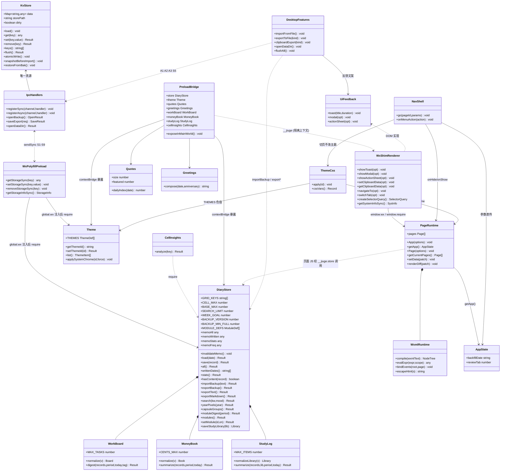
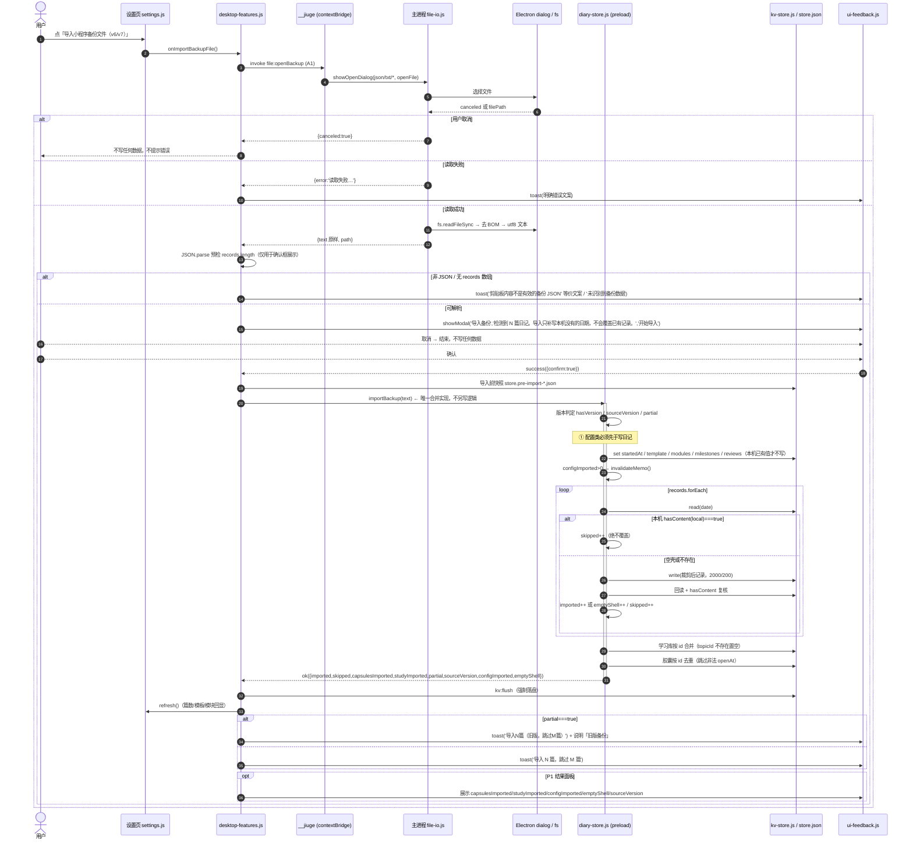
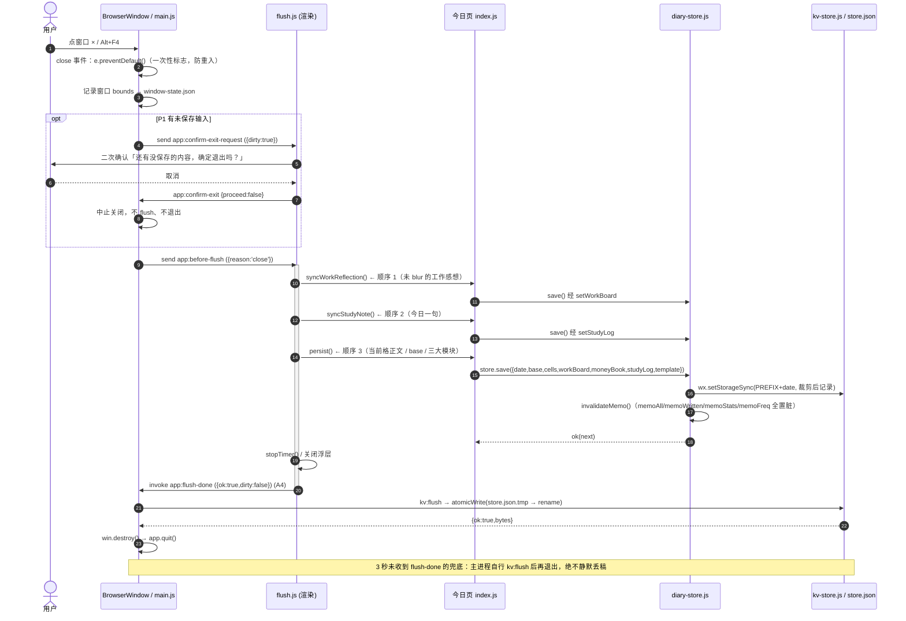
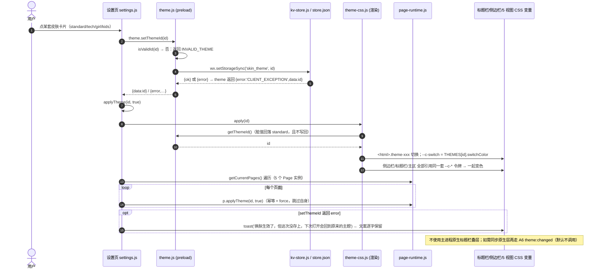
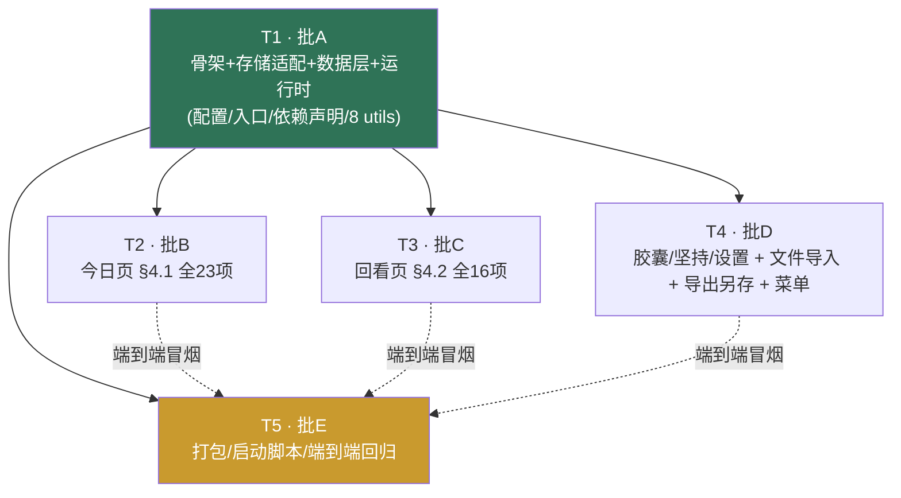

# 九格手记 Windows 桌面版 · 系统架构设计与有序任务分解

> 版本 v1.0　撰写：高见远（Gao）· 架构师　任务 #2
> 上游输入：`docs/01-PRD.md`（459 行，**全文实读**）；源项目 `<工作区>`（**全程只读**）
> 交付目录：`<仓库根>`
> 本文是任务 #3（实现）、任务 #4（QA）的**唯一实现依据**；主理人可直接按 §7 的批次分派工程师。

---

## 0. 输入核对与设计基线（实读结论，非转述 PRD）

### 0.1 源项目实读清单

| 对象 | 实测 | 关键结论 |
|---|---|---|
| `utils/` | 8 个 .js，共 5,060 行 | `diary-store.js` 1935 行为唯一数据入口；`theme.js` 224 行；其余 6 个纯函数模块共 2,901 行 |
| `pages/` | 5 页 × (js/wxml/wxss/json)，JS 2,628 行、WXML 1,718 行、WXSS 6,444 行 | WXML 用 `wx:if / wx:for / wx:key / wx:else / wx:elif / block`、`{{JS 表达式}}`、`bind*`/`catch*`、9 种原生组件 |
| 样式 | `app.wxss` 122 行 + `styles/theme.wxss` 878 行 + 5 页 6,444 行 | **全部使用 `rpx` 单位**（theme.wxss 单文件 204 处），CSS 变量令牌约 150 个，四套 `.theme-*` 同构 |
| `diary-store.js` | 1935 行，`module.exports` 共 **60 个导出** | 只用 4 个存储 API：`getStorageSync`×13、`setStorageSync`×14、`removeStorageSync`×1、`getStorageInfoSync`×2 |
| `theme.js` | 224 行 | `getThemeId/setThemeId` 走 `wx.*StorageSync`；原生 chrome API 用 `callApi()` **逐个探测、缺失静默跳过** → 桌面版天然可不动 |
| `app.js` | 38 行 | `App({globalData:{backfillDate,reviewTab}})` + `onLaunch` 写 `morning_started_at` |
| 页面全局依赖 | `Page()`×5、`getApp()`×4、`getCurrentPages()`×1、`wx.createSelectorQuery()`×1、`wx.getSystemInfoSync()`×1 | 需要一个**小程序兼容运行时**，而不是 React 重写 |
| 网络 | `utils/` 与 5 页 JS 中 **0 处** `wx.request/uploadFile/connectSocket` | 桌面版同样不引入任何会发请求的依赖 |
| `评估报告-逻辑与实用性.md` | 175 行 | 5 条 P1 与「200 篇日记后续渲染 24 次同步读」基线，全部作为**不修项** |

### 0.2 本次唯一新增与硬边界

- 新增能力只有 **「导入小程序备份文件（v6/v7）」** + 三种导出另存为文件 + 桌面壳（导航/菜单/窗口/flush）。
- 六个纯函数模块 **零改动复制**：`work-board` / `money-book` / `study-log` / `cell-insights` / `greetings` / `quotes`（`quotes.size=539`、`featured=200`）。
- `diary-store.js` 与 `theme.js` **本设计实际也做到零改动**（靠 §1.3 的全局 `wx` polyfill 注入，优于「只允许改这两个」的授权上限）。
- 源码中已有中文字符串**逐字保留**，包括 `settings.wxml:98` 的「日记只存在这台手机上」等带小程序语境的表述 —— 等价优先，不擅改口径；如需改口径须主理人单独批准（不阻塞开工）。
- 5 条 P1 保持现状：① 前 4 格 `required` 红星不校验；② `frequentPhrases` n-gram 断词、门槛 2 篇；③ `yearPixels` 一次 372 格；④ **导出 Markdown 用该篇当时模板标签、搜索用标准栏目名**（口径不一致原样保留）；⑤ 学习库单键全量 60 项。

---

## 1. 实现方案与框架选型

### 1.1 结论：**不采用** Vite + React + MUI + Tailwind；采用「原生 HTML/CSS/CommonJS（无构建）+ Electron」

| 维度 | 默认专家栈（Vite+React+MUI+Tailwind） | 本方案（无构建 + Electron） |
|---|---|---|
| 与源码形态的契合 | 需把 5 页 `Page({data,setData})` + 1,718 行 WXML + 6,444 行 WXSS 全部重写为 JSX/Tailwind | 页面 JS **原样复制**，WXML 由运行时解析，WXSS 一次性转 CSS 后原样使用 |
| 等价风险 | 极高：60 个功能点、150 个视觉令牌、539 条名言、8 条导入冲突策略全靠人工重述 | 低：业务算法 2,901 行 + 数据层 1,935 行 + 页面 JS 2,628 行**一行不改**，风险集中在可单测的适配层 |
| 工作量 | 重写 ≈ 12,850 行 + 引入构建链 | 新写适配层 ≈ 2,600 行 + 一次性转换脚本 |
| 硬约束 1「6 模块零改动复用」 | React 下 CommonJS `module.exports` 需打包器转换，违反「不必要转换层」 | Node CommonJS 原生 `require`，零转换 |
| 纯本地零网络 | Vite 开发服务器 / HMR 会起本地监听（虽非外联，但增加不必要进程） | 无 dev server、无 loader、无 telemetry |
| 调试 | 需要 source map / 构建缓存 | 直接改文件、重启窗口即可；`tools/smoke.js` 用 Node 直接跑数据层 |

**取舍理由一句话**：本次是「换壳不换脑」的等价移植，源码是 `Page + WXML + WXSS + CommonJS`，任何 SPA 框架都要求把视图层与状态层重新表达一遍，是**为套默认栈增加不必要的转换层**，直接放弃。MUI/Tailwind 还会与 `theme.wxss` 的 150 个 `--c-*` 令牌打架，四套皮肤逐色值照搬的验收（D5）无法保证。

> 「无构建」的准确含义：**运行时不打包、不转译、不热更新**。`tools/wxss2css.js` 与 `tools/copy-source.js` 是**移植期一次性离线脚本**，产物（`.css` / 复制过来的 `.js` / `.wxml`）直接入库随 exe 发布；运行时只做「读文件 → 解析模板」，没有 webpack/vite/esbuild 环节。

### 1.2 8 个 CommonJS 模块如何加载、`module.exports` 如何暴露

Electron 的 **preload 上下文拥有 Node `require` 权限**；渲染进程在 `contextIsolation:true` 下没有。因此：

```
src/main/main.js          (主进程, Node)
        │  BrowserWindow({webPreferences:{preload, contextIsolation:true, nodeIntegration:false, sandbox:false}})
        ▼
src/preload/preload.js    (隔离上下文, 有 Node require)
   ├─ global.wx = kvPolyfill            ← 先注入全局 wx，再 require
   ├─ const store  = require('../utils/diary-store.js')   ← 内部 require('./work-board.js') 由 Node 解析，零改动
   ├─ const theme  = require('../utils/theme.js')
   ├─ const q/g/w/m/s/ci = require(其余 6 个纯函数模块)
   └─ contextBridge.exposeInMainWorld('__jiuge', {
          store, theme, quotes, greetings, workBoard, moneyBook, studyLog, cellInsights,
          kv, dialog, clipboard, sys, menu, flush   ← 受控函数，无 fs / net / require 泄漏
      })
        ▼
src/renderer/index.html   (渲染进程, 无 Node)
   ├─ <script src="wx-shim.js">          → window.wx = 完整 UI polyfill（转发到 __jiuge）
   ├─ <script src="page-runtime.js">     → window.Page / window.App / window.getApp / window.getCurrentPages
   ├─ <script src="wxml-runtime.js">     → 解析 .wxml、绑定 setData、局部 DOM 更新
   ├─ window.require = (id) => map[id]   → 把 '../../utils/xxx.js' 映射到 __jiuge 上的同名模块
   └─ <script src="../pages/index/index.js"> … 5 页 JS 原样加载
```

**关键点**：`diary-store.js` 内 `require('./work-board.js')` 发生在 preload 的 Node 模块系统里，自动零改动；页面 JS 的 `require('../../utils/diary-store.js')` 由渲染进程的 `window.require` shim 拦截，返回 `__jiuge.store` 的 contextBridge 代理对象。所有返回值（`{data,error}`、数组、字符串、常量对象）均为可克隆的普通 JSON 值，**无 Proxy/类实例/函数回传**，因此 contextBridge 安全可用。

### 1.3 注入方式三选一：**选「全局 wx polyfill」**（明确结论）

| 方案 | 判定 | 理由 |
|---|---|---|
| ① 模块级 shim（在 `diary-store.js` 顶部加 `var wx = require('./kv-shim')`） | ❌ 不选 | 必须改动 `diary-store.js` 源码（哪怕只加一行），违反「导出 API、算法、常量一字不改」的最小改动原则；且 `theme.js` 也要同步改，两份 shim 状态易不同步 |
| ② **全局 `wx` polyfill** | ✅ **选** | 在 preload 里 `global.wx = kvPolyfill` 后 `require`，Node CommonJS 模块的自由变量 `wx` 天然解析到 `global.wx`，**8 个模块全部零改动**；零构建、零代码改写、单份状态。`theme.js` 的 `callApi()` 用 `typeof wx[name] === 'function'` 探测，polyfill 不提供 `setNavigationBarColor` 等原生 API → 自动静默跳过原生 chrome，正好是桌面版要的行为；`THEMES`/`getThemeId`/`setThemeId`/`list` 仍原样可用且共享同一个 `skin_theme` 键 |
| ③ 构建期替换（`wx.*Sync` → `kv.*`） | ❌ 不选 | 引入构建/转译步骤，违反无构建；产出与源码不再逐行可对拍，QA 的「零改动校验」失去依据 |

**补充**：渲染进程另有**第二份 `window.wx`**（UI 版），实现 `showToast/showModal/showActionSheet/setClipboardData/getClipboardData/navigateTo/switchTab/createSelectorQuery/getSystemInfoSync` 及 4 个 KV 转发，供 5 个页面 JS 使用。两份 polyfill 共享主进程同一份 KV 真源，不存在双写。

### 1.4 多页面组织：**单窗口 + 5 视图切换**（不选「每页一个 BrowserWindow」）

`index.html` 内含左侧常驻竖栏（5 项：今日/回看/胶囊/坚持/设置）+ 一个 `<main>`，其中 5 个 `<section class="page" data-page="index|review|capsule|habit|settings">`。切换 = `hidden` 属性切换 + 调用源页 `onHide()`、目标页 `onShow()`。

| 理由 | 说明 |
|---|---|
| 换肤全局生效 | 一次改 `<html>` 的 `.theme-xxx` class / CSS 变量，标题栏、侧边栏、主区一起变（PRD D5）；多窗口则要广播 5 次且闪烁 |
| 退出 flush 只需一个渲染进程 | §6.2 的 `syncWorkReflection → syncStudyNote → persist` 编排落在唯一的今日页实例上 |
| 源码 `onHide()` 语义天然复用 | 小程序切 tab 时 `onHide()` 已经做「感想/今日一句落盘」；桌面切视图时调用它即等价 |
| `getCurrentPages()` 语义天然复用 | `settings.js:102` 换肤广播会遍历页面栈调各页 `applyTheme(id,true)`；单窗口下 5 个 Page 实例常驻，正好一一对应 |
| 跨页带参直传 | `getApp().globalData.backfillDate / reviewTab` 改为**内存 AppState**（不落盘、消费一次即清空），页面 JS 的 4 处 `getApp()` 零改动即完成 Q2「应用内状态直传」 |
| 资源/一致性 | 单份 diary-store 缓存（`memoAll` 等）、单份 `store.json` 句柄、无跨窗口同步问题 |

### 1.5 视图层：小程序兼容运行时（本次最主要的新写代码）

WXML 不是静态 HTML（`{{}}` 是完整 JS 表达式、含三元/逻辑/字符串拼接/下标，另有 `wx:for` 作用域），所以必须实现一个**极简 WXML 运行时**，而不是把 WXML 手改成 HTML：

| 能力 | 实现要点 |
|---|---|
| 模板编译 | 启动期读 `src/views/*.wxml` 文本 → 一次解析成节点树并缓存；标签映射见下表 |
| 数据绑定 | `{{expr}}` 用 `new Function('d','with(d){return (' + expr + ')}')` 求值；**所有插值统一 `escapeHtml()`**，等价 WXML 的文本转义，杜绝日记正文里的 `<`/`&` 破坏 DOM |
| 条件/循环 | `wx:if / wx:elif / wx:else / wx:for / wx:for-item / wx:for-index / wx:key`；`<block>` 渲染为无 DOM 的容器 |
| 事件 | `bindtap/catchtap/bindinput/bindchange/bindblur/bindconfirm/catchtouchmove` → 事件代理；`data-*` → `e.currentTarget.dataset`；`e.detail.value` / `e.touches[0].clientX`（鼠标拖拽包装成同形对象） |
| **`setData` 不整页重建** | 模板节点打 `data-bind` 标记；`setData(patch)` 只做**节点级 diff**（变化文本节点 / `class` / `style` / keyed 列表更新），**不重建 input/textarea**。今日页 `startTimer()` 每秒更新 `clockText`，整页 innerHTML 会导致输入框每秒失焦 —— 局部更新是必须项，不是优化项 |
| 组件映射 | `view→div`、`text→span`、`block→无 DOM`、`input→input`、`textarea→textarea`、`button→button`（忽略 `hover-class`/`open-type`）、`scroll-view→div.scroll`（`scroll-y/x`→`overflow`）、`swiper/swiper-item→div`（保留 `bindchange` 的 `{detail:{current}}`）、`picker mode=date→<input type="date">`（`start`→`min`，值仍 `YYYY-MM-DD`）、`picker mode=selector→<select>`（`range`/`range-key`）、`switch→<input type=checkbox>`（`checked`→`e.detail.value`，色值 `--c-switch` 取 `THEMES.switchColor`） |
| 测量 API | `wx.createSelectorQuery().in(this).select('.intake-track').boundingClientRect(cb).exec()` → `document.querySelector(...).getBoundingClientRect()`；`wx.getSystemInfoSync().windowWidth` **必须返回常量 375**（见 R2），使 `ensureIntakeTrack()` 的 `unit = w/750 = 0.5` 与 §1.6 的 rpx→px 比例一致 |
| UI 反馈 | `showToast`（定时消失的 DOM 条）、`showModal`（`{title,content,confirmText,success({confirm})}`）、`showActionSheet`（`{itemList,success({tapIndex})}`）；**文案全部来自源码实参，逐字输出** |

### 1.6 样式：rpx 一次性转换 + CSS 变量整体换肤

- `tools/wxss2css.js` 把 7 份 WXSS 中的 `\d+rpx` 按 **1rpx = 0.5px** 转成 px（对应小程序 375px 设计宽的 CSS 像素），其余内容（含 150 个 `--c-*` 令牌、四套 `.theme-*` 同构块、`@import` → `<link>` 顺序）**原样保留**，产物写入 `src/renderer/styles/*.css` 并入库。运行时无转换。
- 内容区 `max-width: 900px` 居中留白（PRD Q3 / §8 非目标：不做多栏重构），侧边栏固定在左，整体沿用单列结构。
- 换肤：渲染进程 `theme-css.js` 读 `__jiuge.theme.getThemeId()` → 给 `<html>` 挂 `.theme-standard|tech|girl|kids`，并把 `THEMES[id].switchColor` 写为 `--c-switch`；**色值照搬 `theme.js` 的 `THEMES`**，脏值回落 `standard` 且**不写回**（复用 `theme.getThemeId()` 的纯读语义）。侧边栏/标题栏/主区全部使用同一套变量，自然一起变色。

---

## 2. 主进程 / 渲染进程边界与 IPC 通道清单

### 2.1 边界原则

| 层 | 允许 | 禁止 |
|---|---|---|
| 主进程 `src/main/*` | `fs` 读写 `userData`、`dialog.showOpenDialog/showSaveDialog`、`clipboard`、`Menu`、`BrowserWindow` 生命周期、`app.getPath('userData')` | 业务算法、文案生成 |
| preload | Node `require` 8 个 utils、注入 `global.wx` KV polyfill、`contextBridge.exposeInMainWorld` | 暴露 `require` / `fs` / `ipcRenderer` 原始对象 / `net` |
| 渲染进程 | DOM、WXML 运行时、页面 JS（原样）、调用 `__jiuge.*` | **直接 `require('fs')` 写用户数据**、直接调 `dialog`、任何 `fetch`/`XMLHttpRequest`/WebSocket |

### 2.2 安全配置（`BrowserWindow`）

```js
new BrowserWindow({
  width: 1280, height: 800, minWidth: 1024, minHeight: 680,   // Q3
  show: false, backgroundColor: '#F6F8F3',
  webPreferences: {
    preload: path.join(__dirname, '../preload/preload.js'),
    contextIsolation: true,        // 渲染进程与 preload 隔离
    nodeIntegration: false,        // 渲染进程无 Node
    sandbox: false,                // 必须为 false：preload 需 require 本地 CommonJS 与 sendSync
    webSecurity: true, spellcheck: false,
    nodeIntegrationInWorker: false,
  },
});
// 加载 file:// 本地 index.html；禁用一切外部导航与新窗口
win.webContents.on('will-navigate', (e) => e.preventDefault());
win.webContents.setWindowOpenHandler(() => ({ action: 'deny' }));
```

`contextBridge` 只暴露**函数与可克隆数据**；不加载任何远程 URL、不设 `<webview>`、不解析外部 HTML。WXML 表达式求值需要 `new Function`，因此**不启用会禁用 `unsafe-eval` 的严格 CSP**（本地 file:// 应用、无远程内容、所有用户输入经 `escapeHtml` 输出，风险可控，见 R1）。

### 2.3 IPC 通道清单（逐条）

**A. 同步通道**（`ipcRenderer.sendSync` ↔ `ipcMain.on` + `event.returnValue`；微信 `*Sync` 语义必须同步）

| # | channel | 方向 | 参数 | 返回值 | 备注 |
|---|---|---|---|---|---|
| S1 | `kv:get` | R→M | `{key:string}` | 值（任意可 JSON 克隆）；**未命中返回 `''`** | 对齐 `wx.getStorageSync` 空值语义 |
| S2 | `kv:set` | R→M | `{key,value}` | `{ok:true}` 或 `{ok:false,error:'QUOTA_EXCEEDED'\|'CLIENT_EXCEPTION'}` | **失败时 preload 的 `wx.setStorageSync` 必须 `throw new Error(errMsg含 exceed/quota/size/limit)`**，才能让 `diary-store.write()` 的 catch 返回 `'QUOTA_EXCEEDED'`（NFR-5 可测） |
| S3 | `kv:remove` | R→M | `{key}` | `{ok:true}` | 对齐 `removeStorageSync` |
| S4 | `kv:keys` | R→M | — | `string[]` | 供 `getStorageInfoSync().keys`；`listDates()` 与 `readReviewMap()` 依赖它扫前缀 |
| S5 | `kv:flush` | R→M | — | `{ok:true, bytes:number}` | 强制把内存 Map 原子落盘；保存 / 导入结束 / 退出前调用 |
| S6 | `clipboard:write` | R→M | `{text}` | `{ok:true}` | `clipboard.writeText` |
| S7 | `clipboard:read` | R→M | — | `{text:string}` | `clipboard.readText` |
| S8 | `sys:windowBounds` | R→M | — | `{x,y,width,height}` | 启动读 `window-state.json`；**不进 KV 空间**（见 R4） |
| S9 | `sys:userDataPath` | R→M | — | `{path}` | 设置页只读展示数据目录 |

> 曾评估「preload 内做 KV 镜像以省掉同步 IPC」，**弃用**：渲染进程的 `migrateLegacyKeys()`、`skin_tip_seen` 等写操作会绕过 preload 镜像，导致两份状态不一致（同一份 `store.json` 出现「读到旧值」）。改为**主进程内存 Map 为唯一真源**，所有 KV 读写走同步 IPC；200 篇日记首次渲染 226 次读、后续 24 次读的基线由 `diary-store` 的 `memoAll/memoWritten/memoStats/memoFreq` 保证，不依赖 KV 层镜像（§3.3）。单次 `kv:get` 只回传单条记录（~1–2 KB），226 次约 20–30 ms，可接受。

**B. 异步通道**（`ipcRenderer.invoke` ↔ `ipcMain.handle`）

| # | channel | 方向 | 参数 | 返回值 | 备注 |
|---|---|---|---|---|---|
| A1 | `file:openBackup` | R→M | — | `{canceled:boolean, text?:string, path?:string, error?:string}` | `showOpenDialog({properties:['openFile'],filters:[{name:'备份文件',extensions:['json','txt']},{name:'所有文件',extensions:['*']}]})`；主进程 `fs.readFileSync` 后**去 UTF-8 BOM（EF BB BF）**再 `toString('utf8')`，**原样回传文本**；读失败给明确错误，不静默 |
| A2 | `file:saveExport` | R→M | `{kind:'text'\|'markdown'\|'backup', defaultName, text}` | `{canceled, path?, error?}` | `showSaveDialog({defaultPath: 文档目录/九格手记-备份-YYYY-MM-DD.json, filters…})` → 主进程 `fs.writeFileSync(path,text,'utf8')`；**渲染进程不碰 fs** |
| A3 | `file:openDataDir` | R→M | — | `{ok}` | `shell.showItemInFolder(store.json)`；只读入口，不提供路径自定义 |
| A4 | `app:flush-done` | R→M | `{ok:boolean, dirty:boolean}` | `{ok:true}` | 渲染进程完成 `syncWorkReflection→syncStudyNote→persist` 后回报；主进程随后 `kv:flush` 再 `quit` |
| A5 | `app:confirm-exit` | R→M | `{proceed:boolean}` | `{ok:true}` | P1 二次确认结果；主进程据此继续或取消关闭 |
| A6 | `theme:changed` | R→M | `{id, titleBarColor?}` | `{ok}` | 可选：仅当采用原生标题栏叠层时同步色值；本设计用自绘标题栏 + CSS 变量，**默认不调用** |

**C. 主进程 → 渲染进程推送**（`webContents.send`）

| # | channel | 方向 | 参数 | 用途 |
|---|---|---|---|---|
| P1 | `menu:action` | M→R | `{action:'save'\|'page:1'…'page:5'\|'export'\|'import'\|'settings'\|'theme:<id>'}` | 菜单/快捷键（Ctrl+S、Ctrl+1~5、Ctrl+E、Ctrl+I、Ctrl+,） |
| P2 | `app:before-flush` | M→R | `{reason:'close'}` | 关窗前通知渲染进程执行 §6.2 flush 编排 |
| P3 | `app:confirm-exit-request` | M→R | `{dirty:boolean}` | P1：有未保存输入时请渲染进程弹二次确认 |
| P4 | `kv:quota-simulated` | M→R | `{limitBytes}` | 仅测试用：由 `JIUGE_KV_QUOTA` 注入，见 R6 |

### 2.4 菜单与快捷键（Q7 最小集）

`Menu.buildFromTemplate`：文件（导入备份 `Ctrl+I` / 导出 `Ctrl+E` / 打开数据目录 / 退出）、视图（5 页 `Ctrl+1~5` / 4 套皮肤 / 保存当前格 `Ctrl+S`）、帮助（关于 / 使用小贴士）。所有项只发 `menu:action`，**不改变任何业务逻辑**；`desktop-features.js` 把 action 映射到既有页面方法（`finishToday`/`persist`、`nav.go`、`onExportBackup`、`onImportBackup`…）。

---

## 3. 存储适配层设计

### 3.1 结论：单文件 `store.json`，不分片

固定路径 `app.getPath('userData')/jiuge-desktop/store.json`（Q4）。文件内容就是一个**扁平 KV 对象**：`{ "morning_diary_2026-11-07": {...}, "md_modules": {...}, "skin_theme": "tech", … }`。

- 键名与值结构**与小程序逐字一致**，保证 v6/v7 备份 `records[].date` 与 `importBackup()` 可直读直写（验收 D3 / B6）。
- 不分片：分片会破坏 `getStorageInfoSync().keys` 的单一视图，且 `listDates()`/`readReviewMap()` 依赖「扫全部键名」；单文件还能让用户直接把 `store.json` 复制走当备份。
- `window-state.json`（窗口尺寸/位置）与 `store.json.bak`/`store.pre-import-*.json`（快照）**独立于 KV 空间**，不进 `kv:keys` 返回结果，避免污染 `listDates()` 的前缀过滤（PRD §11.3 的命名空间纪律）。

### 3.2 写盘时机、原子写、崩溃安全、快照策略

| 项 | 设计 |
|---|---|
| 内存真源 | 主进程启动时一次性 `JSON.parse(store.json)` 到 `Map`；所有 `kv:get/set/remove/keys` 只读写该 Map。**KV 层不做业务缓存** |
| `kv:set` | 同步更新 Map → 标 dirty → 安排 **80 ms 防抖合并写盘**；若距上次落盘 > 500 ms 则立即写一次（限流，防长会话丢太多）。导入 200+ 次 set 会在 80 ms 窗口内合并成 1~2 次写盘，**不会触发 200 次全量序列化**（R5） |
| 强制 flush | ① `persist()` / `finishToday()` 后 ② `importBackup()` 返回后 ③ `file:saveExport` 前 ④ `app:before-flush` 流程末尾，均调用 `kv:flush`，主进程立即原子落盘并回执 |
| 原子写 | 写 `store.json.tmp`（`fs.writeFileSync(..., {encoding:'utf8',flag:'w'})`）→ `fs.renameSync(tmp, store.json)` 覆盖；**写 tmp 前先把现有 `store.json` 复制为 `store.json.bak`**，任何时刻至少有一份完整旧版 |
| 崩溃恢复 | 启动时若 `store.json` 不存在 → 空 `{}`；若 `JSON.parse` 失败 → 用 `store.json.bak` 恢复并在设置页/启动 toast 明确提示「数据文件损坏，已从上一份备份恢复」，**不静默清空**；两者都坏则拒绝覆盖写入并提示用户手动处理 |
| 导入前快照 | `file:openBackup` 成功、用户点「开始导入」**之前**，主进程写 `store.pre-import-YYYYMMDD-HHmmss.json`（保留最近 3 份），这是唯一破坏性操作前的安全网；不提供 UI 回滚入口，但文件在「打开数据目录」里可见 |
| QUOTA 模拟 | `JIUGE_KV_QUOTA` 环境变量设字节阈值；`kv:set` 后若 `JSON.stringify(Map)` 超阈值 → 回滚该次 Map 变更并返回 `{ok:false,error:'QUOTA_EXCEEDED'}` → preload `throw` → 走通 `write()` 的 `'QUOTA_EXCEEDED'` 与页面「本机存储已满，请先导出备份再清理旧日记」文案（QA 可测 A5/D7） |
| 字符编码 | 全程 UTF-8；写盘不加 BOM；读备份容错 BOM（A1） |

### 3.3 「写时失效」内存缓存协议（硬约束 3）

`diary-store.js` 内部已有且**原样保留**：`memoAll / memoWritten / memoStats / memoFreq / memoFreqLimit` 五个模块级变量 + `invalidateMemo()`；`write()` 成功后立即调用；`importBackup()` 写完配置类后也调用一次（源码 1541 行）。

适配层的**唯一义务**是：不引入第二份会过期的数据视图、不绕过 `wx.*StorageSync`。因此：
- `kv-store.js` 的 Map 只是磁盘镜像与写合并缓冲，**不参与业务读缓存**；
- `wx.getStorageSync` 每次都同步 IPC 到主进程取当前值；
- `all()` / `writtenDates()` / `stats()` / `frequentPhrases()` 的缓存语义完全由 diary-store 自己控制，200 篇日记后续单次渲染同步读 **≈24 次**的基线不退化；
- `importBackup` 的配置类写入通过同一个 `wx.setStorageSync`，`invalidateMemo()` 照常生效 → 启程天数、模板、模块开关、里程碑、复盘答案即时刷新（PRD §5.4 规则 3）。

> 验收判据（交给 QA）：`tools/bench-store.js` 注入 200 篇日记后，第二次渲染的 `kv:get` 调用数 ≤ 30；任一 `kv:set` 之后首次 `all()` 必须重新触发全量读。

### 3.4 键名清单与命名空间隔离

| 键 / 键模式 | 用途 | 谁写 |
|---|---|---|
| `morning_diary_<YYYY-MM-DD>` | 日记记录（唯一按天堆积命名空间） | diary-store `save/importBackup` |
| `morning_started_at` / `morning_template` / `morning_firstweek` | 开始日 / 模板 / 头七天 | diary-store、`app.js onLaunch` |
| `morning_review_week_<date>` / `morning_review_month_<YYYY-MM>` | 周/月复盘三问 | diary-store `saveReview` |
| `morning_capsules` / `morning_milestones` | 胶囊数组 / `{items:[{at,reward}]}` | diary-store |
| `md_modules` | 功能模块开关（**只认明确 false**） | diary-store `setModule` |
| `md_study_library` | 学习库单键全量 | diary-store `saveStudyLibrary` |
| `md_quote_today` / `md_base_intake` / `skin_theme` / `skin_tip_seen` | 当天名言 / 状态收集标记 / 皮肤 / 一次性提示 | 页面 JS、theme.js |
| `morning_diary_quote_today`（legacy） | `migrateLegacyKeys()` 迁移后清除 | index.js |

**纪律**：桌面新增的任何 UI 状态键**不得**使用 `morning_diary_` 前缀；窗口尺寸/位置放 `window-state.json`；主题沿用 `skin_theme`（不另建键）；换肤失败回落 `standard` 时**不写回**。

### 3.5 从旧版 / 剪贴板数据迁移的入口（唯一入口，不另写合并逻辑）

| 来源 | 入口 | 处理 |
|---|---|---|
| 小程序备份文件 v6/v7 / 无版本号旧档 | 设置页「导入小程序备份文件（v6/v7）」→ `file:openBackup` → 确认框 → **`store.importBackup(text)`** | 完整走源码 1485–1631 行：版本判定、配置先写、8 条冲突策略、回读复核、学习库按 id 合并、胶囊按 id 去重并跳过非法 `openAt`、落盘裁剪 |
| 剪贴板 | 设置页「从剪贴板导入」（**原样保留不动**）→ `wx.getClipboardData` → 确认框 → **同一个 `store.importBackup(text)`** | Q1：`wx.showModal` 文案「检测到 N 篇日记。导入只补写本机没有的日期，不会覆盖已有记录。」+「开始导入」逐字保留 |
| 旧版本地数据 | 首次启动 | `migrateLegacyKeys()` 空跑（新装无 legacy 键）；备份文件里若有 `morning_diary_quote_today` 由同一函数清理 |
| 无任何手工迁移 | — | **禁止**在桌面端另写合并/去重/版本分支；`importBackup` 是唯一实现 |

> 桌面版自身导出写 `version: 7`（由未改动的 `exportBackup()` 决定，`BACKUP_VERSION=7`）；导入兼容 `version>=6` 与无版本号旧档（`partial=true`，提示「旧版备份」）—— 全部由源码既有逻辑完成，桌面层只负责把文本送达。

---

## 4. 完整文件清单（相对 `jiuge-desktop/`）

**来源标注**：【零复制】= 从源项目只读复制、内容逐字不变（哈希校验）；【适配改写】= 基于源产物做机械转换/最小增补；【新写】= 桌面层新代码。
估计行数中【零复制】为**实测行数**。

### 4.1 项目根 / 配置（批 A）

| 文件 | 职责 | 估计行数 | 来源 |
|---|---|---|---|
| `package.json` | `main: src/main/main.js`；scripts：`start`(electron .)、`dist`(electron-builder)、`smoke`、`verify`；devDeps 见 §8 | 45 | 新写 |
| `package-lock.json` | 锁版本 | — | npm 生成 |
| `.gitignore` | 忽略 `node_modules/`、`build/`、`*.log` | 12 | 新写 |
| `electron-builder.yml` | win 目标 portable + nsis、artifactName、files 白名单 | 40 | 新写 |
| `scripts/start.bat` | 双击启动（调用 `npm start`，无控制台黑窗用 `start "" /min`） | 15 | 新写 |
| `scripts/package-win.bat` | 设置镜像环境变量并跑 `npm run dist` | 25 | 新写 |

### 4.2 主进程 `src/main/`（批 A）

| 文件 | 职责 | 估计行数 | 来源 |
|---|---|---|---|
| `main.js` | `app.whenReady` → 建窗（默认 1280×800 / min 1024×680 / 记忆 bounds）、菜单、`close` 拦截 + flush 编排、`window-all-closed` 退出、禁用导航 | 260 | 新写 |
| `kv-store.js` | **单文件 store.json**：启动加载、Map 真源、`get/set/remove/keys`、80ms 防抖 + 500ms 限流、原子写 + `.bak`、损坏恢复、导入前快照、QUOTA 模拟 | 200 | 新写 |
| `ipc-handlers.js` | 注册 §2.3 全部 S/A 通道；同步通道 `event.returnValue`、异步 `handle`；统一 `{ok,error}` 包装 | 230 | 新写 |
| `file-io.js` | `showOpenDialog/showSaveDialog`、UTF-8 BOM 容错读取、导出写文件、`shell.showItemInFolder`、默认文档目录与 `九格手记-备份-YYYY-MM-DD.*` 命名 | 130 | 新写 |
| `window-state.js` | `window-state.json` 读写、`resized/moved` 防抖保存、工作区边界校验（多显示器/分辨率变更回落默认） | 80 | 新写 |
| `menu.js` | 文件/视图/帮助最小菜单 + 快捷键 → `menu:action` | 120 | 新写 |

### 4.3 preload 与兼容层 `src/preload/`、`src/renderer/`（批 A）

| 文件 | 职责 | 估计行数 | 来源 |
|---|---|---|---|
| `preload.js` | `global.wx = kvPolyfill`（§1.3）→ `require` 8 个 utils → `contextBridge.exposeInMainWorld('__jiuge', …)`；`kv:set` 失败时 `throw` 带 quota 字样；订阅 `menu:action`/`app:before-flush` | 190 | 新写 |
| `wx-shim.js` | 渲染进程 `window.wx`：`showToast/showModal/showActionSheet/setClipboardData/getClipboardData/navigateTo/switchTab/createSelectorQuery/getSystemInfoSync(→375)/4 个 KV 转发`；`window.require` 映射到 `__jiuge` 模块；鼠标拖拽包装 `e.touches[0].clientX` | 260 | 新写 |
| `page-runtime.js` | `App()/getApp()`（内存 AppState：backfillDate/reviewTab，消费一次即清）、`Page()` 注册 5 实例、`getCurrentPages()`、`setData(patch)` → 局部 diff、生命周期 `onLoad/onShow/onHide/onUnload` 转发 | 340 | 新写 |
| `wxml-runtime.js` | WXML 文本 → 节点树；`{{expr}}` 求值（escapeHtml）、`wx:if/elif/else/for/key`、`data-bind` 标记、节点级 diff、事件代理与 dataset | 430 | 新写 |
| `component-map.js` | §1.5 组件映射表：`picker(date/selector)`、`swiper`、`switch`、`scroll-view`、`input/textarea/button` 的属性与事件归一化 | 200 | 新写 |
| `nav.js` | 左侧 5 项竖栏、视图切换、调用源页 `onHide()`/目标页 `onShow()`、URL→pageId 映射、菜单/快捷键动作分发 | 130 | 新写 |
| `theme-css.js` | 读 `theme.getThemeId()` → `<html>.theme-xxx`；`THEMES[id].switchColor` → `--c-switch`；`setThemeId` 后广播 `getCurrentPages().applyTheme(id,true)`；脏值回落 standard 不写回 | 100 | 新写 |
| `ui-feedback.js` | toast / modal / actionSheet 的 DOM 实现（含 `confirmText`、`icon:'none'`、`duration` 语义）；**只渲染传入文案，不改一个字** | 160 | 新写 |
| `flush.js` | 退出编排：按 Q6 顺序 `syncWorkReflection()` → `syncStudyNote()` → `persist()` → `kv:flush` → 回 `app:flush-done`；P1 脏输入二次确认 | 100 | 新写 |
| `desktop-features.js` | 新增「导入备份文件」全流程（§6.1）、三种导出另存 + 剪贴板入口保留、「打开数据目录」、导入结果反馈（P0 toast / P1 面板）、菜单动作映射 | 200 | 新写 |
| `index.html` | 单窗口骨架：自绘标题栏、左侧 5 项竖栏、`<main>` 内 5 个 `<section>`、按顺序引入 shim/runtime/styles/5 页 JS | 100 | 新写 |

### 4.4 数据层 `src/utils/`（批 A，★ 全部零改动）

| 文件 | 职责 | 实测行数 | 来源 |
|---|---|---|---|
| `diary-store.js` | 唯一数据入口：60 个导出、9 固定键、4 模板、缓存、裁剪、QUOTA、8 条导入冲突策略、导出三格式 | **1935** | **【零复制】** |
| `work-board.js` | 任务/感想纯函数（MAX_TASKS=20 等） | 540 | **【零复制】** |
| `money-book.js` | 分制收支纯函数（CENTS_MAX=999999999） | 463 | **【零复制】** |
| `study-log.js` | 学习库/流水纯函数（MAX_ITEMS=60） | 723 | **【零复制】** |
| `cell-insights.js` | 单格历史分析 `analyze` | 356 | **【零复制】** |
| `greetings.js` | 时段问候 `compose/periodOf/scopeKey` | 235 | **【零复制】** |
| `quotes.js` | 名言库 `size=539`、`featured=200` | 584 | **【零复制】** |
| `theme.js` | `THEMES` 四套色值、`skin_theme` 读写；原生 chrome 调用自动静默跳过 | 224 | **【零复制】** |

### 4.5 页面 JS `src/pages/`（批 B/C/D）

| 文件 | 职责（对应 PRD §4 功能点编号） | 实测行数 | 来源 |
|---|---|---|---|
| `index/index.js` | **今日页 §4.1 全 23 项**：hero/时钟/八段锦、streak/weekCount、补记、九格 + 4 模板、三模块角标、引导提问、状态收集滑杆、头七天、往年今天、胶囊提醒、539 条名言、一键留一句、完成今日、工作/金钱/学习三面板、单格历史分析、跨零点挂起、QUOTA 回滚、migrateLegacyKeys | 1410 | **【零复制】** |
| `review/review.js` | **回看页 §4.2 全 16 项**：3 标签、概览 6 卡（周小结/工作统计/收支/学习/心情柱图）、复盘 3 块（三问/九格汇总/高频字句）、日记 7 块（日期控件/历年并排/372 格年历/随机重读/搜索上限 200/全部列表/补记） | 554 | **【零复制】** |
| `capsule/capsule.js` | **胶囊页 §4.3 全 7 项**：三组统计、到期拆开、写新胶囊（4 预设 + 自定义未来日期）、倒计时与进度、70 字预览、阅读器浮层、非法 openAt 跳过的分组 | 154 | **【零复制】** |
| `habit/habit.js` | **坚持页 §4.4 全 5 项**：stats、三关挑战、里程碑增删改/去重/恢复默认、头七天、设置入口 | 287 | **【零复制】** |
| `settings/settings.js` | **设置页 §4.5 全 9 项**：4 皮肤、4 模板 ActionSheet、3 模块开关（只认明确 false）、头七天双向、三导出、剪贴板导入、**新增文件导入入口**、USAGE_TIPS/KEEP_TIPS、关于 | 223 → 260 | **【适配改写】**：仅新增 `onImportBackupFile()` 一行入口 + P1 结果面板；其余逻辑与文案逐字不动 |

### 4.6 视图 `src/views/` 与样式 `src/renderer/styles/`

| 文件 | 职责 | 估计行数 | 来源 |
|---|---|---|---|
| `views/index.wxml` | 今日页模板（718 行原式），含九宫格、三模块面板、状态收集、6 类浮层 | 718 | **【零复制】** |
| `views/review.wxml` | 回看页模板（551 行），含 `swiper` 3 标签、年历、搜索、全部列表 | 551 | **【零复制】** |
| `views/capsule.wxml` | 胶囊页模板（108 行），含 `picker mode=date` | 108 | **【零复制】** |
| `views/habit.wxml` | 坚持页模板（123 行） | 123 | **【零复制】** |
| `views/settings.wxml` | 设置页模板（182 行）+ **在「从剪贴板导入」行下方新增一行「导入小程序备份文件（v6/v7）」** | 182 → 190 | **【适配改写】**：仅 +1 个 `data-btn`，文案按 Q1 |
| `styles/theme.css` | 四套 `.theme-*` 令牌 + `.theme-root` 兜底 | 878 | 【适配改写】：`theme.wxss` 经 `rpx→px` 机械转换 |
| `styles/app.css` | 全局 page/card/btn-primary/btn-ghost/tag/divider | 122 | 【适配改写】：`app.wxss` 同上 |
| `styles/index.css` | 今日页全量样式（3,423 行） | 3423 | 【适配改写】 |
| `styles/review.css` | 回看页全量样式（1,465 行） | 1465 | 【适配改写】 |
| `styles/capsule.css` | 胶囊页（380 行） | 380 | 【适配改写】 |
| `styles/habit.css` | 坚持页（744 行） | 744 | 【适配改写】 |
| `styles/settings.css` | 设置页（433 行）+ 导入结果面板样式 | 433 → 460 | 【适配改写】 |
| `styles/shell.css` | **新写**：自绘标题栏、左侧 5 项竖栏（随主题变色）、内容区 `max-width:900px` 居中、浮层遮罩层级 | 190 | 新写 |

> 文件清单对 §4 五张对照表 60 行的覆盖方式：`index.js + views/index.wxml + styles/index.css` 承担 §4.1 的 1–23；`review.*` 承担 §4.2 的 1–16；`capsule.*` 承担 §4.3 的 1–7；`habit.*` 承担 §4.4 的 1–5；`settings.* + desktop-features.js + file-io.js` 承担 §4.5 的 1–9（含新增第 7 项）。工程师按此映射逐条自证，QA 按同一映射逐条勾选。

### 4.7 移植工具与验证脚本 `tools/`（批 A / 批 E）

| 文件 | 职责 | 估计行数 | 来源 |
|---|---|---|---|
| `copy-source.js` | **只读**从源项目复制 8 utils + 5 页 JS + 5 WXML 到 `src/`，逐文件写 `.sha256` 清单；运行时再次校验，防止误改 | 90 | 新写 |
| `wxss2css.js` | 一次性 `rpx→px(×0.5)` 转换 + `@import` → 有序 `<link>` 提示；产物入 `styles/*.css` | 70 | 新写 |
| `verify-equivalence.js` | 对拍：8 个 utils 哈希、60 个导出清单、常量值（CELL_MAX/BASE_MAX/SEARCH_LIMIT/WEEK_GOAL/BACKUP_VERSION=7/BACKUP_MIN_FULL=6/GRID_KEYS/MODULE_DEFS/quotes.size=539）、中文文案字符串集合、零网络关键字扫描 | 160 | 新写 |
| `smoke.js` / `bench-store.js` | **无 GUI、无 Electron** 的 Node 冒烟：注入内存 `global.wx`，跑 31+ 导出方法、v6/v7/无版本号导入、8 条冲突策略、200 篇日记读放大基线（≤30 次） | 240 | 新写 |
| `docs/02-ARCHITECTURE.md` | 本文 | — | 新写 |
| `docs/class-diagram.mermaid` / `docs/sequence-diagram.mermaid` | §5 / §6 的图源备份（唯一权威仍是本文） | — | 新写 |

**合计**：新写约 3,000 行、机械转换约 7,700 行、零改动复制约 8,300 行；不新增任何运行时第三方库。

---

## 5. 数据结构与接口

### 5.1 Mermaid 类图



### 5.2 关键接口签名表（`diary-store.js` 60 个导出中 QA 必须覆盖的核心项）

| 分类 | 签名（原样） | 返回 | 备注 / 硬约束 |
|---|---|---|---|
| 常量 | `GRID_KEYS:string[9]`、`MODULE_DEFS:ModuleDef[3]`、`TEMPLATES:Template[4]`、`PROMPTS`、`REVIEW_PROMPTS` | — | NFR-1 九键固定；模板只换 label/hint/prompt |
| 读写 | `load(date):Result<Record>`、`save(record):Result<Record>`、`listDates():Result<string[]>`、`all():Result<Record[]>`、`writtenDates():string[]` | `{data,error}` 或数组 | `save` 裁剪 2000/200，失败 `QUOTA_EXCEEDED` / `CLIENT_EXCEPTION` |
| 判定 | `hasContent(record):boolean`、`dayNumber(s):number`、`today():string`、`formatDate(d):string` | — | NFR-4：只认字符串；非法返回 `NaN` |
| 统计 | `stats()`、`firstWeekState()`、`weeklyReview()`、`moodTrend(30)`、`moduleDigest(period)`、`workDigest(period,tag)`、`moneySummary(period)`、`studySummary(period)`、`workTagPool(limit)` | `Result<…>` | `WEEK_GOAL=5`；今天未写从昨天回溯 |
| 检索 | `search(keyword,mood):Result<…>`、`frequentPhrases(12)`、`yearPixels(year)`、`randomEntry()`、`sameDayAcrossYears(date)`、`previousToday()` | `Result<…>` | **SEARCH_LIMIT=200**；372 格一次渲染不修 |
| 配置 | `getTemplateId()`、`activeTemplate()`、`activeGridFields()`、`fieldsFor(tplId)`、`setTemplate(id)`、`modules()`、`setModule(id,on)`、`firstWeekEnabled()`、`setFirstWeekEnabled(on)` | `Result` | NFR-3：只认明确 false；开关**绝不碰数据** |
| 复盘 | `reviewPeriodKey(p,date)`、`reviewPrompts(p)`、`loadReview(p,key)`、`saveReview(p,key,answers)` | `Result` | 键 `morning_review_week_<date>` / `month_<YYYY-MM>` |
| 里程碑 | `milestones()`、`milestoneView()`、`saveMilestones(list)`、`resetMilestones()` | `Result` | 空数组=用户删光，不被默认值回填 |
| 胶囊 | `capsulePresets()`、`saveCapsule(text,openAt)`、`listCapsules()`、`dueCapsules()`、`openCapsule(id)`、`capsuleGroups()`、`prettyDate(s)` | `Result` | 校验 `EMPTY_TEXT/INVALID_DATE/DATE_NOT_FUTURE`；跳过非法 `openAt` |
| 学习库 | `readStudyLibrary()`、`saveStudyLibrary(lib)`、`studySaveOk()`、`studyLibraryText()` | `Library` / `boolean` | 单键全量；写失败显式提示 |
| 导出 | `exportText()`、`exportMarkdown()`、`exportBackup()` | `Result<string>` | **Markdown 用该篇当时模板标签、搜索用标准栏目名，口径不一原样保留**；`version:7` |
| 导入 | `importBackup(text):Result<ImportReport>` | `{imported,skipped,capsulesImported,studyImported,partial,sourceVersion,configImported,emptyShell}` | 失败码 `INVALID_JSON/INVALID_FORMAT/CLIENT_EXCEPTION`；8 条冲突策略全在内部 |

> `Result<T>` = `{data:T|null, error:string|null}`；`ImportReport` 老字段一个不改、新字段只增不减。
> 6 个纯函数模块导出概要：`work-board`(21)、`money-book`(18)、`study-log`(33)、`cell-insights`(5)、`greetings`(5)、`quotes`(6)；全部经 `module.exports` 原样暴露给页面 JS。

---

## 6. 程序调用流程

### 6.1 时序图①：导入 v6/v7 备份文件（含确认框、配置先写、冲突策略、结果反馈）



### 6.2 时序图②：关闭窗口退出 flush（Q6：绝不静默丢稿）



### 6.3 时序图③：切换皮肤全局生效（含侧边栏）



### 6.4 时序图④：单次写格子的 KV 落盘与写时失效（性能基线）

```mermaid
sequenceDiagram
    autonumber
    participant IDX as 今日页 index.js
    participant DS as diary-store.js
    participant WX as global.wx polyfill (preload)
    participant IPC as ipc-handlers.js (主进程)
    participant KV as kv-store.js
    participant FS as store.json

    IDX->>DS: saveCell() → persist() → store.save(record)
    DS->>DS: 裁剪 cleanCells(2000) / cleanBase(200)
    DS->>WX: wx.setStorageSync('morning_diary_YYYY-MM-DD', next)
    WX->>IPC: sendSync kv:set (S2)
    IPC->>KV: Map.set(key,next); dirty=true
    KV->>KV: 80ms 防抖（或距上次>500ms 立即）→ atomicWrite
    KV->>FS: writeFileSync(store.json.tmp) → renameSync(store.json)
    IPC-->>WX: {ok:true}
    WX-->>DS: 返回（不抛错）
    DS->>DS: write() 成功 → invalidateMemo()
    DS-->>IDX: ok(next)
    Note over DS: 后续 all()/writtenDates()/stats()/frequentPhrases() 重新计算并重建 memo，200 篇日记后续渲染同步读 ≈24 次
    opt QUOTA_EXCEEDED 模拟
        IPC-->>WX: {ok:false,error:'QUOTA_EXCEEDED'}
        WX->>DS: throw Error('exceed quota size limit')
        DS-->>IDX: fail('QUOTA_EXCEEDED') → 页面提示「本机存储已满，请先导出备份再清理旧日记」+ 内存回滚
    end
```

---

## 7. 有序任务列表（T1…T5，按可分批派工的批次分组）

> **派工方式**：主理人按批次（T1=批A … T5=批E）分派给工程师；每批内的「工单」是同一工人一次可完成的粒度，不单独编号、不单独派工。
> **依赖原则**：T2/T3/T4 **只依赖 T1**，三批页面可并行或按任意顺序做；T5 只依赖 T1（打包），端到端冒烟需要 T2–T4 完成后再跑一次。
> **每批的验收判据均可由 `tools/*.js` 在**无 GUI、无浏览器自动化**的条件下验证（本机 GUI 自动化不可用）。

### T1 · 批 A：项目骨架 + 存储适配 + 数据层 + 兼容运行时 【P0，必须最先】

| 项 | 内容 |
|---|---|
| **输入文件（只读）** | `docs/01-PRD.md`；源项目 `app.js` / `app.json` / `app.wxss` / `styles/theme.wxss` / `utils/*.js` 共 8 个 |
| **产出文件** | `package.json`、`.gitignore`、`electron-builder.yml`、`scripts/start.bat`、`scripts/package-win.bat`；<br>`src/main/{main.js,kv-store.js,ipc-handlers.js,file-io.js,window-state.js,menu.js}`；<br>`src/preload/preload.js`；<br>`src/renderer/{index.html,wx-shim.js,page-runtime.js,wxml-runtime.js,component-map.js,nav.js,theme-css.js,ui-feedback.js,flush.js,desktop-features.js}`；<br>`src/renderer/styles/{theme.css,app.css,shell.css}`；<br>`src/utils/` 8 个模块（零复制）；`src/app.js`（AppState 改写）；<br>`tools/{copy-source.js,wxss2css.js,verify-equivalence.js,smoke.js,bench-store.js}`；`docs/class-diagram.mermaid`、`docs/sequence-diagram.mermaid` |
| **依赖前置任务** | 无（第一个任务；配置文件 + 入口文件 + 依赖声明全部在本任务） |
| **批次内工单** | **A1** 配置/入口/打包骨架（package.json、builder yml、两个 .bat、main.js 空窗 + 菜单骨架）；<br>**A2** `kv-store.js` + `ipc-handlers.js`（S1–S9、A1–A6、P1–P4 全通道）；<br>**A3** `copy-source.js` 复制 8 utils + `preload.js` 注入 `global.wx` 并暴露 `__jiuge`；<br>**A4** `wx-shim.js` + `page-runtime.js` + `wxml-runtime.js` + `component-map.js`（小程序兼容运行时）；<br>**A5** `nav.js` + `theme-css.js` + `ui-feedback.js` + `index.html`（5 视图骨架、侧边栏、CSS 变量换肤）+ `wxss2css.js` 产出 theme/app/shell CSS；<br>**A6** `file-io.js` + `window-state.js` + `flush.js` + `desktop-features.js`（文件 I/O、窗口记忆、退出 flush、导入/导出框架）+ `verify-equivalence.js`/`smoke.js`/`bench-store.js` |
| **验收判据** | ① `npm start` 能开 1280×800 窗口，左侧 5 项竖栏可见，冷启动落在「今日」视图（E1 前置）；关闭窗口走完 `app:before-flush → app:flush-done → kv:flush → quit`（D6 前置）。<br>② `verify-equivalence.js` 全绿：8 个 utils SHA256 与源项目一致；60 个导出名一致；`CELL_MAX=2000 / BASE_MAX=200 / SEARCH_LIMIT=200 / WEEK_GOAL=5 / BACKUP_VERSION=7 / BACKUP_MIN_FULL=6 / GRID_KEYS 九键 / MODULE_DEFS / quotes.size=539 / featured=200`；源码中文字符串集合全覆盖；全项目零 `request/fetch/WebSocket/uploadFile` 关键字（A6、NFR-6）。<br>③ `smoke.js` 用内存 `global.wx` 跑通 `load/save/all/writtenDates/stats/search/yearPixels/capsuleGroups/moduleDigest/modules/exportText/exportMarkdown/exportBackup/importBackup` 等 31+ 方法（不改源码、不开 Electron）。<br>④ `bench-store.js`：注入 200 篇后第二次渲染 `kv:get` ≤ 30 次（硬约束 3）。<br>⑤ `importBackup` v6 / v7 / 无版本号旧档三条路径在 `smoke.js` 中通过，配置类顺序先于写日记（C3–C5、C10）。<br>⑥ 四套 `.theme-*` 令牌色值与 `THEMES` 对拍一致；`skin_theme` 脏值回落 `standard` 且不写回（D5、P0-06）。<br>⑦ 窗口 bounds 写入 `window-state.json` 且不出现在 `kv:keys()` 结果里（命名空间隔离）。 |

### T2 · 批 B：今日页（§4.1 全 23 项）【P0】

| 项 | 内容 |
|---|---|
| **输入文件** | 源 `pages/index/{index.js,index.wxml,index.wxss}`；`src/utils/*`；T1 的运行时与 `__jiuge` |
| **产出文件** | `src/pages/index/index.js`（零复制 1410）、`src/views/index.wxml`（零复制 718）、`src/renderer/styles/index.css`（wxss2css 适配 3423）；必要时只改运行时（不页面 JS）以修绑定差异 |
| **依赖前置任务** | **T1** |
| **批次内工单** | **B1** hero/clocks/八段锦/streak/weekCount/补记（1–4）；**B2** 九宫格 + 4 模板 + 角标 + 引导提问 + 编辑浮层（5–7）；**B3** 今日状态收集滑杆（鼠标拖拽）+ 状态条 + 头七天（8–10）；**B4** 往年今天/胶囊提醒/名言 539/一键留一句/完成今日（11–15）；**B5** 三大模块面板（工作 20 条、金钱 999999999 分、学习 60 项 + 写失败提示）+ 汇总复制（16–18）；**B6** 单格历史分析、跨零点挂起、QUOTA 回滚、`migrateLegacyKeys()`（19–23） |
| **验收判据** | §4.1 逐行 23 项通过（B1）；同一时刻 `motionFor()`/`dailyIndex`/`promptFor()` 与源码一致；切 4 套模板来回后任意历史日期 `cells` 九键值不变（A1）；`md_modules` 脏数据按开启、关闭模块后数据完整且重开回显（A3）；5000 字正文稳定裁到 2000、`QUOTA_EXCEEDED` 与「学习库未能保存，请检查本机存储空间」两条文案逐字出现（A5、D7）；编辑一半直接关窗口不丢字（D6）；时钟每秒刷新时输入框不失焦（R4）；所有 toast/modal 文案与源码逐字一致（硬约束 6）。 |

### T3 · 批 C：回看页（§4.2 全 16 项）【P0】

| 项 | 内容 |
|---|---|
| **输入文件** | 源 `pages/review/{review.js,review.wxml,review.wxss}`；`src/utils/*`；T1 运行时；T2 的跨页参数约定（仅接口，不等实现） |
| **产出文件** | `src/pages/review/review.js`（零复制 554）、`src/views/review.wxml`（零复制 551）、`src/renderer/styles/review.css`（适配 1465）；`component-map.js` 中 `swiper`/`picker mode=date` 的桌面行为（属运行时，允许在 T3 微调） |
| **依赖前置任务** | **T1**（可与 T2/T4 并行） |
| **批次内工单** | **C1** 3 标签点击/滑动 + 概览 6 卡（1–6）；**C2** 复盘三块：三问独立存储、九格模块汇总、n-gram 高频字句（7–9）；**C3** 日记 7 块：日期控件、历年并排、372 格年历、随机重读、搜索 200 上限 + 心情筛选、全部列表、补记（10–16） |
| **验收判据** | §4.2 逐行 16 项通过（B2）；`search()` 命中恰好 200 条上限、只按心情时每篇一条摘要（A4）；`yearPixels()` 一次 372 格且不做分片/canvas（F2）；**导出 Markdown 用该篇当时模板标签、搜索用标准栏目名，两种口径不一致原样保留**（F2，重点核查）；回看「补记」落到今日指定日期、未来日期被拒并提示「只能补记今天或更早的日子」（D1）；今日「往年今天」落到回看「日记」标签（D1）。 |

### T4 · 批 D：胶囊 / 坚持 / 设置页 + 新增文件导入 + 导出另存 + 菜单快捷键【P0 + P1】

| 项 | 内容 |
|---|---|
| **输入文件** | 源 `pages/{capsule,habit,settings}/*.js/.wxml/.wxss`；T1 的 `desktop-features.js`/`file-io.js`/`menu.js`；`docs/01-PRD.md` §5 |
| **产出文件** | `src/pages/capsule/capsule.js`（零复制 154）、`habit/habit.js`（零复制 287）、`settings/settings.js`（适配 223→260，新增文件导入入口 + P1 结果面板）；`src/views/{capsule.wxml,habit.wxml}`（零复制）、`settings.wxml`（+1 行「导入小程序备份文件（v6/v7）」）；`src/renderer/styles/{capsule.css,habit.css,settings.css}`；`src/renderer/desktop-features.js` 补齐导入全流程与三种导出另存；`src/main/menu.js` 快捷键落地 |
| **依赖前置任务** | **T1**（可与 T2/T3 并行） |
| **批次内工单** | **D1** 胶囊页 7 项（到期才可开启、未到期不泄露内容、非法 `openAt` 不出现「NaN 天」）；**D2** 坚持页 5 项（里程碑增删改/去重/恢复默认、空数组不被回填）；**D3** 设置页 9 项（4 皮肤/4 模板/3 开关/双向引导/小贴士/关于）+ 3 种导出剪贴板入口**原样保留**；**D4** 新增文件导入：原生对话框、BOM 容错、确认框、薄封装只调 `importBackup(text)`、P0 toast / P1 结果面板；**D5** 三种导出另存（`九格手记-备份-YYYY-MM-DD.json/.md/.txt`、默认文档目录）+「打开数据目录」只读入口；**D6** 菜单快捷键 Ctrl+S / Ctrl+1~5 / Ctrl+E / Ctrl+I / Ctrl+, 与 P1 二次确认 |
| **验收判据** | §4.3 / §4.4 / §4.5 逐行 7+5+9 项通过（B3/B4/B5）；C1–C10 全通过（尤其 C2 取消不写数据、C3 v6 五配置字段缺失不报错、C4 配置顺序先于写日记、C5 partial 提示「旧版备份」、C7 重复导入不产生重复胶囊/学习库、C9 空壳计 `emptyShell` 与 `skipped`）；D4 三种导出字节内容与 `exportText/exportMarkdown/exportBackup` 一致（除时间戳）且剪贴板入口仍在；D5 四套皮肤切换后标题栏/侧边栏/主区一起变色；「从剪贴板导入」入口保留不动且与文件导入调用**同一个** `importBackup`；无表情包生成器入口（F1）。 |

### T5 · 批 E：打包脚本、启动脚本与端到端交付【P0】

| 项 | 内容 |
|---|---|
| **输入文件** | T1 的 `package.json`/`electron-builder.yml`/`scripts/*`；T2–T4 全部产物；`tools/verify-equivalence.js`、`tools/smoke.js` |
| **产出文件** | 定稿 `electron-builder.yml`、`scripts/package-win.bat`、`scripts/start.bat`；`build/` 下 portable exe（`九格手记-便携版.exe`）+ 可选 NSIS 安装版；`docs/` 下交付说明（若主理人要求）；最终 `verify`/`smoke` 报告 |
| **依赖前置任务** | **T1**（打包配置）；端到端冒烟需 T2–T4 完成（不作为硬依赖链，可最后补跑） |
| **批次内工单** | **E1** `npm run dist` 产出 portable exe；**E2** 冷启动直落今日页、断网可用、数据落在 `userData/jiuge-desktop/store.json`；**E3** 卸载/重装后数据目录不被误删（portable 天然满足）；**E4** 全量回归：`verify-equivalence.js` + `smoke.js` + `bench-store.js` + §9 验收清单 A–F 逐项勾选；**E5** 如实标注打包结果与任何降级情况（§8.3） |
| **验收判据** | E1 产出可运行 exe 且冷启动直落今日页；E2 断网全功能可用；E3 数据目录位置明确；A1–A6、B1–B6、C1–C10、D1–D8、F1–F4 全绿；F4 源项目目录 `git status`/哈希无任何变化。 |

### 7.1 任务依赖图



---

## 8. 依赖包清单、联网需求与降级方案

### 8.1 依赖包（**运行时零第三方库**）

| 包 | 版本建议 | 用途 | 是否需联网下载 |
|---|---|---|---|
| `electron` | `^31.0.0`（devDependency，锁定到 `package-lock.json`） | 桌面运行时；内置 Chromium + Node，直接跑 CommonJS，无需打包器 | **是**：`npm install` 的 postinstall 从 GitHub 下载 `electron-v31.x-win32-x64.zip`（~100 MB） |
| `electron-builder` | `^24.13.3`（devDependency） | 产出 Windows `portable` 免安装 exe + 可选 NSIS 安装版 | **是**：打包期下载 `nsis` / `winCodeSign` 资源（~20 MB） |
| 其余 | **无** | 不引入 React/MUI/Tailwind/Vite/axios/遥测/更新器 | 无 |

**打包工具二选一结论：选 `electron-builder`**。理由：① 支持 `portable` target，双击即用、不写注册表、卸载/重装不会误删 `userData`（直接满足 E1/E3 与 US1「双击即可写」）；② 可同时产出 NSIS 安装版备用；③ `electron-packager` 只产出目录、不生成单文件 exe，还需用户自己找 `.exe`，不符合「交付 exe」的验收口径。两者都不引入运行时依赖。

`package.json` 关键字段：
```json
{
  "name": "jiuge-desktop",
  "version": "1.0.0",
  "main": "src/main/main.js",
  "scripts": {
    "start": "electron .",
    "dist": "electron-builder --win --x64",
    "smoke": "node tools/smoke.js",
    "verify": "node tools/verify-equivalence.js"
  },
  "devDependencies": { "electron": "^31.0.0", "electron-builder": "^24.13.3" }
}
```

### 8.2 联网与镜像

- 纯本地是**产品底线**，指运行时零 HTTP/WS；`npm install` / 打包期的下载属于**开发构建期**，允许且仅此两处联网。
- 国内网络优先设置：
  ```bat
  set ELECTRON_MIRROR=https://npmmirror.com/mirrors/electron/
  set ELECTRON_BUILDER_BINARIES_MIRROR=https://npmmirror.com/mirrors/electron-builder-binaries/
  ```
- 若镜像也不可用：`npm i --ignore-scripts` 跳过自动下载，手工把 `electron-v*-win32-x64.zip` 解压到 `node_modules/electron/dist/` 并写 `path.txt`（内容为 `electron.exe`），`npx electron .` 即可启动。

### 8.3 降级方案（npm 安装 Electron 失败 / 下载超时）

按优先级逐级降级，**每一级都要如实标注，不得声称已产出 exe**：

| 级别 | 条件 | 交付物 | 标注口径 |
|---|---|---|---|
| L0 正常 | 安装 + 打包全成功 | `build/九格手记-便携版.exe`（+ 可选安装版） | 「已打包 Windows 免安装 exe，离线可运行」 |
| L1 打包资源超时 | Electron 二进制已就位，`nsis/winCodeSign` 下载失败 | **免安装目录**（`electron-builder --dir` 或手工把 `src/` + `node_modules/electron/dist/` 组装成目录），附 `scripts/start.bat` 一键启动 | 「未产出单文件 exe；交付可运行的免安装目录，双击 bat 启动；功能等价已验证」 |
| L2 Electron 二进制下载失败 | 镜像与手工 zip 均不可用 | **纯源码目录** + `scripts/start.bat`（提示需自行安装 Electron） + `npm run smoke` / `npm run verify` 两份通过报告 | 「**未产出 exe、未产出可运行桌面程序**；交付完整源码与无 GUI 数据层验证报告，待环境恢复后执行 `npm run dist` 即可补齐」 |
| L0–L2 通用 | 任何级别 | `tools/smoke.js` 用**纯 Node** 注入内存 `global.wx` 跑 31+ 导出方法、v6/v7/无版本号导入、8 条冲突策略、200 篇读放大基线；`tools/verify-equivalence.js` 跑哈希/常量/文案/零网络扫描 | **本机浏览器自动化不可用，GUI 验证不可依赖** → 这两份脚本是 QA（任务 #4）的主要自动化依据，必须在每个级别都通过并附输出 |

> 降级红线：**不得**为了「看起来能跑」引入本地 HTTP 服务、远程 CDN、Electron 替代品（如打包成网页）或任何联网能力；不得把 L2 描述成「已交付 exe」。

---

## 9. 共享知识（跨文件约定，工程师与 QA 共同遵守）

### 9.1 模块与全局

| 约定 | 内容 |
|---|---|
| 模块形式 | 全部 `CommonJS`：`const x = require('./x.js')` / `module.exports = {...}`；**禁止** ESM `import/export`、禁止打包器 |
| 8 个 utils | `src/utils/*.js` 与源项目**逐字节一致**，不得因桌面适配改动任何一行；校验脚本按 SHA256 对拍 |
| 全局命名空间 | 渲染进程只暴露 `window.wx`、`window.Page`、`window.App`、`window.getApp`、`window.getCurrentPages`、`window.require`（映射表）、`window.__jiuge`（contextBridge）；**不得再挂其它全局** |
| preload 全局 | `global.wx = kvPolyfill` **必须先于**任何 `require('../utils/...')`；不得把 `require`/`fs`/`ipcRenderer` 原样暴露给渲染进程 |
| AppState | `getApp().globalData = {backfillDate:'', reviewTab:null}`，**纯内存、不落盘、消费一次即清空**；Q2 的「状态直传」即此，不改页面 JS 的 4 处 `getApp()` |
| 页面栈 | `getCurrentPages()` 返回 5 个常驻 Page 实例（单窗口），与 `settings.js` 换肤广播一一对应 |

### 9.2 IPC

| 约定 | 内容 |
|---|---|
| 通道命名 | 同步 `kv:*` / `clipboard:*` / `sys:*`；异步 `file:*` / `app:*` / `theme:*`；推送 `menu:action` / `app:*` / `kv:quota-simulated`；**不得新增未登记通道** |
| 同步语义 | `wx.*StorageSync` 必须同步返回；`ipcMain.on` + `event.returnValue`，**不得**改成 async/await |
| 返回包装 | 统一 `{ok:true}` / `{ok:false,error:CODE}`；`wx.getStorageSync` 未命中返回 `''`（不是 `undefined`/`null`） |
| 错误传递 | `kv:set` 失败 → preload `throw new Error('exceed quota size limit')` 等含关键字的 errMsg，让 `diary-store.write()` 的 `QUOTA_EXCEEDED` 判定生效 |
| 文件 I/O | **只在主进程**；渲染进程不得 `require('fs')` 写用户数据；主进程读备份容错 BOM 后**原样回传文本**，桌面层不得预解析/改写备份内容 |

### 9.3 数据与文案

| 约定 | 内容 |
|---|---|
| 日期 | 一律 `YYYY-MM-DD` 字符串（本地时区）；`formatDate` 用 `getFullYear/getMonth+1/getDate`，禁止 `toISOString()` 做日期键；`exportedAt` 例外，用 ISO 时间戳 |
| 金额 | **分为单位**（整数），`CENTS_MAX=999999999`；显示由 `moneyBook.formatCents/signedText` 负责，界面不得自行换算 |
| 时间 | `updatedAt` / `createdAt` / `openedAt` 为毫秒时间戳；时钟文本 `HH:MM` 每分钟刷新 |
| 数据键 | 见 §3.4；UI 状态键**严禁** `morning_diary_` 前缀；窗口状态放独立 `window-state.json` |
| 文案 | 所有 toast/modal/actionSheet/picker/navigate 的中文字符串**逐字取自源码实参**，不得润色、不得改成「电脑」；源码里「这台手机上」等表述按等价优先原样保留；唯一新增文案是「导入小程序备份文件（v6/v7）」、文件读取错误提示、P1 二次确认与结果面板 |
| 导入 | 文件导入与剪贴板导入**原样调用同一个 `store.importBackup(text)`**，禁止另写合并/去重/版本分支；确认框文案「检测到 N 篇日记。导入只补写本机没有的日期，不会覆盖已有记录。」+「开始导入」逐字保留 |
| 导出 | 桌面版写 `version: 7`；默认 `九格手记-备份-YYYY-MM-DD.json`（`.md`/`.txt` 同前缀），默认文档目录；剪贴板入口保留 |
| 5 条 P1 | 不修、不优化、不统一口径（尤其 Markdown 标签 vs 搜索栏目名） |

### 9.4 CSS 变量命名表（照搬 `styles/theme.wxss`，不得改名）

| 前缀 | 含义 | 示例 |
|---|---|---|
| `--c-*` | 颜色主族 | `--c-bg` / `--c-surface` / `--c-ink-1..4` / `--c-brand*` / `--c-btn-bg` / `--c-paper*` / `--c-gold*` / `--c-lv-0..5` / `--c-up*` / `--c-down*` / `--c-seal*` / `--c-accent-*` |
| `--sp-*` | 间距 | `--sp-1 … --sp-8` |
| `--fs-*`、`--lh-*`、`--fw-*`、`--ls-*` | 字号 / 行高 / 字重 / 字距 | `--fs-base`、`--lh-base`、`--fw-bold`、`--ls-eyebrow` |
| `--radius-*` | 圆角 | `--radius-l` / `--radius-xl` / `--radius-pill` |
| `--shadow-*`、`--glow-*`、`--grad-*` | 阴影 / 光晕 / 渐变 | `--shadow-1..3`、`--grad-hero`、`--grad-inverse` |
| `--c-switch` | **桌面新增**，取 `THEMES[id].switchColor` | 供 `<switch>` 与开关控件使用 |
| 根类 | `.theme-root`（标准版兜底值，只写一次） + `.theme-standard / .theme-tech / .theme-girl / .theme-kids`（四套同构、各自完整） | 挂在 `<html>`；脏值回落 `.theme-standard` 且不写回 `skin_theme` |

四套主题关键色值（逐字照搬 `theme.js` 的 `THEMES`，仅用于标题栏/侧边栏底色与 switch 色，**不得另配色**）：

| id | nav.bg | window.bg | tab.color / selectedColor / bg | switchColor |
|---|---|---|---|---|
| `standard` | `#F6F8F3` | `#F6F8F3` | `#5C7265` / `#2F7357` / `#FFFFFF` | `#2F7357` |
| `tech` | `#0B1729` | `#EEF3FB` | `#556C86` / `#1B62D6` / `#F7FAFE` | `#1B62D6` |
| `girl` | `#FFF6F8` | `#FDF6F4` | `#7A5A64` / `#C9416F` / `#FFFFFF` | `#C9416F` |
| `kids` | `#FFC22E` | `#FFFCF2` | `#5A7180` / `#1578B8` / `#FFFFFF` | `#1578B8` |

### 9.5 事件总线 / 状态管理

- **不引入** Redux/MobX/EventEmitter 依赖。`setData` 是页面内唯一状态写入口；跨页只经 `AppState`（`backfillDate`/`reviewTab`）与 `nav.go()`。
- 换肤广播复用源码 `getCurrentPages().forEach(p => p.applyTheme(id,true))`，不新增事件总线。
- 菜单/快捷键/退出通知通过 `menu:action` / `app:before-flush` 推送，渲染侧 `desktop-features.js`/`flush.js` 单点消费。
- 主题与 KV 的**唯一真源**分别是 `skin_theme` 键和主进程 Map；页面不做第二份缓存（源码注释亦强调「多存一份状态就多一处不同步」）。

### 9.6 禁止事项（ checklist ）

1. ❌ 修改源项目 `<工作区>` 任何文件（F4）。
2. ❌ 改动 `src/utils/` 下 8 个模块的任何一行（硬约束 1、2）。
3. ❌ 在桌面端另写导入合并逻辑 / 版本分支 / 去重规则（Q1、§5）。
4. ❌ 引入任何发请求的依赖、遥测、自动更新器、`appid`/`sitemap`/`urlCheck` 残留（NFR-6、D8）。
5. ❌ 渲染进程 `require('fs')` 写用户数据、直接调 `dialog`（硬约束 7）。
6. ❌ 用 `nodeIntegration:true` 暴露 Node（除非 §10 R3 的降级被明确批准并记录）。
7. ❌ 修 5 条 P1、改常量、改文案、改九键、给前 4 格加校验、拆分学习库单键、分片 372 格年历（F2、NFR 全条）。
8. ❌ 做大窗口多栏 / 响应式 / 触屏 / 开机自启 / 托盘 / 云同步 / 账号 / 表情包生成器（P2 全条）。
9. ❌ `setData` 用整页 `innerHTML` 重建（会导致每秒时钟刷新打断输入，R4）。
10. ❌ 把 `rpx` 留在运行时 CSS 里、或把 `getSystemInfoSync().windowWidth` 返回真实窗口宽（R2）。

---

## 10. 风险与待明确事项

> Q1–Q7 已由主理人拍板，§8 / §9 已覆盖，**不再列为待确认**。以下只列真正影响实现的风险与规避；末尾两条为按硬约束自行裁定的执行口径，不阻塞 T1 开工。

| # | 风险 | 影响 | 规避方案 |
|---|---|---|---|
| R1 | WXML 运行时用 `new Function` 求值 `{{expr}}`，与严格 CSP 的 `unsafe-eval` 冲突；同时用户日记正文若直接进 innerHTML 会破坏 DOM | 模板渲染失败或内容错乱 | 本地 `file://` 应用**不加载任何远程内容**，不启用禁用 eval 的 CSP；所有 `{{}}` 插值统一 `escapeHtml()`（等价 WXML 文本转义）；`verify-equivalence.js` 扫描确认无远程 URL / 无 `<webview>` / 无 `dangerouslySetInnerHTML` 类写法 |
| R2 | WXSS 全用 `rpx`（theme.wxss 单文件 204 处），Web 无此单位；且 `ensureIntakeTrack()` 用 `w/750` 反推轨道宽 | 样式整体错位、今日状态滑杆档位算错 | `wxss2css.js` 一次性按 **1rpx = 0.5px** 转换，产物入库、运行时无转换；`wx.getSystemInfoSync().windowWidth` **固定返回 375**（设计基准宽），使 `unit=0.5` 与 CSS 比例一致；滑杆优先走 `createSelectorQuery().boundingClientRect()` 的真实 DOM 矩形（桌面用 `mousedown/mousemove/mouseup` 包装 `e.touches[0].clientX`） |
| R3 | `contextBridge` 暴露的函数代理在某些 Electron 版本上对**同步调用 / 不可克隆返回值**有限制 | 页面 JS 调 `store.*` 报错或返回被冻结 | 所有返回值限定为纯 JSON（`{data,error}`、数组、字符串、常量对象），不回传函数/类实例/Proxy；若实测同步性不满足，**降级为 `contextIsolation:false, nodeIntegration:true, sandbox:false`**（渲染进程直接 `require`，`global.wx` 同源注入），行为不变但需在交付说明中如实记录安全配置降级 |
| R4 | 今日页 `startTimer()` 每秒 `setData({clockText})`；若整页重渲染，输入框每秒失焦、长文被打断 | 无法写日记，等价性崩塌 | `wxml-runtime.js` 采用**节点级 diff**：编译期给绑定节点打 `data-bind`，`setData` 只更新变化的文本/class/style 与 keyed 列表，**不重建 input/textarea**；另在渲染前后保存/恢复 `activeElement` 与 `selectionStart/End` 作为双保险 |
| R5 | `importBackup()` 对 200 篇日记会触发 200+ 次 `wx.setStorageSync`，若每次全量序列化写盘会卡数秒 | 导入体验差甚至假死 | 主进程 KV 采用 80 ms 防抖合并 + 500 ms 限流；`kv:flush` 在导入结束后强制一次落盘；导入前写 `store.pre-import-*.json` 快照 |
| R6 | 桌面磁盘几乎不会满，`QUOTA_EXCEEDED` 与「学习库未能保存」两条异常路径在真实环境无法触发，QA 无法验收 A5/D7 | 硬约束无法验证 | `JIUGE_KV_QUOTA` 环境变量注入字节阈值；`kv:set` 超阈值回滚 Map 并返回 `QUOTA_EXCEEDED`，preload `throw` 走通源码 catch 与页面文案；`smoke.js` 内置该用例 |
| R7 | 需搬运约 8,300 行零改动源码 + 7,700 行样式，人工复制易漏/易误改 | 等价性静默破坏 | `tools/copy-source.js` 只读复制 + 生成 SHA256 清单，`verify-equivalence.js` 启动时与运行时两次校验；`wxss2css.js` 只做数值替换并输出替换计数，禁止手改 CSS |
| R8 | 未签名的 Electron exe 在 Windows 首次运行可能被 SmartScreen/杀软拦截 | 用户以为程序坏了 | 优先交付 `portable` 免安装版（不写注册表、不触发安装拦截）；交付说明写明首次运行点「更多信息 → 仍要运行」；如实标注未签名，不谎报 |
| R9 | 源页面 JS 里 `getApp()` / `getCurrentPages()` / `wx.createSelectorQuery()` 等原生全局，若运行时缺一个就整页崩溃 | 页面白屏 | `page-runtime.js` 启动时自检 5 个全局齐备，缺一即在控制台与启动 toast 明确报错；`smoke.js` 用 mock `Page()` 真跑 5 个页面 JS 的 `onLoad` 路径（复用源项目 `.workbuddy` 里的 `test_page.js` 思路） |
| R10 | `userData` 路径在中文/空格用户名、多显示器、分辨率变更下可能异常 | 数据找不到 / 窗口开在屏幕外 | 全程 `app.getPath('userData')` + `path.join`，不手拼字符串；`window-state.js` 校验 bounds 是否落在 `screen.getDisplayMatching` 工作区，否则回落默认 1280×800 |

**自行裁定的执行口径（不阻塞开工，供主理人知悉）**

1. **交付形态**：按 PRD E1「由架构师定」，定为 **portable 免安装 exe 优先 + NSIS 安装版可选**。理由：US1「双击即可写」、E3「卸载/重装数据不被误删」、不写注册表、便于直接放在 D 盘/移动硬盘。
2. **导入结果反馈**：P0 只做与小程序等价的 toast（`导入 N 篇，跳过 M 篇` / 旧版 `导入N篇（旧版，跳过M篇）`）；P1-04 结果面板（`capsulesImported/studyImported/configImported/emptyShell/sourceVersion/partial`）作为 T4 内的可选增补，**不阻塞验收 C8**。二次确认（P1-03）为新增文案，不计入「文案逐字保留」约束。
3. **源码中带小程序语境的文案**（如「日记只存在这台手机上」）：按硬约束 6 与 PRD「等价优先」**逐字保留**，不擅自改成「电脑」。若主理人希望改口径，请单独批示后由 T4 一次性替换并同步 `verify-equivalence.js` 的文案白名单。

---

## 11. 交付给任务 #3 / #4 的一页速查

| 你要做什么 | 看哪一节 |
|---|---|
| 搭骨架、写 IPC 与存储适配 | §2.3 通道表、§3、T1 |
| 决定不改哪些文件 | §4.4（8 个 utils）、§9.1、§9.6 禁止事项 |
| 写今日 / 回看 / 胶囊 / 坚持 / 设置页 | §4.5–§4.6 映射、T2/T3/T4、PRD §4 逐行对照 |
| 实现文件导入 | §6.1 时序图、§3.5、T4-D4、PRD §5 |
| 退出不丢稿 | §6.2 时序图、T1-A6、Q6 |
| 换肤 | §6.3 时序图、§9.4 色值表、T1-A5 |
| 打包与降级 | §8、T5 |
| QA 写用例 | §7 各批验收判据 + PRD §9 A–F 清单 + `tools/smoke.js` / `verify-equivalence.js` / `bench-store.js`（无 GUI 可跑） |

---

*文档版本 v1.0　撰写：高见远（Gao）· 架构师　基于 PRD 全文与源项目全量代码实读（2026-11-07）*

