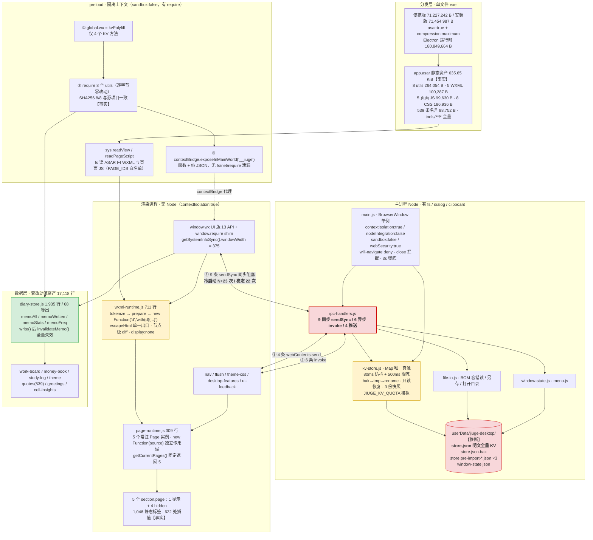

# 九格手记 Windows 桌面版 · 架构 / 性能 / 数据 / 安全 / 可扩展性深度评审

> 评审人：高见远（Gao）· 架构师（software-architect）
> 评审对象：`<仓库根>`（任务 #3 交付物）
> 对照源项目（只读）：`<工作区>`
> 评审日期：2026-11-07 · **本轮只写评审报告，未修改被评审的任何文件**

---

## 0. 结论先行

### 0.1 架构总评

| 维度 | 评级 | 一句话判断 |
|---|---|---|
| **等价性工程** | **优秀** | 用「主进程单 Map 唯一真源 + `global.wx` polyfill + 零构建 CommonJS」把 17,118 行源资产**逐字节搬进桌面**，本次实测 8 个 utils 与源项目 `utils/` 的 SHA256 **8/8 完全一致**，等价风险被压缩到 ~6,000 行可单测的适配层里。这是 90/90 验收通过的根本原因。 |
| **持久化可靠性** | **良好，但有 P0 缺口** | `bak→tmp→rename` 原子写 + 解析失败明确恢复 + 导入前快照 + 关窗 flush 三段式 + 3 秒兜底，物理崩溃防护做得扎实；**但没有单实例锁，且异常退出（杀进程/断电/系统关机）绕过 close 拦截后 `dispose()` 只清 timer 不落盘**。 |
| **性能可扩展性** | **当前够用，中期会退化** | 200 篇冷启动 223 次同步 IPC ≈ 67 ms（估算）、稳态 22 次 ≈ 6.6 ms，很流畅；**但冷启动与「每次写完后的全量重读」都是 O(篇数)**，约 1000 篇开始可感知、3650 篇接近假死。瓶颈不在磁盘容量，在 **N 次 `sendSync` 往返**。 |
| **数据安全面** | **边界内封死，边界外无兜底** | 日记正文只作为 `with(d)` 的数据值、文本统一 `escapeHtml`、模板与页面 JS 都随 ASAR 发布且路径白名单 → 表达式注入面为 0；代价是 `sandbox:false` + `new Function` + 无 CSP，`store.json` **明文无加密无 ACL**。 |
| **可维护性** | **中等** | `PAGE_IDS` 在 4+ 个文件硬编码、两份 `wx` polyfill + 一份 `require` shim、渲染层 memo 靠「约定式失效」——改动一处必须改多处，且失败多为**静默降级**。 |
| **文档一致性** | **需回写校准** | 架构写「60 个导出 / 226 次读 / 24 次读 / 20–30 ms / ≈2,600 行」，源码实测 **68 / 223 / 22 / 约 67 ms / 3,851~7,674 行**；验证脚本只校验关键字与哈希，不校验文档数值。 |

> **⚠️ v1.4 重要限定（总报告请保留）**：本轮 `docs/review/04-质量与风险.md` **本版（618 行 / 78,153 B，数字与评级未变）** 已确认**断言集合外存在 1 个可复现的产品缺陷** —— `wxml-runtime.js` 循环项引用外层标量的绑定永不刷新（我已独立复核源码，机理见 §A2「补漏」小节）；三份分报告统一采用 **≥10 处**的保守汇编口径。因此上表「等价性工程：优秀」**仅指 8 个 utils 逐字节一致的数据层等价**，**不代表五页 UI 行为全部等价**；`90/90` 与 `NoOne` 也**仅表示现有断言集合全绿，不表示产品无缺陷**。本报告「设计得好的 3 个决策」第 3 条已据此加限定。

### 0.2 一句话风险判断

> **这是一个「等价性近乎完美、单用户单实例短中期使用没问题」的交付；它最该补的不是功能，而是三件工程底线——单实例锁、异常退出落盘、以及把「N 次同步 IPC」换成「1 次批量 IPC」。前两件不做，数据会在用户无感知的情况下静默丢失；第三件不做，日记写满约 3 年（1000 篇）后每次保存都会卡。**

### 0.3 证据分级（全文遵守）

| 标记 | 含义 | 本报告的取数方式 |
|---|---|---|
| **【事实】** | 本次评审**实读源码 / 实跑脚本 / 实测文件字节**所得，可复现 | `node tools/bench-store.js`、纯 Node 量化脚本、`sha256sum`、`fs.statSync`、`wc -l`、逐文件 Read |
| **【推断】** | 由源码控制流、API 语义推演，**未做运行时实测** | 崩溃时序、并发覆盖、失败分支、路径解析 |
| **【估算】** | 含**明确假设**的量化推算，不是实测 | 单次 `sendSync` 往返 0.30 ms（区间 0.20–0.80）、磁盘带宽 300/100 MB/s、Electron 常驻内存 150–300 MB |

> 老刘是工程背景，本报告尽量用「可测的量、可数的次数、可算的字节」说话；凡属推断或估算，一律标注，不与实测混写。

### 0.4 本次实读 / 实跑清单

| 类别 | 内容 |
|---|---|
| 源码实读 | `main.js`(258) `kv-store.js`(363) `ipc-handlers.js`(189) `file-io.js`(161) `window-state.js`(141) `preload.js`(188) `component-map.js`(328) `wxml-runtime.js`(711) `page-runtime.js`(309) `wx-shim.js`(177) `flush.js`(141) `nav.js`(179) `desktop-features.js`(196) `index.html`(68) `diary-store.js`(1935，全篇) `electron-builder.yml` `package.json` `README.md` |
| 文档实读 | `docs/02-ARCHITECTURE.md`(1013，含 §10 风险表) `docs/01-PRD.md`(§5 导入契约 / §7 硬约束) `docs/03-QA.md`(325) |
| 实跑脚本 | `node tools/bench-store.js`（4/4 PASS）；3 段纯 Node 只读量化脚本（单篇字节 / 全量体积 / CPU 下界 / DOM 规模）；`sha256sum` 8 个 utils 与源项目比对 |
| **未做**（如实标注） | GUI 点击自动化、真实 Electron 内存采样、1000 篇真实文件压测、真实磁盘写满、干净虚拟机 SmartScreen —— 与 `03-QA.md` §7 口径一致 |

### 0.5 报告间口径说明（供总报告汇编时避免串台）

| 事项 | 本报告口径 | 出处 / 说明 |
|---|---|---|
| 凡引「QA §x」「A5 / D7」「90/90」 | 一律指**上一轮验收执行报告** `docs/03-QA.md`（任务 #4），**不是**本轮元评审 | 本轮元评审为 `docs/review/04-质量与风险.md`，两者是不同文档、不同评级体系 |
| 长周期压测评级 | 上一轮 `03-QA.md` §7(`:296`) 暂定「低」；**本轮 04 报告 §4.2 R5 已重估为 P3×S3 = 9 分（中）**，并明确「`bench` 是内存注入 200 篇、非真实 `store.json` 文件」「随篇数增长、非固定低」 | 本报告 §A4 量化表与 04 报告结论**一致**；总报告请勿把 `03-QA.md` 的「低」当成本轮评级 |
| 双实例 / 强杀退出 | 本轮 04 报告 N2（15 分）/ N3（16 分）**均已列为 P0 覆盖边界**；`NoOne` 采用「测试轮次路由成立 / 发布放行结论不成立」双重判定 | 与本报告 P0 一致，不推翻 QA 判定、只补覆盖边界 |
| 白名单 5 条 P1 | 上一轮 `03-QA.md` §9 为「原样保留、未误报为缺陷」；本轮 04 报告 §7.2 结论为「**白名单本身没有掩盖缺陷**，PRD §8 明确要求保持、README §9 已逐条告知，属可接受质量取舍」，另补 4 项**应告知而未告知** | 两份均不计缺陷 |
| 产品侧 P0「导出双口径」 | 设置页三按钮＝复制到剪贴板、文件菜单同名三项＝另存为文件，同名不同义且界面内零提示 —— **属信息架构 / 文档问题，不是架构缺陷**；本报告**不将其列为风险**，也不建议改动 IPC、导出口径或菜单 label | `docs/review/01-产品视角.md`；解法为「设置页加静态说明 + 另存成功给含路径回执」 |
| 本轮 04 报告综合评级 | **B−（有条件可用）** | 与本报告「等价性优秀、但有 P0 工程底线」的总评同向 |
| `windowWidth` 锁 375 / 单列 900px / 隐藏原生标题栏 | 产品侧判 P2 且**本次不改**；本报告仅在 §A2 / §A3 作技术语义分析，**未判为架构缺陷** | 放宽会牵动 rpx 等价基线与 native `close` 的 flush 链路 |
| WXML 计数 1,046 / 622 / 74 / 94 | 与 `03-实现质量.md` 的 **3,055 节点 / 576 绑定点 / 110 条件节点** 不冲突，是**不同计数域**：本报告为源文件正则命中数，03 报告为运行时节点 / 绑定点数 | 详见 §A2「统计口径注释」与 `03-实现质量.md` §10.1；总报告引用时请标注计数域 |
| **「产品缺陷 0」表述 / 断言集合外缺陷** | 本轮 04 报告 **本版（618 行 / 78,153 B；v3 数字与评级未变）** 已确认：断言集合外**已定位 1 个已确认、可复现的产品缺陷** —— `wxml-runtime.js` 循环项引用外层 `setData` 标量的绑定永不刷新（机理见本报告 §A2「补漏」小节，我独立复核源码确认成立）。**影响面三份分报告统一采用 ≥10 处的保守汇编口径**：7 处选中态 class（含 `index.wxml:354` `study-kind-pick-on`）+ settings 皮肤卡片 3 处（`settings.wxml:19` class / `:21` `aria-checked` / `:22` `aria-label`，新增**「无障碍属性不刷新」**维度）；`review.wxml:360` `dg-row-open` 作为**机理最强实证单列、不计入保守计数**（若按全部绑定点含文本插值计则 ≥12 处，三层口径见 §A2）。另有 2 个代码事实级风险。**「产品缺陷 0」表述失效**。`NoOne` 双重判定仍成立，但收紧为「**仅表示现有断言集合全绿，不表示产品无缺陷**」。综合 **B−**、Top3、原 5 个补测用例优先级均不变 | `docs/review/04-质量与风险.md` §0.1 / §0.3 / §7.1 / §7.3 / §7.4 / §8 用例 6-A / §9.2 / §9.3 / 附录「第三次修订：影响面计数统一」；已建议主理人单独派工，**标「发布前必修」** |
| **⚠️ 不得由「ENOSPC 非产品缺陷」推出「本交付无产品缺陷」** | 附录「真实 ENOSPC 证据边界」定性为**验证路径与真实路径分叉、非产品缺陷**，与上行的**循环项选中态已确认产品缺陷**是**两个不同事项**；上表「两份均不计缺陷」仅指**白名单 5 条 P1**，不宜泛化。凡出现「90/90」「不推翻 QA 判定」均应跟一条限定：**90/90 只表示现有断言集合全绿** | 本报告 §B7 / §A2 / §0.1 限定；总报告汇编务必保留此区分 |
| 数据主权三条 / 「文档 · 告知层」建议组 | 本报告 §C10 三条（卸载残留 / OneDrive 重定向 / 便携版数据不随 U 盘走）已被 `01-产品视角.md` **v1.1a** §10 采纳；**OneDrive 一条按「宿主环境前提、NFR-6 达成判定不变」处理，不升级为缺陷**（本报告 §C10 与 §3 P2 措辞已同步校准）。三条 + 01 报告 4 条 P0 + QA 4 项「应告知而未告知」按 PM 建议**合并为一组「文档 / 告知层」建议**（根因、解法、影响面相同，不拆成不同性质的问题）。**QA 4 项原文（v1.8 已取得，来自 04 §7.2）**：① **双开实例互相覆盖 `store.json` 丢日记**（无单实例锁，N2），README 完全未提；② **「不丢字」只覆盖正常点 × 退出**，强杀 / 断电 / 系统强制关机下最近 80 ms 可能丢，README §2 措辞已限定但极易误读；③ **`store.json` 损坏时从 `.bak` 恢复可能丢最近一次写入**，README §2 未说明 `.bak` 与恢复口径；④ **`Ctrl+1~5` 在输入框聚焦时是否切页**，README §5 未提示与输入冲突（N9 未测） | 4 项原文现已补齐，**总报告可直接引用，无需再向 QA 索取**；4 项与本报告 §C10 三条、P0 两条（双实例 / dispose 不 flush）、P1 `copy-source` 风险同源，建议合并成一组**零改架构**的文档 / 告知动作 |

---

## 1. 架构分层图（Mermaid）

> 红框 = 本报告识别的两个硬瓶颈（同步 IPC 通道 / 明文单文件真源）；黄框 = 需按量级演进的模块；绿框 = 零改动、等价性基石。

---

## A. 架构评审

### A1 全局 `wx` polyfill 注入法：得、失与三条路线

#### 得（【事实】，含本次独立复核）

| 项 | 证据 |
|---|---|
| 8 个 utils 逐字节零改动 | 本次用 `sha256sum` 对 `G:\...\2026-10-31-23-19-46\utils\*.js` 与桌面版 `src/utils/*.js` 逐一比对，**8/8 一致**；`diary-store.js` 77,016 B / 1,935 行 / 68 个导出，`src/utils/.sha256.json` 用绝对 `source` 路径锁定源目录 |
| 注入顺序正确 | `preload.js:81` 先 `global.wx = kvPolyfill`，`:86-93` 才 require 8 个模块；Node CommonJS 的自由变量 `wx` 天然解析到 `global.wx` |
| 原生 chrome API 优雅跳过 | `preload.js:8-9` 故意不提供 `setNavigationBarColor` 等，`theme.js` 用 `typeof wx[name]==='function'` 探测后静默跳过（桌面版要的行为） |
| 单份状态、无双写 | 两份 `wx`（preload 的 KV 版 `:44-79`、渲染层 `wx-shim.js:95-152` 的 UI 版）都转发到主进程**同一个 Map**（`kv-store.js:78`）；架构 §2.3 明确弃用「preload 内做 KV 镜像」以避开双份状态 |
| 零构建、可纯 Node 验证 | `package.json` 运行时零第三方库；`tools/bench-store.js` 用内存 `global.wx` 直接跑数据层，无需 GUI |

#### 失：长期代价（【推断】，基于源码语义）

1. **小程序运行时语义被永久固化在桌面版里**。被固化的不只是 4 个方法名，还有一整套隐性契约：`*Sync` 必须同步、`getStorageInfoSync().keys` 必须返回**全部键名**、未命中返回 `''` 而非 `undefined`（`kv-store.js:170-174` / `preload.js:45-50`）、配额异常消息必须含 `exceed|quota|size|limit`（`diary-store.js:349` ↔ `preload.js:60-63`）、单键 1 MB / 总 10 MB 的容量隐喻（`diary-store.js:17-21`、`:405-416`）。未来小程序若改异步 storage、加索引/命名空间 API、调整 quota 模型，桌面版只有两条路：继续补 polyfill（永远追在后面），或改动零改动资产（打破全部验收基线）。
2. **polyfill 覆盖面窄，且缺口是静默的**。preload 的 `kvPolyfill` 只有 4 个方法；渲染层补了 13 个 UI 类 API。`theme.js` 式探测对配置类安全，但 `diary-store.js` 这类**直接调用**的代码若遇到新 `wx.xxx`，会抛 `TypeError` 被 `try/catch` 吞掉，返回 `CLIENT_EXCEPTION` 或空值 —— 用户看到的是「数据没读出来」，不是「API 不支持」。
3. **`getStorageInfoSync().keys` 全量扫是结构性瓶颈**。`kv:keys` → `Array.from(this.data.keys())`（`kv-store.js:246-249`）一次 IPC 回传**所有键名**；`listDates()`（`diary-store.js:431-441`）与 `readReviewMap()`（`:1432-1446`）都在渲染层做 O(总键数) 正则过滤。【事实】实测 filter 本身 3650 键只要 0.429 ms，所以瓶颈不在 CPU，而在**每次都要把 N 个键名跨进程搬一遍**：200 篇约 208 键 ≈ 6 KB，3650 篇约 3658 键 ≈ 106 KB。
4. **三份映射表各自演化**。新增一个 utils 模块要同步改 `preload.js:86-93`(require)、`preload.js:173-188`(`__jiuge` 暴露)、`wx-shim.js:157-166`(`MODULE_MAP`)；漏一处则 `window.require` 返回 `{}` 且只 `console.warn`（`wx-shim.js:172-173`），页面拿到空对象后静默失败。

#### 三条路线的成本与触发条件

| 路线 | 一次性成本 | 每次小程序升级的同步成本 | **建议触发条件（量化）** | 主要风险 |
|---|---|---|---|---|
| ① **继续 polyfill**（现状） | 0 | 低~中：每新增 1 个 `wx` API 补 2~3 处转发；等价性靠 SHA256 守住 | 小程序端**停止演进**，或 1 年内只加 UX 文案/常量 | 语义债累积；篇数 ≥800 时 `keys` 全量扫 + N 次 `sendSync` 成为瓶颈 |
| ② **抽象 Storage 接口**（推荐中期） | 中：preload 增 `kv:getBatch` / `kv:keysByPrefix` / `kv:setBatch` 3 个通道 + 薄适配层；**8 个 utils 仍不动**（由 polyfill 内部改走批量） | 低：接口稳定，升级只补适配层 | **篇数 ≥800 或冷启动 ≥400 ms 或写后回看 ≥300 ms**；或小程序新增索引类 API | 需重跑等价性哈希与 QA 90 条（utils 不变但 polyfill 变了）；`diary-store.js:447` 的 `map(read)` 是最大障碍，见 §C8 |
| ③ **换框架重写** | 极高：架构 §1.1 自估重写 ≈12,850 行，本次实测源资产 17,118 行 | 高：与小程序双轨维护 | 产品定位改变（多端/云/富文本/协作）且**愿意放弃「逐字等价」** | 破坏当前全部验收基线；在「等价优先」前提下不推荐 |

> **判断**：路线 ② 是唯一兼顾「等价性」与「可扩展性」的路径，但它必须跨越一个硬冲突——见 §C8 与演进路线图。

---

### A2 WXML 兼容运行时：本质是一个自制小程序框架

【事实】四份代码合计约 1,525 行构成自制框架：`wxml-runtime.js`(711) + `page-runtime.js`(309) + `component-map.js`(328) + `wx-shim.js`(177)。

#### 覆盖边界（任务书称「17 类」，源码实测如下）

| 能力面 | 实测数量 | 出处 |
|---|---|---|
| 标签映射 `TAG_MAP` | **20** 个（view/text/block/input/textarea/button/scroll-view/swiper/swiper-item/picker/switch/image/icon/form/label/navigator/progress/slider/checkbox/radio） | `component-map.js:27-48` |
| 事件映射 `EVENT_MAP` | **20** 个 | `component-map.js:69-89` |
| `wx:` 指令 | **7** 类（if / elif / else / for / for-item / for-index / key，含 `*this`） | `wxml-runtime.js:230-245`、`:387-392` |
| 控件属性 `CONTROL_NAMES` | **12** 个 | `wxml-runtime.js:207-211` |
| 5 个 WXML 里实际用到 | **1,046 个元素标签** / **622 次 `{{` 原始出现** / **74 次 `wx:for` 前缀命中（真循环 62）** / **94 个 `wx:if`**【事实，本次正则统计；口径见下注】 | `src/views/*.wxml` |

> **统计口径注释【事实，与 `docs/review/03-实现质量.md` §10.1 交叉核对后补全】**：以下四个数字是**源文件正则命中数**，不是运行时节点数，两者计数域不同、**无冲突** ——
> - `1,046` = `<[a-zA-Z][^>]*>` 命中的**元素标签**；03 报告的 **3,055 节点** = 1,046 元素 + **2,009 个 `#text`**（WXML 文本块也被 `tokenize()` 建为节点）。
> - `622` = 源文件中 `{{` 的**原始出现次数**；其中 **1 处在 HTML 注释里**，`tokenize()` 剥离注释后可见 **621** 处；03 报告的 **576** 是「含 ≥1 个插值的**绑定点数**」（一个属性可含多段 `{{}}`）。
> - `74` = `wx:for` **前缀命中数**，实为 `62 个 wx:for=` + `9 个 wx:for-item` + `3 个 wx:for-index`（`/wx:for\b/` 会匹配后两者的前缀）；**真正的循环指令节点只有 62 个**。本报告前两版写「74 处 `wx:for`」易被误读为 74 个循环，**特此更正**；下文凡出现「74 `wx:for`」均按此口径理解。
> - `94` = 纯 `wx:if`；另有 `2 个 wx:elif` + `14 个 wx:else`，03 报告的 **110 个条件节点** = 94 + 2 + 14。
> - 同理：`635.65 KiB` 是**全部静态资产**（8 CSS + 5 WXML + 5 页面 JS + 8 utils），03 报告的 `186,936 B` 是**仅 8 份 CSS**；`3,851 行` 适配层 vs 03 报告 ≈`3,862 行` 属统计域边界差异。**两组数字不打架，总报告引用时请标注计数域。**

> 「17 类」是任务书/架构文档的概数，**不算缺陷**（见 §6 刻意保留项）；但概数会掩盖「20 标签里只有少数被真正特化、其余走 `|| 'div'` 静默降级」这一事实。

#### 未覆盖语法会怎样失败：**整体是「静默降级」，不是白屏**

| 缺口 | 失败模式 | 白屏? | 代码位置 |
|---|---|---|---|
| 未登记标签（`rich-text`/`canvas`/`map`/`web-view`/`movable-view`…） | `TAG_MAP[tag] \|\| 'div'` → 静默变空 div，功能丢失**无任何告警** | 否，局部错乱 | `component-map.js:99` |
| 未登记事件 | `EVENT_MAP[short] \|\| short` → `addEventListener('foo')` 永不触发 | 否 | `component-map.js:167` |
| `{{expr}}` 求值抛错 | `evalExpr` catch → 返回 `''`，文本渲染为空 | 否，**静默空白** | `wxml-runtime.js:69-76` |
| `new Function` 编译失败 | 缓存一个 `return ''` 的函数，此后永久静默 | 否 | `wxml-runtime.js:58-67` |
| `selectAll()` | 设了 `_all=true`，但 `exec()` 仍用 `querySelector` 只取一条 → 语义未实现 | 否，少数据 | `wx-shim.js:49` / `:54` |
| `wxs` / `template` / `import` / `include` / `slot` / 自定义组件 / `model:` 双向绑定 / 动画 API | tokenizer 当普通标签或属性，忽略或错误渲染 | 否 | `wxml-runtime.js:160-205` / `:214-265` |
| 页面 JS 执行异常 | catch → `console.error` + `resolve(false)` → 该页回落**占位实例**，整页功能缺失 | 否（有占位） | `page-runtime.js:208-219` |
| WXML 挂载抛错 | catch → `_view=null`，该 section 空白 | **局部白屏** | `page-runtime.js:131-136` |
| 缺全局（R9 自检） | 控制台 + toast 明确报错 | 否 | `page-runtime.js:248-255`、`wxml-runtime.js:690-695` |

> **这是本架构最需要警惕的性格**：「不崩」是优点，但「错了也不报错」意味着**错渲染不进控制台、不进 QA 断言**（QA B-37 只断言「JS 异常 0」，正好被静默降级绕过）。建议补一张「未覆盖语法清单」，在 `compile()` 阶段对未登记标签/事件 `console.warn` 并计数，纳入 `verify` 可断言项。

#### 【v1.4 补漏 · 已确认、可复现的产品缺陷】循环项引用外层数据的绑定永不刷新

> **这是本报告自身的补漏**：该缺陷由 `software-engineer` 定位、`software-qa-engineer` 在 04 报告 v2 确认；我**独立实读 `wxml-runtime.js` 复核后确认成立**，且它正落在我的评审范围内 —— 前几版把「节点级 diff」列为设计优点第 3 条时未覆盖这一分支。在此明确更正，不护短。

**机理【事实，源码确定】**

| 步骤 | 代码 | 后果 |
|---|---|---|
| ① `setData` 只改外层标量（`tabIndex` / `moneyCategory` / `studyKindFilter` …） | `page-runtime.js:95-105` 合并进 `data` 后调 `_view.update()` | `wx:for` 的数组型数据源**未变** |
| ② `update()` 只刷 `rootInsts` | `wxml-runtime.js:661` `this.rootInsts.forEach(refreshInst)` | 循环项实例**不在 rootInsts**：`createChildren():517` 是 `if (inst && !inst.isLoop) list.push(inst)`；`createLoop():538` 返回的包装实例 `children:[]`、`bindings:[]`，真实子项只存在于 `loop.items` Map |
| ③ 循环刷新被 signature 短路 | `wxml-runtime.js:546` `if (signature === loop.signature) return;`，signature = `JSON.stringify(arr)`（`:545`） | 数组没变就直接返回，`:568` 的 `refreshInst(inst)` **根本不到达** |
| ④ 求值本身没问题 | `makeScope():123-127` / `scopeFor():394-399` 以 `page.data` 为原型链 | 循环项 scope **能**读到新标量值，缺的只是「触发一次求值 / 刷新」 |

> **结论**：`{{tabIndex === index ? 'rv-tab-on' : ''}}` 这类引用**外层标量**的 class 绑定，在用户点击后**永不刷新**，选中态不跟随。这是「静默功能错误」，不是白屏、不抛异常。

**影响面【事实，本次实测 `src/views/*.wxml`；v1.8 按三份分报告统一口径】**：**汇编口径 ≥10 处**（三份分报告一致，供总报告直接引用）——

| 类别 | 数量 | 位置 | 受影响内容 |
|---|---|---|---|
| 选中态 class | **7 处** | `review.wxml:8`（`rv-tab-on` / `tabIndex`）、`index.wxml:272`（`money-cat-on` / `moneyCategory`）、`index.wxml:340`（`study-chip-on` / `studyKindFilter`）、`index.wxml:347`（`studyTopicFilter`）、`index.wxml:354`（`study-kind-pick-on` / `studyNewKind`）、`index.wxml:372`（`studyNewTopicId`）、`habit.wxml:104`（`ms-preset-on` / `msDays`） | 回看标签 / 记账分类 / 学习筛选 / 坚持页预设的选中态不跟随点击 |
| settings 皮肤卡片 | **3 处** | `settings.wxml:19`（`skin-cell-on` class）、`:21`（`aria-checked`）、`:22`（`aria-label` 的「已选中 / 未选中」） | **「无障碍属性不刷新」**维度（04 报告 N9）：换肤后读屏用户得到错误状态 |
| 额外实例（**不计入保守计数**） | **1 处** | `review.wxml:360`（`dg-row-open` / `digestOpen[item.key]`） | 回看摘要展开态行样式；与同节点 `:374` 的 `wx:if` 形成**同屏不一致**（机理最强实证，见下方 ②） |

> **三层口径（v1.8 统一，避免总报告出现第四个数字）**：① **汇编口径 ≥10 处** = 7 处选中态 `-on` class + settings 3 处 —— QA 04、03 实现质量、本报告三份统一采用，**总报告请用这个数字**；② 若把 `review.wxml:360` 的 `dg-row-open` 计入状态 class，为 **≥11 处**（本报告 v1.7 曾采用，现回退以对齐团队口径，该实例作为实证保留）；③ 若按**全部绑定点**（再加 `index.wxml:340` 的 `{{studyKindCounts[item.id]}}` 文本插值）则为 **≥12 处**（03 报告给出的上界口径）。三者是**筛选规则宽窄**不同，不是数字冲突。

> **v1.7 补入的两个实例与一层架构洞察**（由 `software-engineer` 定位，我实读源码复核确认）：
> ① **settings 皮肤卡片打在已验收项上**：`skinList: theme.list()` 只在 `settings.js:41` 的 `Page.data` 初始化一次，`applyTheme()`（`:68-71`）只 `setData({theme, switchColor})`、**从不重设 `skinList`** → signature 不变 → `:19/:21/:22` 不刷新。而 **B-26「四套皮肤在全部 5 页一起变色」只断言 `<html>` class / `--c-switch` / 5 页 `data.theme`**（`renderer-probe.js:345-355`），**不查 `.skin-cell-on`** —— 同一缺陷正好落在已验收项的断言盲区里。
> ② **「同屏不一致」是机理的最强实证**：`review.js:251-264` 的源码注释白纸黑字写着「**只用一格 `setData(digestOpen.key)` 而不是重设整个 `digest.rows`，这样九行不会跟着重绘**」—— 源码作者为性能**刻意不重设数组**，正好撞上桌面 runtime 以 `JSON.stringify(arr)` 作循环项刷新的唯一判据。结果 `review.wxml:360` 的 `{{digestOpen[item.key] ? 'dg-row-open' : ''}}`（走 `refreshInst` 的 class 通道）**不刷新**，而同一节点 `:374` 的 `wx:if="{{item.last && digestOpen[item.key]}}"`（走 `update():663` 的 `syncCondGroup`）**会刷新** → 用户看到「**正文展开了、行样式没变**」。数据对、`wx:if` 条件也对，唯独 class 绑定通道没被触发 —— 这正是「缺陷纯粹是没人触发一次求值、不是作用域问题」的反证式实证。
> ③ **架构层洞察（比单点缺陷更值得记）**：小程序原生 `setData` 是**细粒度依赖追踪**，桌面自制 runtime 却把**数组整体变化**当作循环项刷新的唯一信号。源码里「不重设数组以省重绘」的优化，在小程序是优点、在桌面 runtime 直接变成功能错误 —— 这是「换壳不换脑」等价移植在**状态更新语义**上的根本张力，不是简单补一行能根除的类别问题。
>
> **精确集合的划分标准【采纳 engineer 建议】**：不要再靠人工枚举（本报告三轮才从 6 收敛到 11，本身就说明人工枚举不可靠）。应按**「是否走 `refreshInst` 通道」**划分：`class` / `style` / `data-*` / 文本插值 / `aria-*` 走 `refreshInst` → **受影响**；`wx:if` / `wx:elif` / `wx:else` 走 `syncCondGroup`（`update():663` 每帧执行）→ **不受影响**。**修复时请用 DOM 快照回归兜底**（关键交互前后对整页 / 关键子树做 DOM 快照 diff），而非继续人工列位置。
>
> **计数演进（诚实留痕）**：v1.4 记 6 处 → QA 第三次修订指出 `index.wxml:354` 少算、两份报告漏 settings 3 处 → v1.6 统一为 ≥10 处 → v1.7 曾把 `review.wxml:360` 计入状态 class 写成 ≥11 处 → **v1.8 按 QA / engineer 的三份报告约定回退到 ≥10 处汇编口径**，把 `review.wxml:360` 保留为「不计入保守计数的额外实例」。前版把「6 处 vs 至少 7 处」写成「口径不同、结论一致」**不准确**：同一筛选规则内是**漏算**；跨筛选规则的差异才属统计域不同。**总报告请统一用 ≥10 处，不要出现 11 / 12 两个数字**（如需说明宽度差异，用本节三层口径一句带过）。
>
> **不受影响的边界【事实，避免误算】**：① `settings.wxml:43` 的 `wx:if` 与 `review.wxml:374` 的 `wx:if` 走 `condGroups` 独立通道，**不受 `syncLoop` 短路影响**；② 只引用 `item.*` 自身属性的绑定（`capsule.wxml:50`、`review.wxml:88/512`、`index.wxml:400`）在数组变化时会改变 signature，**不受影响**；③ `index.wxml:337/344/369` 静态 chip 不在 `wx:for` 内、属 `rootInsts`，**不受影响**。

**为什么 90/90 没发现【转述 + 源码推断】**：QA B-11 / B-12 只断言 swiper 的 `{detail:{current}}` 与 `tabIndex` 数值同步、B-26 只断言 `<html>` class / `--c-switch` / 5 页 `data.theme`，`renderer-probe.js:186-215` 与 `:345-355` **均未断言任何 class / aria**；`refreshInst` 又不抛异常、不进控制台 → 缺陷完全落在断言集合外，正是本节开头「静默降级不进 QA 断言」论断的实证。

**最小修复建议【推断，v1.6 按 QA 复核补强】**：`syncLoop()` 在 `signature === loop.signature` 时**不要直接 return**，改为遍历 `loop.items` 对每个 inst 调 `refreshInst(inst)`。
- 作用域判断已复核：`makeScope():123-127` / `scopeFor():394-399` 用 `Object.create(page.data)` 作原型链，`setData` 后**能读到新标量** → 缺陷纯粹是「没人触发一次求值」，修复方向是触发刷新而非改作用域（QA 独立复核一致）。
- 安全性：`refreshInst():301` 有 `if (b.last === raw) return;` 值级 diff，未变化的绑定**不写 DOM**。
- **⚠️ 求值开销不能只靠推断**：`refreshInst():297-320` 在值级 diff **之前**对每个 binding 都会执行 `evalBinding`（`with` 求值），`b.target === 'text'` 会写 `innerHTML`、`attr` 通道只跳过 `value` 型 input / textarea、还会调 `refreshControl(inst)` 并**递归 `inst.children`**。修复后今日页 `startTimer()` **每秒** `setData({clockText})` 都会遍历所有 loops（最大回看页年历 372 格）做求值 —— 值级 diff 只避免写 DOM，**求值本身仍要做**。前版「亚毫秒级」是**推断、非实测**，低配机 / 高 DPI 下必须实测。
- 备选（更优但复杂）：按 `setData` 的 patch key 精确失效引用了外层数据的循环项，不建议本期做。
- **修复后必须补两条回归断言**：① `document.querySelector('.rv-tab-on')` 的 index 与 `tabIndex` 一致（补进 `renderer-probe.js`）；② **重跑 QA B-05「每秒刷 `clockText` 6 次，输入框节点 / 焦点 / 选区三重不变」** —— 不能只靠「值级 diff 所以不打断焦点」的推断。另按 QA 建议补 settings 皮肤切换的 class / `aria-checked` / `aria-label` 断言（04 报告用例 6-A）。

#### `new Function` + 无 CSP 的安全面

- **注入面在当前边界内确实封死**【事实 + 推断】：`new Function("d","with(d){ return (" + expr + "); }")`（`wxml-runtime.js:61`）的**源码**只有两类，且都不受用户输入控制 —— ① 5 份随 ASAR 发布的 `.wxml` 模板片段（`sys.readView()`，`preload.js:134-141`）；② 5 份页面 JS 源码（`sys.readPageScript()`，`preload.js:147-154`）。两者路径都被 `PAGE_IDS.indexOf(pageId)` 白名单锁死（`preload.js:120`、`:135`、`:148`），无法穿越到任意文件。**日记正文只作为 `scope`(`d`) 的数据值进入 `with(d)`，是被求值的变量值，不是表达式文本**（`:70-76`、`:123-127`）。
- 输出侧：文本插值统一 `escapeHtml()`（`:36-40`、`:303-305`，`& < > " '` 全实体化）；属性用 `setAttribute`（`:312`、`:314`）；`picker` 的 option 用 `textContent`（`component-map.js:303-305`）。**不存在「正文 → innerHTML 未转义」的路径**。
- **代价是没有第二道防线**：`index.html:1-16` 无 CSP meta，`sandbox:false`（`main.js:51`）让 preload 拥有完整 Node 权限，`new Function` 可执行任意 JS。架构 §2.2 / R1（`02-ARCHITECTURE.md:157`、`:978`）明确选择不启用禁 `unsafe-eval` 的严格 CSP，理由是「本地 file://、无远程内容、输入已转义」——**在当前部署假设下成立**。一旦未来加「用户自定义模板 / 主题包 / 在线内容」或供应链把恶意 `.wxml` 打进 ASAR，就升级为「任意代码执行 + 本地文件读写」，且无 CSP 兜底。建议加一条**不禁用 eval 但收紧其它来源**的宽松 CSP（`connect-src 'none'; object-src 'none'; default-src 'self' file:`），把「零网络」从代码约定升级为浏览器强制。

#### `display:none` 与小程序「销毁节点」的语义差异（逐项）

`syncCondGroup()` 用 `setVisible()` → `style.display='none'`（`wxml-runtime.js:339-343`、`:587-598`），节点**不销毁**：

| 维度 | 小程序 `wx:if=false` | 本实现 | 实际后果 | 证据 |
|---|---|---|---|---|
| DOM / 内存 | 节点销毁、释放 | 节点保留在 DOM，仍在 `rootInsts` / `condGroups` / `loops` / `swipers` 数组 | 5 套 DOM 共 1,046 静态标签常驻；`update()` 只在 `isConnected===false` 时清理（`:666-674`），而 `display:none` 的节点 `isConnected` 仍为 true → **永不清理** | `wxml-runtime.js:339-343`、`:658-676` |
| 每帧求值 | 条件块不存在 | 每帧 `syncCondGroup` 对**所有成员**（含隐藏）求值 | 94 处 `wx:if` 每次 `setData` 都全量跑 | `:587-598` |
| 事件绑定 | 监听器随节点销毁 | 监听器仍挂在 el 上（`bindEvents` `:377`） | 用户交互收不到（display:none），但**程序化派发的 DOM 事件仍会触发 handler** | `:358-385` |
| `createSelectorQuery` | 查不到该节点 | `document.querySelector(q._sel)` 是**全局查询**，`in(page)` 存的 `_page` 根本没用；会命中隐藏 section 里同 class 节点，`getBoundingClientRect()` 对 display:none 返回全 0 | 测量错误 | `wx-shim.js:41-74` |
| swiper | 只渲染当前项 | `querySelectorAll('.j-swiper-item')` 把隐藏项也算进索引 | 索引偏移风险 | `wxml-runtime.js:600-607` |

> **个案兜底做得好**：`index.js:677-681` 用 `rect && rect.width > 0` 过滤，`ensureIntakeTrack()`（`:684-691`）用 `windowWidth=375` 按 rpx 反推轨道范围 —— 作者显然清楚隐藏节点测不到尺寸，并做了防御。但这是**个案补丁，不是机制修复**；换一个页面/选择器仍可能踩坑。此外 `index.html:38-42` 的 4 个 `<section hidden>` 与 `nav.js:83-86` 的组合，让 4 套完整 DOM 常驻并同样参与全局 `querySelector`。

#### 每页 `new Function` 独立作用域的调试与 sourcemap 代价

- 实现：`page-runtime.js:212` `(new Function(source))()`，source 由 `sys.readPageScript()` 读文件文本，5 页串行加载（`:224-228`）。目的正确 —— 5 个页面 JS 的顶层 `const/let` 互不冲突，等价小程序模块作用域。
- 代价【推断】：① DevTools 栈一律显示 `eval at <anonymous>` / `VM####`，**无文件名、无行号**；② 项目无构建链，**不可能有 sourcemap**；③ 断点只能打在 VM 生成代码上，刷新后编号变化、断点不持久；④ 与 `fnCache`（`wxml-runtime.js:33`，模块级全局共享的表达式编译缓存）叠加，出错时栈里同时出现「模板表达式」与「页面 JS」两层匿名帧；⑤ QA「控制台 JS 异常 0」只能证明没抛异常，**不能证明静默降级没发生**。对 1,410 行的 `index.js` 而言，这是长期维护中最贵的一笔隐性成本。

---

### A3 单窗口 5 视图的取舍

#### 得（架构 §1.4 五条理由，本次逐一验证）

| 理由 | 验证 |
|---|---|
| 换肤一次生效 | `theme-css.js` 只改 `<html>` 的 `.theme-*` class + CSS 变量，标题栏/侧栏/主区一起变（`02-ARCHITECTURE.md:123`） |
| 退出 flush 只需一个实例 | `flush.js:57` 直接 `rt.byId('index')` 取唯一今日页，按 `syncWorkReflection → syncStudyNote → persist → stopTimer` 编排（QA D-09 日志逐字命中） |
| `getCurrentPages()` 天然复用 | `page-runtime.js:181-183` 返回常驻 5 个实例，正好对应 `settings.js` 换肤广播遍历页面栈 |
| 跨页带参直传 | `nav.js:67-74` 写内存 `AppState`，页面 JS 的 4 处 `getApp()` 零改动 |
| 状态单一 | 单份 `memoAll/...` 缓存、单份 `store.json` 句柄、无跨窗口同步 |

#### 失（【事实】实测体量）

| 项 | 实测值 |
|---|---|
| 5 个 Page 实例常驻 | `page-runtime.js:283` 注释「5 个常驻 Page 实例」 |
| 5 套 DOM 同时存在 | `index.html:38-42`，4 个 `hidden`；1,046 静态标签 + 622 插值 + 74 `wx:for` + 94 `wx:if` |
| 启动期全部编译 | 每页 `mountPage()` → `WXML.mount()` → `compile()`（`page-runtime.js:132`、`wxml-runtime.js:630`），5 份 WXML 全量 tokenize + prepare + createNode + bindEvents |
| 8 份 CSS 全量 `<link>` | `index.html:8-15`，186,936 B，无论当前显示哪页都加载并解析 |
| 静态资源合计 | CSS 186,936 + WXML 100,287 + 页面 JS 99,630 + 8 utils 264,054 = **635.65 KiB**；名言 `quotes.js` 88,752 B / 539 条常驻内存 |
| 回看页年历 | 12×31 = 372 格一次渲染（QA B-13），`wx:for` 展开后实际 DOM 节点远多于 1,046 |

> **内存定性**【估算】：Electron 31 主 + 渲染 + GPU + utility 多进程常驻 150–300 MB（行业经验，本机未实测）；5 套 DOM + 1,046 个元素标签（含文本块约 3,055 节点）+ 约 576 个绑定点相对 Chromium 基线是**小头（几 MB 量级）**，不是主要瓶颈。真正成本在**启动期 CPU**（解析 1,046 标签 + 编译 622 表达式）与首帧布局，以及「4 套隐藏 DOM 仍参与全局查询/每帧求值」。

#### 未来做多窗口 / 多文档的可行性：**当前架构基本不可行**

| 障碍 | 说明 |
|---|---|
| 渲染层 memo 各自独立 | 每个窗口有自己的 `memoAll/...`；窗口 A 写、窗口 B 不失效 → 读到旧数据。架构 §2.3 只论证了「preload 镜像会双写」，**单窗口掩盖了渲染层 memo 同样会不一致** |
| `getCurrentPages()` 语义 | `page-runtime.js:181` 硬编码返回全局 5 个，需改成 per-window 页面栈 |
| 退出 flush 编排 | `flush.js:57` 假设「唯一的今日页实例」，多窗口要聚合 |
| 推送单点 | `win` 是模块级单例（`main.js:24`），`ipc.push()` 只推给 `getWindow()` 返回的那一个（`ipc-handlers.js:40-49`） |
| 需要的改造 | 主进程广播 `kv:changed` → 各渲染层 `invalidateMemo()`；per-window Runtime；多窗口 flush 聚合。**成本：高（架构级）** |

---

### A4 IPC 同步阻塞与量化推算表（本报告核心）

#### 机理与实测校准

- `ipcRenderer.sendSync`（`preload.js:18-25`）在渲染进程主线程**同步等待**主进程；`kv:get` handler 只做 `Map.get`（`ipc-handlers.js:64-66`），本身 µs 级，主导成本是**跨进程往返 + 结构化克隆**。
- 【事实】`node tools/bench-store.js` 实测：200 篇 → 首次 `kv:get=223` / `getStorageInfoSync=1`；稳态 `kv:get=22` / `info=0`；任一 `kv:set` 后首次 `all()` → `kv:get=201` / `info=1`。逐项拆解可精确对上：**223 = 200 篇日记 + 22 个配置/模板读取 + 1 次 STARTED_KEY；22 = 稳态配置读取（其中 19 次是 `FIRSTWEEK_KEY` 与 `TEMPLATE_KEY` 被 `promptFor` 反复同步读）**。
- 因此：**冷启动 / 写后重读 = O(N)，稳态 = O(1)**，其中 `N` = 日记篇数，`N+23` 为冷启动读次数（200 篇校准为 223 ✓）。
- `listDates()`（`diary-store.js:431-441`）先 `kv:keys` 拿全部键名，再 `all()` 第 447 行 `result.data.map(read)` → **每篇一次独立 `kv:get`**。这就是 O(N) 的根源；单条 JSON 反序列化发生在跨进程结构化克隆里，已计入下面假设。
- 【事实】纯 CPU 下界（本机 Node 实测，**不含** Electron IPC 调度）：

| 篇数 | 全量 `JSON.stringify` | 全量 `JSON.parse` | N 次单条 parse（等价 N 次 `kv:get` 反序列化） | `keys()` 全量 + filter |
|---|---|---|---|---|
| 200 | 0.59 ms | 0.69 ms | 0.70 ms | 0.130 ms |
| 1000 | 2.84 ms | 2.67 ms | 2.08 ms | 0.141 ms |
| 3650 | 11.99 ms | 11.11 ms | 21.85 ms | 0.429 ms |

> **关键判断**：3650 篇时纯 CPU 反序列化也才 21.85 ms，**CPU 不是瓶颈，N 次跨进程往返才是**。

#### 估算假设（写明，不冒充实测）

| 假设 | 取值 | 依据 |
|---|---|---|
| 单次 `sendSync` 往返（含结构化克隆与调度） | **0.30 ms**，区间 **0.20–0.80 ms** | Electron 本机同步 IPC 常见量级；本机 CPU 下界仅 0.7~21.9 ms，故调度占主导。**无本机实测埋点，属估算** |
| 单次回传数据量 | **413 B**（B 形态单条 record，含键名 442 B）【事实】 | 本次 `Buffer.byteLength(JSON.stringify(record))` 实测：A 最小 353 B / B 真实 413 B / C 饱满 2509 B |
| 稳态读次数 | 恒 **22** 次，与 N 无关（memo 命中）【事实】 | bench 实测 |
| 磁盘顺序写带宽 | SSD 300 MB/s / HDD 100 MB/s【估算】 | 用于估算 flush 耗时 |
| 每次 flush 写盘份数 | **2 份全量**（`copyFileSync` bak + `writeFileSync` tmp）【事实】 | `kv-store.js:283-292` |

#### 量化推算表：200 / 1000 / 3650 篇

| 篇数 N （约合年限） | 约键数 | 冷启动 `kv:get` 次数 | 单次回传 | 单次读总数据量 | **IPC 往返耗时** 0.20 / **0.30** / 0.80 ms | 纯 CPU 下界 （N 次 parse） | **写后全量重读** ≈N+1 次 ×0.30 ms | 稳态 22 次 | `store.json` 体积 B / C 形态【事实】 | 单次 flush 写盘 B / C（×2） | 判定 |
|---|---|---|---|---|---|---|---|---|---|---|---|
| **200**（≈0.55 年） | 208 | **223** | 413 B | ≈81 KB | 45 / **67** / 178 ms | 0.70 ms | 201 次 → **60 ms** | 6.6 ms | 0.08 / 0.49 MB | 0.16 / 0.98 MB | **流畅**（与 QA 90/90 口径一致） |
| **1000**（≈2.7 年） | 1008 | **1023** | 413 B | ≈403 KB | 205 / **307** / 818 ms | 2.08 ms | 1001 次 → **300 ms** | 6.6 ms | 0.42 / 2.44 MB | 0.84 / 4.88 MB | **可感知卡顿**：每次保存后切回看都顿一下 |
| **3650**（10 年） | 3658 | **3673** | 413 B | ≈1.47 MB | 735 / **1102** / 2938 ms | 21.85 ms | 3651 次 → **1095 ms** | 6.6 ms | 1.53 / 8.91 MB | 3.06 / 17.8 MB | **不可接受**：冷启动/写后均冻结主线程 ≈1.1 s（悲观 2.9 s），接近假死 |

> 稳态 22 次 × 0.30 ms = **6.6 ms**，与篇数无关 —— 说明 `memoAll` 等缓存设计本身是有效的，**问题全部集中在「缓存未命中 / 写后失效」这两类场景**。

#### 第一个会崩的量级（明确结论）

| 量级 | 触发点 | 现象 |
|---|---|---|
| **≈1000 篇（约 2.7 年每日写）** | **写后全量重读 ≈300 ms**，冷启动 ≈307 ms | **第一个可感知的崩点**。比冷启动更早被察觉，因为「写一次就卡一次」：`write()` 成功后 `invalidateMemo()`（`diary-store.js:343`）清空 5 个 memo，下一次 `all()` 又 N 次 `sendSync`。用户保存一格 → 切回看页 → 明显停顿 |
| **≈1800–2000 篇（约 5 年）** | 冷启动中位破 **0.5 s** | 日常使用开始受影响；加上 5 页 DOM 编译与 622 处表达式求值，冷启动实际体感可达 1–2 s |
| **3650 篇（10 年）** | 冷启动 / 写后各 ≈1.1 s（悲观 2.9 s） | 主线程冻结、窗口无响应，用户会认为程序挂了 |
| **磁盘容量？** | 3650 篇 C 形态也只有 **8.91 MB**【事实】 | **容量不是崩点**。真正崩的是「N 次同步 IPC」与「每次写全量重写」两个 O(N) 行为 |

> 文档口径对照：架构 §2.3（`02-ARCHITECTURE.md:175`）写「226 次约 **20–30 ms**，可接受」，隐含约 0.1 ms/次；按本次估算 223 次中位 **67 ms**（区间 45–178），**偏乐观约 2–3 倍**。该数字无实测埋点支撑，建议补一次真实计时。另**上一轮验收执行报告** `docs/03-QA.md` §7(`:296`) 已如实标注「未做 1000 篇真实文件压测」并暂定「低」——本表正是对该遗留风险的量化展开；**本轮元评审 `docs/review/04-质量与风险.md` §4.2 R5 已据同一推演重估为 P3×S3 = 9 分（中）**、明确「随篇数增长、非固定低」，两份报告口径一致（出处辨析见 §0.5）。

---

## B. 性能评审

### B5 内存与启动：与原生 Win32/WPF、WebView2 壳的定性对比

【事实】二进制基线：`electron.exe` 180,849,664 B、`build/win-unpacked/九格手记.exe` 180,849,152 B、压缩单文件便携版 71,227,242 B / 安装版 71,454,987 B（`asar:true` + `compression:maximum`，`electron-builder.yml:24-25`）。启动期静态文本合计 635.65 KiB，全部来自 `file:///...app.asar/...`（QA E2 日志无远程地址）。

| 方案 | 分发体积 | 常驻内存【估算】 | 冷启动【估算】 | 与 17,118 行源资产的等价性 | 开发维护成本 |
|---|---|---|---|---|---|
| **本方案 Electron 31** | 71 MB 单文件 + 运行时解压约 180 MB | **150–300 MB**（主+渲染+GPU+utility 多进程，本机未实测） | **1–3 s**（Chromium 起多进程 + ASAR 解压 + 5 页 WXML 编译 + 1,046 节点挂载） | **极高**：8 utils SHA256 逐字节一致 | **低**：零构建、纯 Node 可测 |
| 原生 Win32 / WPF (.NET) | 10–30 MB（.NET 运行时另计或系统自带） | 30–80 MB | 0.2–0.8 s | 需重写全部源资产为 C#/XAML | **高** |
| WebView2 壳 | 5–10 MB 壳 + 系统已有 WebView2 Runtime（约 100 MB，**多应用共享**） | 80–180 MB（共享运行时） | 0.5–1.5 s | 仍需 WXML 运行时，但 polyfill 法可保留；Node 侧要另搭 | **中** |

> **判断**：Electron 的代价不是 71 MB 磁盘，而是**每个应用独带一份 Chromium**（不共享系统 WebView2 Runtime）+ 多进程常驻内存；换来的是「preload 用 Node `require` 直接跑 8 个 CommonJS utils」这一**零改动前提** —— WPF 完全没有该能力，WebView2 壳要么自建 Node 侧、要么把 utils 重写成 JS 模块。在「逐字等价优先」约束下，这笔交换是划算的；但若产品未来不需要等价性、且在意内存/启动，WebView2 壳是更省的方向。

---

### B6 写放大与缓存：失效覆盖审计、崩溃窗口、关窗 flush 覆盖性

#### 缓存失效是否覆盖所有写路径（逐条审计）

`invalidateMemo()`（`diary-store.js:285-291`）清 `memoAll/memoWritten/memoStats/memoFreq/memoFreqLimit` 五个变量。**唯一调用点在 `write()` 成功后（`:343`）**；`importBackup` 在写完配置类后手工补一次（`:1541`）。

| 写路径 | 是否经 `write()` → 失效 | 是否影响 4 个 memo | 结论 |
|---|---|---|---|
| `save()` → `write()`（`:426`） | 是 | 是 | 覆盖 |
| `save()` 内写 `STARTED_KEY`（`:393`） | 紧接 `:426` 的 `write()` | 是（`stats()` 缓存了 `startedAt`，`:548`） | 覆盖 |
| `importBackup()` → `write(rec)`（`:1566`） | 是（每篇一次） | 是 | 覆盖（但 200 篇导入 → 200 次失效，见下） |
| `importBackup` 配置/复盘写入（`:1503/1509/1517/1523/1536`） | **否** | 部分（`STARTED_KEY`） | **`:1541` 手工补一次** —— 这是「约定式一致性」的补丁式证据 |
| `saveMilestones`(`:614`) / `setTemplate`(`:687`) / `setFirstWeekEnabled`(`:698`) / `setModule`(`:730`) / `saveReview`(`:1026`) / `writeCapsules`(`:1046`) / `writeStudyLibrary`(`:1649`) / 学习库与胶囊导入写入(`:1595/:1618`) | **否** | **否**（这些键都不参与 4 个 memo 的计算） | **不失效是正确且精准的**：UI 状态键写入**不会误触发全量失效**，这正是设计优点 |

> **结论【推断】**：当前实现在「缓存只由 `morning_diary_*` 日记键 + `STARTED_KEY` 构成」这一前提下是**自洽的**，属于精准失效而非全量失效。但它**脆弱**：这是纯约定，没有机制强制。任何新增「写配置键且被 `stats/all` 读取」的路径，若忘了 `invalidateMemo()`，就会静默返回旧启程天数/模板 —— `importBackup:1541` 说明作者已经踩过一次。建议把配置键写入收口到一个 `setConfig()` 内部函数并强制失效，或给 memo 加 key 集合/版本号校验。
> 另一处小隐患：`all()` 第 444 行 `return memoAll` 直接返回**内部数组引用**（`writtenDates()` 第 455 行却返回 `.slice()` 拷贝）；当前 5 页代码全用 `.filter/.map/.forEach` 生成新数组，未触发原地改写【推断】。

#### 写放大与崩溃/断电窗口

- 【事实】`set()`（`kv-store.js:180-217`）：距上次落盘 ≥500 ms → **立即 `flush()`**；否则 `scheduleFlush(80 ms)`。持续输入约每 500 ms 落盘一次，间歇输入最后一次 set 后 ≤80 ms 落盘。
- 【事实】`flush()` → `atomicWrite()` → `JSON.stringify(this.toObject())`（`:290`）= **整文件全量重写**，且 `copyFileSync` 到 `.bak` + `writeFileSync` 到 tmp，**一次 flush 写 2 份全量**。防抖/限流只减少**次数**，不改变单次 O(N)。
- **会丢多少数据**【估算】：最大丢失窗口 ≈ 80 ms（防抖）+ 磁盘写耗时（3650 篇 C 形态约 60 ms SSD / 178 ms HDD）≈ **0.1–0.3 s**；若写入恰落在 500 ms 限流边界前且进程被杀，窗口放大到 ~500 ms。但**一次 `save()` 是整篇 record 一次性 `wx.setStorageSync`**（`diary-store.js:342`），所以丢的不是几个字，而是**最近一次保存的整篇日记**（9 格 + base + 三模块）。

#### 关窗 flush 是否覆盖「直接杀进程 / 系统关机 / 蓝屏」

| 退出方式 | 过 `win.on('close')`? | 是否 `kv.flush()` | 数据保全 | 依据 |
|---|---|---|---|---|
| 点 × / Alt+F4 / 菜单退出 | 是 | **是**（`finishQuit` 第 99 行） | **保全**（QA D-09~D-12 真实回启 4/4） | `main.js:91-108`、`:110-134` |
| 渲染进程卡死未回 `flush-done` | 是 | 是（3 秒兜底 `finishQuit('timeout')`） | 保全已落盘数据；但**未执行 `syncWorkReflection/persist`**，未失焦输入可能丢 | `main.js:125-128` |
| `taskkill /F` / 任务管理器结束进程 | **否** | **否** | 丢最近 ≤80–500 ms 的整篇 | 无 close 事件 |
| 系统关机 / 注销（`WM_QUERYENDSESSION`） | 通常否（未注册 `powerMonitor`） | 否 | 同上 | `main.js` 无相关处理 |
| 断电 / 蓝屏 / 强制重启 | 否 | 否 | 同上 | 物理层 |
| 非正常关闭触发 `window-all-closed` 但未走 `finishQuit` | 否 | **否** | 丢，且**待写 timer 被主动清掉** | 见下 |

> **关键发现【事实】**：`app.on('window-all-closed')` 只有 `windowState.dispose(); kv.dispose(); app.quit()`（`main.js:248-252`）；`KvStore.dispose()` 仅 `cancelTimer()`（`kv-store.js:345-347`），`WindowState.dispose()` 也仅 `clearTimeout`（`window-state.js:125-130`）—— **两者都只取消待执行的防抖 timer，不 flush**。任何绕过 `finishQuit()` 的关闭路径，都会把 dirty 数据连同待写 timer 一起丢掉。这是最便宜、最该补的 P0 加固点。

#### 可落地加固建议（按成本排序）

| # | 动作 | 成本 | 级别 |
|---|---|---|---|
| 1 | `KvStore.dispose()` 改为 `if (this.dirty) this.flush(); this.cancelTimer();`；`window-all-closed` 里显式 `kv.flush()` | ~10 行 | **P0** |
| 2 | 注册 `app.on('before-quit', () => kv.flush())` 与 `powerMonitor.on('shutdown', () => kv.flush())` | ~10 行 | **P0** |
| 3 | `set()` 在 `flush()` 失败时**不要静默 `return r`**：当前 Map 已改（`:187`）、`dirty` 仍 true、但**没有重新 `scheduleFlush()`**（`:211-213`），这批数据可能永远不重试落盘，而 UI 收到 `CLIENT_EXCEPTION` 以为保存失败（内存里其实有）。应回滚该次 Map 变更或重试 | ~15 行 | **P1** |
| 4 | 把 `DEBOUNCE_MS` 从 80 ms 降到 ~30 ms，或改「写即标脏 + 空闲落盘 + 每 2 s 兜底」，把丢失窗口压到 <50 ms | 常量 + 回归 | P1 |
| 5 | WAL 追加日志（每次 set append 一条 `{key,value}`，启动 replay），把丢失窗口压到一次 append | 高（引入第二份数据视图，与「单文件唯一真源」冲突，需评估） | P2 |

---

### B7 原子写与恢复、快照容量、QUOTA 与真实磁盘满是否等价

#### `.bak` 何时写、与 tmp 的时序，会不会「主文件与 bak 同时损坏」

【事实】`atomicWrite()`（`kv-store.js:280-297`）顺序：① `if exists(storePath) copyFileSync(storePath, bakPath)`（`:283-289`，**失败被静默吞掉**）；② `writeFileSync(tmpPath, text, {flag:'w'})`（`:291`）；③ `renameSync(tmpPath, storePath)`（`:292`）。即 **`.bak` 是「上一次成功落盘的完整版本」，在 tmp 写入与 rename 之前生成**。

| 崩溃点 | `store.json` | `.bak` | `tmp` | 恢复结果 |
|---|---|---|---|---|
| copy 之前 / 进行中 | 完整旧版 | 半截或更旧版 | 无 / 旧残留 | **主文件可读，无需 bak** |
| copy 后、rename 前 | 完整旧版 | 完整旧版（同代） | 可能半截 | 主文件可读；tmp 半截下次被 `flag:'w'` 覆盖，且 `load()` 根本不读 tmp → **无害** |
| rename 之后 | 完整新版 | 完整上一版 | 已消失 | 两份完整且不同代，最优 |
| rename 本身中断（NTFS 原子） | 完整旧版或新版之一 | 完整旧版 | 可能残留 | 至少一份完整 |

> **结论【推断】**：物理断电 / 进程崩溃**不会**造成「主文件与 bak 同时损坏」，`renameSync` 在 NTFS 上是原子的，tmp 半截也只影响 tmp。这个设计是扎实的，**属于本报告「设计得好的 3 个决策」之一**。

但存在**两类真实缺口**：

1. **`.bak` 只保留一代，防截断不防篡改/逻辑错**。每次 flush 都覆盖 `.bak`；若损坏是渐进或逻辑级（某次写入把一批日记写成「合法但错误」的内容、用户手动编辑、恶意程序篡改），下一次 flush 会把这个坏版本复制成 `.bak`，覆盖掉唯一好版本 → 主文件与 bak 变成同一份坏数据，而 `parseFlatObject()`（`kv-store.js:53-59`）只校验「顶层是扁平对象」、`JSON.parse` 仍成功 → **恢复逻辑根本不触发**，用户要到翻日记时才发现。
2. **`copyFileSync` 失败被吞**（`:286-288`）：磁盘满/权限异常时 `.bak` 保持更旧一代甚至不存在，而写入继续；若紧接着主文件被写坏，只剩 N-2 代可用甚至无 bak。

#### 导入前快照的容量成本

【事实】`snapshotBeforeImport()`（`:299-310`）写全量 `JSON.stringify(toObject())`，`MAX_IMPORT_SNAPSHOTS=3`（`:21`），`pruneImportSnapshots()`（`:312-330`）按 mtime 保留最近 3 份。磁盘占用 ≈ `store.json`(1) + `.bak`(1) + 快照(3) = **5 份全量**。

| 篇数 / 形态 | 单份 `store.json`【事实】 | 5 份冗余【估算】 |
|---|---|---|
| 200 / B 典型 | 88,432 B = 0.08 MB | ≈ 0.42 MB |
| 1000 / C 饱满 | 2.44 MB | ≈ 12.2 MB |
| 3650 / C 饱满 | 8.91 MB | **≈ 44.6 MB** |

> 对桌面磁盘可忽略，但两个细节值得记：① 快照用**本地时区秒级时间戳**命名（`formatStamp`，`:30-35`），同一秒内连续导入两次会**互相覆盖**（`flag:'w'` 同文件名）；② 多机/跨时区（U 盘场景）时间戳可能倒序，按 mtime 排序（`:323`）能部分缓解。

#### QUOTA 模拟 vs 真实磁盘写满：**不等价**（逐项对照）

| 维度 | `JIUGE_KV_QUOTA` 模拟 | 真实 `ENOSPC` |
|---|---|---|
| 触发点 | `set()` 内**纯内存估算** `entryBytes()`（`:44-51`），改 Map 后预检 | `copyFileSync` / `writeFileSync` / `renameSync` 抛异常 |
| 是否回滚 | **是**（`:195-196` 把 Map 改回旧值） | **否**：`:187` 已改 Map，`:211` `flush()` 失败直接 `return r`，**不回滚、不重试、不重新 scheduleFlush** |
| 返回码 | `QUOTA_EXCEEDED` | `CLIENT_EXCEPTION`（`flush()` catch，`:271-273`） |
| 上层文案 | preload throw 含 `exceed quota size limit`（`preload.js:60-63`）→ `write()` 返回 `'QUOTA_EXCEEDED'`（`diary-store.js:349`）→ 页面「本机存储已满，请先导出备份再清理旧日记」 | throw 不含 quota 关键字 → `write()` 返回 `false` → `save()` 返回 `CLIENT_EXCEPTION`（`:428`）→ **普通失败文案，用户不知道是磁盘满** |
| 内存真源状态 | 干净（该次写入被拒） | **脏**：Map 里已有这次写入、`dirty=true`、但无后续重试；下次任何成功的 set 会把它一起写盘 → UI 说「保存失败」而数据其实在内存里 |
| 磁盘残留 | 无 | tmp 可能半截（无害）、`.bak` 可能未更新（失败被吞） |
| QA 覆盖 | A-08 / D-7 逐字验证 | **`03-QA.md:297` 明确未验证**（架构 R6 也已承认「桌面磁盘几乎不会满」） |

> **结论**：模拟只验证了「错误码 → 文案」这条链路，**没有验证真实失败时的状态一致性**。加固建议：`flush()` 失败时统一 `scheduleFlush()` 重试并把 `ENOSPC` 映射为 `QUOTA_EXCEEDED`（或新增 `DISK_FULL`），`set()` 在 flush 失败时按 QUOTA 分支同口径回滚 Map 变更。
>
> **证据边界限定【供总报告在「A5 / D7 已逐字验证」之后紧跟一条】**（与 `software-qa-engineer` 本轮元评审交叉复核一致）：这**不是产品缺陷**，而是**验证路径与真实路径分叉** ——
> - 模拟分支 `kv-store.js:189-206`：`set()` 改 Map 后检查阈值 → **回滚 Map**（`:195-196`）→ 返回 `QUOTA_EXCEEDED`；
> - 真实 ENOSPC：`set():187` 已改 Map → `flush():267-274` catch → `CLIENT_EXCEPTION`，**不回滚、不重试**；`atomicWrite()` 的 `copyFileSync` 失败还被 `:286-288` 静默吞掉；
> - `preload.js:60-65` **只有** `r.error === 'QUOTA_EXCEEDED'` 才 throw 含 `exceed quota size limit` 的错误（`diary-store.js:349` 靠此判定走「本机存储已满，请先导出备份再清理旧日记」），其它一律 `client exception` → 上层只得到 `CLIENT_EXCEPTION` → **普通失败文案**；
> - **所以 A5 / D7 逐字验证过的两条专属文案，在真实磁盘写满时根本走不到**；且数据其实还留在内存 Map 里、下次 flush 可能又成功（UI 说「保存失败」、重启后数据又在）。
> - 本轮 04 报告已据此升级 §4.2 R6 / §8 用例 5（**用写满的小容量虚拟磁盘制造真实 ENOSPC，与 QUOTA 模拟对照**，记录 error 码、界面实际文案、内存/磁盘一致性、后续写入能否恢复），并在 §9.2 P2 补「真实写盘失败应统一映射到专属文案并回滚或明确标注不一致」。**本报告采纳该建议，定性为证据边界问题，不计入产品缺陷。**

---

## C. 数据管理评审（重点）

### C8 单文件全量 JSON 的容量曲线与迁移阈值

#### 单篇字节【事实，本次 `Buffer.byteLength(JSON.stringify(record))` 实测】

| 形态 | 构成 | 单条 value | 含键名 |
|---|---|---|---|
| **A 最小**（bench 注入形态） | `date` + `base`(4) + `cells`(9，仅 work 20 字) + 三个 `{}` 子对象 + `template` + `updatedAt` | **353 B** | 382 B |
| **B 真实落盘**（`emptyRecord()` + normalize，一格 20 字） | 同上，但 `workBoard/moneyBook/studyLog` 为 normalize 后的完整空结构 | **413 B** | 442 B |
| **C 饱满**（9 格各约 49 字 + 3 任务 + 3 收支 + 1 学习条目） | 典型认真写的一天 | **2,509 B** | 2,538 B |

中文按 UTF-8 3 B/字。另 8 个配置键（`started_at`/`template`/`md_modules`/`milestones`/`study_library`/`capsules`/`firstweek`/`review_week_*`）合计 **432 B**【事实】。

#### 全量 `store.json` 体积【事实，构造 200/1000/3650 篇实测】

| 篇数 | 约键数 | A 最小 | B 典型 | C 饱满 | 单次 flush 写 2 份（B / C） | 5 份冗余（B / C） |
|---|---|---|---|---|---|---|
| 200 | 208 | 0.07 MB | **0.08 MB** | 0.49 MB | 0.16 / 0.98 MB | 0.42 / 2.45 MB |
| 1000 | 1008 | 0.36 MB | **0.42 MB** | 2.44 MB | 0.84 / 4.88 MB | 2.1 / 12.2 MB |
| 3650 | 3658 | 1.32 MB | **1.53 MB** | 8.91 MB | 3.06 / 17.8 MB | 7.65 / 44.6 MB |

#### 每次 `kv:set` 是否整文件重写？**是**

【事实】`set()` → `flush()` → `atomicWrite()` → `JSON.stringify(this.toObject())`（`kv-store.js:290`），再 `copyFileSync` 全量 bak + `writeFileSync` 全量 tmp + `renameSync`。**80 ms 防抖 + 500 ms 限流只减少次数，不改变单次是全量 O(N)**。

- 架构 R5 的判断对 200 篇成立：导入 200 篇是同步循环（几十 ms 内完成），第一次 set 立即 flush，其余落在 500 ms 窗口内 → 80 ms 防抖合并成 1~2 次全量写。
- 但【推断】**3650 篇导入若耗时 >500 ms**，每跨一个 500 ms 就触发一次全量写（8.91 MB × 2），且导入前 `snapshotBeforeImport()` 还额外写一份全量 —— 导入期会出现周期性卡顿。
- 【估算】单次 flush 耗时（3650 篇 C 形态）：CPU stringify 11.99 ms【实测】+ 磁盘 17.8 MB ÷ 300 MB/s ≈ 60 ms（SSD）/ ÷100 MB/s ≈ 178 ms（HDD）。持续输入时约每 500 ms 一次，会明显拖慢输入响应。

#### 迁移触发阈值与方案骨架

| 阶段 | **触发阈值（取先到者）** | 方案 | 迁移成本 | 是否动 8 utils |
|---|---|---|---|---|
| 单文件（现状） | N < 800 且 `store.json` < 2 MB 且冷启动 < 300 ms | 保持 | 0 | 否 |
| **① 零改动优化（优先）** | **N ≥ 800 或冷启动 ≥ 400 ms 或写后回看 ≥ 300 ms** | 增 `kv:getBatch` / `kv:keysByPrefix` 批量 IPC，把 `listDates()+N×read` 合成 **1 次往返**；配置键 memo 化，消除稳态 22 次里 19 次重复读；memo 改按 key 精确失效 | 中（约 4 个文件 + QA 回归） | **否**（可在 polyfill/KV 层做） |
| **② 分片** | N ≥ 2000 或 `store.json` ≥ 5 MB 或单次 flush ≥ 50 ms | 按年/月分片 `store-YYYY.json`，主进程维护 `key→分片` 索引，`kv:keys` 改查索引；KV 语义与备份格式不变 | 中高（`kv-store.js` 重写 + 一次性迁移脚本） | 否 |
| **③ SQLite / LevelDB** | N ≥ 5000，或需要事务 / 并发 / 增量同步 / 全文检索 | `better-sqlite3`（**同步 API，最贴合 `*Sync` 语义**）或 `classic-level`；表 `kv(key TEXT PRIMARY KEY, value TEXT)`；原子写交给事务/WAL | 高：引入原生依赖（放弃「运行时零第三方库」、需重打包与 ABI 适配）+ 全部验收重做 | 否（IPC 返回结构不变） |

**骨架（③）**：① 新增 `SqliteKvStore` 实现相同接口 `get/set/remove/keys/flush/status`；② `createKvStore()` 按 `store.json` 是否存在自动选择实现并一次性迁移（读全量 JSON → 事务批量 INSERT → 旧文件改名 `.migrated`）；③ **IPC 通道名与返回结构一字不改**，preload 与 8 utils 完全不动；④ `verify-equivalence.js` 增加「同一份数据两实现导出字节一致」断言；⑤ 快照/备份改用 `VACUUM INTO` 或沿用 JSON 导出。

> **最关键的判断**：`store.json` 到 3650 篇最大也仅 **8.91 MB**，**容量本身不是迁移理由**。真正的触发器是「N 次同步 IPC 往返」与「每次写全量重写」。所以**优先级必须是先做 ①（批量 IPC），再考虑 ②/③**；直接上 SQLite 而不改 `listDates()` 的 N 次读，等于把瓶颈从 IPC 搬到 SQL 查询，收益有限。
>
> **同时必须点破一个硬冲突**：`diary-store.js:447` 的 `result.data.map(read)` 是**写死的 N 次单键读**。要把它变成 1 次，要么改 `diary-store.js`（**打破「8 utils 零改动」硬约束**），要么在 preload 的 `kvPolyfill` 层做「一次 keys 后批量预取所有日记值到 preload 内存镜像」—— 而后者正是架构 §2.3 明确**弃用**的方案（理由是渲染进程 `migrateLegacyKeys()`/`skin_tip_seen` 等写操作会绕过镜像导致双份状态）。当前所有写都走同步 `kv:set`，理论上可用「`kv:set` 时同步失效镜像」化解，但这需要重新论证。**这是「等价性」与「可扩展性」之间最硬的一处取舍，建议列入待主理人拍板事项。**

---

### C9 备份与导入契约：稳健设计 vs 历史包袱

#### 逐条评审（8 条冲突策略 + 版本 + BOM + 错误码）

| # | 契约 | 判定 | 依据与理由 |
|---|---|---|---|
| 1 | 本机有正文才跳过 | **稳健** | `diary-store.js:1551` `if (local && hasContent(local))`；「绝不覆盖用户当前数据」是最安全的默认 |
| 2 | 空壳补写 | **稳健（语义微妙）** | `:1551` 注释 + `:1552-1566`；解决「点开过就生成空 record」挡住换机恢复；局限见下 |
| 3 | 配置先于写日记 + 写完 `invalidateMemo` | **稳健，且是踩过坑的补丁** | `:1497-1541`；`save()` 第 393 行会把 `STARTED_KEY` 补成第一篇日期，顺序错了启程天数凭空少几天；`:1541` 手工失效反证缓存协议是约定式 |
| 4 | 学习库按 id 合并 | **稳健（去重）/ 局限（只补不更新）** | `:1573-1596`；`topicId` 悬空置空（`:1590`）是好细节 |
| 5 | 胶囊按 id 去重 + 校验 `openAt` | **稳健** | `:1598-1618`；跳过非法 `openAt` 防「NaN 天」 |
| 6 | 写后回读 `hasContent` 复核 | **稳健** | `:1566-1570`；`imported` 只计真实正文篇数，防虚高 |
| 7 | `hasContent()` 口径 | **稳健** | `:354-371`；只认字符串，防 `[object Object]` 污染连续天数与导出条数 |
| 8 | 导入裁剪 ≤2000 / ≤200 / ≤500 | **稳健** | `:1555/:1559/:1608/:1610`；与 `save()` 裁剪同口径 |
| 版本 | v7 导出 / 兼容 ≥6 与无版本旧档 partial | **稳健** | `:1428-1429`、`:1463-1479`、`:1493-1495`；`partial` 只影响提示、不判 `INVALID_FORMAT`，v6 缺 5 个配置字段不报错 |
| BOM | UTF-8 BOM 容错 | **稳健（分层清晰）** | `file-io.js:46-50` `readTextTolerantBom` + `kv-store.js:24-27` `stripBom`；主进程去 BOM 后**原样回传文本**，桌面层不预解析 |
| 错误码 | `INVALID_JSON` / `INVALID_FORMAT` | **稳健** | `:1487-1490`；只要求 `records` 是数组，用「宽松必需字段」换版本兼容 |

#### 历史包袱 / 必须显式告知用户的局限

| 局限 | 说明 | 影响场景 |
|---|---|---|
| **「只补写不覆盖」没有时间戳/冲突协商** | `importBackup()` **完全不比较 `updatedAt`**（`:1562` 只在新建时取备份值），无 last-write-wins、无冲突清单、无 CRDT、无设备 id | 见下两栏 |
| ↳ **换机恢复** | 新机全空 → 全部补写，正确。但若用户在新机**先写了几天再导入旧备份**，这几天有正文的日期会**永久跳过旧机内容**，结果面板只显示 `skipped=N`，不告诉用户「哪几天被跳过、那边有更完整内容」 | 建议：导入前先导出本机；或结果面板列出被跳过的日期 |
| ↳ **双端并行写** | 不同日期互导可合并（设计有效）；**同一天两端都写了 → 两端各自保留本机，永远不合并，无任何冲突提示**。这不是「同步」，是「并集补全」。文案「导入只补写本机没有的日期」准确，但用户容易理解成同步 | 建议：明确写「这不是同步，同日冲突以本机为准」；「以备份为准 / 逐条选择」会破坏 8 条硬约束，需单独立项 |
| 配置类 `!hasLocalKey()` 才写 | `:1502/1505/1512/1520/1533`：本机一旦有任何值（哪怕是脏值、默认值、旧版遗留），备份里的配置被**永久忽略** | 「换机后与手机一致」（PRD §5.4 判据）在「新机非全新」时不成立 |
| 学习库 / 胶囊只补不更新 | `:1588-1594`、`:1603-1617`：本机已有条目的进展不会被备份里更新的进展覆盖 | 双端并行场景下进度回退/停滞无法修复 |
| `emptyShell` 同时计入 `skipped` | `:1570` 口径略绕，但 PRD §5.4 规则 6 明确要求 | 属契约，非缺陷 |
| 无版本旧档 `partial=true` 仍按 v7 字段全量尝试 | `:1495-1538`：`partial` 只影响提示，不限制导入字段；兼容靠 `templateById` / `sanitizeMilestones` / 正则键等大量**隐式清洗** | 「用防御性代码换版本兼容」的历史包袱，健壮但难审计 |
| `importBackup(text)` 自身不 `stripBom` | `:1487` 直接 `JSON.parse`；BOM 依赖 file-io 层 | **剪贴板导入路径**（settings.js）若传入带 BOM 文本会 `INVALID_JSON`【推断，QA C-12 只测了函数、未测该端到端】 |
| `records.length` 无上限 | `:1489-1490` 只校验是数组 | 一个百万条 `records` 的备份会让渲染进程 `forEach` 同步阻塞数秒~数十秒且无法取消（**可用性 DoS，非代码执行**）。建议设上限（如 20000）并给明确提示 |

---

### C10 数据主权与隐私：分级加固建议

#### 优点【事实】

纯本地零网络（QA F-01 扫 46 文件 0 命中）、无账号/上传/遥测/自动更新器；`win.loadFile` 本地 `file://`、`will-navigate` preventDefault、`setWindowOpenHandler deny`（`main.js:68-73`）；无 `<webview>`；ASAR 资源全为 `file:///...app.asar/...`。数据主权完全在用户，是产品最硬的卖点。

#### 风险清单

| 风险 | 说明 | 等级 |
|---|---|---|
| **明文存储** | `store.json` 是 UTF-8 明文 JSON，**无加密、无访问控制**；任何本机进程、任何能登录该 Windows 账户的人、任何备份/同步软件可直接读取全部日记正文、收支、心情、胶囊 | **P1**（隐私属性极高） |
| 无文件 ACL | `fs.writeFileSync` 用默认权限（继承 `%APPDATA%` 目录 ACL）；同机其他标准用户通常读不到（用户目录隔离，这是好事），但**同一账户下任何进程/脚本可读** | P1 |
| `userData` 路径口径 | `dataDirOf()` = `app.getPath('userData')/jiuge-desktop`（`main.js:32-34`）。中文/空格用户名：Node `fs` 用 UTF-8 路径可正常工作（架构 R10 已识别并规避）。但**两个文档口径不一致**：README §2(`:23`) 写 `AppData\Roaming\jiuge-desktop\jiuge-desktop\store.json`，`electron-builder.yml:41` 注释写 `%APPDATA%/九格手记`；且 QA 用 `tests/.qa-userdata` 隔离，**未在真实 `%APPDATA%` 验证**【推断】 | P2（需实测确认） |
| **OneDrive / 文件夹重定向** | 若 `%APPDATA%` 被 OneDrive / 企业策略重定向，`store.json` 会被**第三方同步到云端**（不是应用主动联网，是宿主文件系统行为）。**口径限定**：代码层面「零网络」与 NFR-6 **达成判定不变**（QA F-01 扫 46 文件 0 命中），只是结果的「本地性」**不由应用单方面保证、依赖宿主环境前提**，用户不知情即无法自证 | **P1**（宿主环境前提缺口；**不是 NFR-6 未达成、不是产品缺陷**，与 `01-产品视角.md` §10.1「达成判定不变、补一句宿主环境前提」口径一致） |
| 多用户 | 每个 Windows 账户独立 `%APPDATA%` → 天然隔离（好）；但**同一账户下多实例 / 便携版+安装版共用同一路径** → 见 C11 | P1 |
| **卸载残留** | `nsis.deleteAppDataOnUninstall: false`（`electron-builder.yml:52`）+ portable 不写注册表 → 卸载/重装后**明文数据永久留在磁盘**；README §2(`:25`) 只提示「换电脑前导出备份」，**没有提示「卸载后应手动删除数据目录」** | **P1** |
| 导出文件 | `.json/.md/.txt` 明文落盘且无清理提示；Markdown 正文原样输出（`diary-store.js:1278`），在允许 HTML 的第三方预览器里有下游渲染风险（超出本应用边界） | P2 |

#### 分级加固（**不破坏纯本地约束**）

| 级别 | 动作 | 成本 |
|---|---|---|
| **P0 · 零成本** | README + 设置页补两句：①「卸载/转让/报废电脑前请手动删除数据目录（用『打开数据目录』定位）」；②「若 AppData 被云同步，请关闭该目录的同步」 | 文档 |
| **P1 · 低** | 启动检测数据目录是否落在已知云同步路径（OneDrive/Dropbox 路径特征）或被重映射，命中则设置页明确提示（纯本地判断，不联网） | ~30 行 |
| **P1 · 中** | 可选「启动口令」加密：Node `crypto.scrypt` 派生密钥 + `aes-256-gcm` 加密 `store.json`，口令不落盘；**必须**强提示「忘记口令 = 数据不可恢复」并引导导出明文备份。只改 `kv-store.js` 的 `load/atomicWrite`，**8 utils 与 IPC 返回结构不动** | 中（对日记类产品需慎重：口令丢失即全失） |
| **P2 · 低** | 设置页展示解析后的**真实绝对路径**（`sys:userDataPath` 已返回 `dataDir`，`ipc-handlers.js:110-117`）+「复制路径」按钮；顺带消除 README/yml 注释的口径不一致 | ~20 行 |
| **P2** | 数据目录从 `%APPDATA%`（Roaming，可随域账户漫游）改为 `%LOCALAPPDATA%`（默认不漫游、不随域同步）；文件权限收紧 | 中（需一次性迁移） |

---

### C11 数据一致性：多实例 / 便携版跨机

#### 单进程单窗口下【事实】

主进程单 `KvStore` 实例（`main.js:138`）、单 Map、单窗口、同步 IPC 顺序执行 → 无并发写。QA 90 条全部在此假设下成立。

#### 但**没有单实例锁**【事实：全项目 grep `requestSingleInstanceLock` / `second-instance` 0 命中】

双击两次 exe（或快捷方式连点）→ 两个 Electron 进程各自 `createKvStore(dataDir)` 指向**同一份 `store.json`**，各自持有独立内存 Map：

- 启动时各自 `load()` 读同一快照 → A 写键 K1、B 写键 K2 → A flush 用**自己的 Map 全量重写**（`kv-store.js:290`）→ B 的 K2 从未进过 A 的 Map → **B 的写入被静默覆盖（lost update）**；反之亦然。**后退出者胜出，先退出者的全部改动消失**。
- `.bak` 互相覆盖，恢复点混乱；快照文件名秒级 + 本地时区（`kv-store.js:30-35`），两实例同秒导入会互相覆盖。
- **便携版 + 安装版同机并存同理**：同一 `appId: com.jiuge.desktop` / `productName: 九格手记`（`electron-builder.yml:5-6`）、同一 userData 路径【推断，需实测确认】。

#### 「便携版拷到 U 盘在多台机器写同一目录」——与直觉相反

`portable` 只让**程序**随身，`userData` 仍落各机器的 `%APPDATA%`（`electron-builder.yml:41` 注释、README §2 明确写路径，且 `:25` 提示「换电脑请先导出备份」）。所以**不会跨机写同一目录，也就没有跨机并发冲突**；但用户看到「免安装版 / 拷到别的电脑也能用」（README §1 `:12`）容易误以为**数据跟着 U 盘走**，实际每台机器各存一份、互不相通。这是**预期与实现的偏差**，建议 README 首屏一句话点明「数据不随 U 盘走，换机请用导出/导入」。

#### 检测与防护方案（按成本）

| # | 动作 | 成本 | 级别 |
|---|---|---|---|
| 1 | `app.requestSingleInstanceLock()`：拿不到锁 `app.quit()`；`second-instance` 事件里把已有窗口 `restore()/focus()` | **~15 行，零侵入** | **P0** |
| 2 | 数据目录写 `owner.lock`（pid + 启动时间 + 主机名），启动发现未过期锁则弹「可能正被另一实例使用」二选一；覆盖「故意绕过多实例检查」与「共享目录」 | ~40 行 | P1 |
| 3 | `atomicWrite()` 前校验 `store.json` 的 mtime/size 是否与本进程上次写入一致，不一致则重新 `load()` 合并（read-merge-write）再写；或加 `revision` 字段做乐观并发检测。**任何合并逻辑都不得放进 diary-store.js**，只能在 KvStore 层 | 中 | P1 |
| 4 | 若未来允许多实例/多窗口：必须上 ③（SQLite 事务）+ 主进程广播 `kv:changed` 让各渲染层 `invalidateMemo()`，否则渲染层 memo 也会读到旧值 | 高 | P2 |

---

## D. 安全评审

### D12 注入面、untrusted 备份、未签名 exe

#### 渲染层防线【事实】

`contextIsolation:true` / `nodeIntegration:false` / `webSecurity:true`（`main.js:49-52`）；`contextBridge` 只暴露函数与纯 JSON（`preload.js:173-188`），不暴露 `require` / `fs` / `ipcRenderer` / `net`；`will-navigate` preventDefault + `setWindowOpenHandler deny`；无远程 URL、无 `<webview>`（QA F-01 / F-09）。

#### 「日记正文被当成表达式」是否被完全封死：**是，在当前边界内**

| 环节 | 结论 | 证据 |
|---|---|---|
| `new Function` 的**源码来源** | 只有 ① 5 份随 ASAR 发布的 `.wxml` 模板片段、② 5 份页面 JS 源码；路径被 `PAGE_IDS.indexOf()` 白名单锁死 | `preload.js:120/134-141/147-154`、`wxml-runtime.js:61`、`page-runtime.js:212` |
| 日记正文的角色 | 只作为 `scope`(`d`) 的**数据值**进入 `with(d)`，是被求值的变量值，**不是表达式文本** | `wxml-runtime.js:70-76`、`:123-127` |
| 文本输出 | 统一 `escapeHtml()` 单一出口，`innerHTML` 只写已转义文本 | `:36-40`、`:303-305` |
| 属性 / option 输出 | `setAttribute`（不解析 HTML）/ `textContent`（天然防注入） | `:312/:314`、`component-map.js:303-305` |
| 导入数据 | `JSON.parse` → 类型 + 长度 + 白名单清洗 → 写 KV → 渲染时作为 scope 值 → escapeHtml；**未发现「导入文本进入 new Function 源码」的路径** | `diary-store.js:1485-1631` |

#### 但有两个「边界外」风险

1. **`sandbox:false` + 无 CSP = 没有第二道防线**。`sandbox:false` 是 preload 需用 Node `require` 跑 8 个零改动 utils 的**必要前提**（不是疏漏），代价是 preload 拥有完整 Node 权限；`new Function` 可执行任意 JS；`index.html:1-16` 无 CSP meta，架构 §2.2 / R1 明确选择不启用禁 `unsafe-eval` 的严格 CSP。当前安全**完全依赖「模板/页面 JS 不可被外部替换 + 不加载远程内容」这一部署假设**。一旦加「用户自定义模板/主题包/插件/在线内容」，或供应链把恶意 `.wxml` 打进 ASAR，`new Function` + `sandbox:false` 直接升级为**任意代码执行 + 本地文件读写**，无 CSP 兜底。建议加宽松 CSP（`connect-src 'none'; object-src 'none'; default-src 'self' file:`），**保留 `unsafe-eval`**（属刻意保留项，不算缺陷）。
2. **untrusted 备份导入后渲染**：链路本身安全（上表），但 ① `parsed.records` **长度无上限**（`:1489-1490` 只校验是数组），百万条会让渲染进程同步阻塞且无法取消（可用性 DoS）；② `parsed.reviews` / `capsules` / `studyLibrary` 同理无配额；③ `cells`/`capsules[].text` 有裁剪但数组/键数没有。建议导入前对 `records.length` / `reviews` 键数设上限并给明确提示，解析放主进程或分片让 UI 可响应。

#### 未签名 exe：SmartScreen 与供应链

【事实】`electron-builder.yml:54-55` 明确「不签名」；README §7 如实告知「更多信息 → 仍要运行」；上一轮 `docs/03-QA.md` §7(`:293`) 承认「未在干净虚拟机双击验证」。

| 风险 | 说明 |
|---|---|
| SmartScreen 首次拦截 | 用户以为程序坏了 —— 已用文档缓解，且优先 portable 免安装（不触发安装拦截）是正确取舍 |
| **无发布者身份验证 / 无完整性校验** | exe 在传输、镜像、二次分发中被篡改，系统无法发现；`asar:true` 只防 casual 查看，不防 `asar extract` 后改包重打包 |
| **生产包内可触达面偏大** | `files: src/**/*, tools/**/*`（`electron-builder.yml:15-22`）把**验证脚本与渲染探针**（`tools/renderer-probe.js` 等）一并打进 ASAR；`main.js:190-235` 的 `JIUGE_TEST_PROBE` / `JIUGE_TEST_READBACK` / `JIUGE_TEST_CLOSE_MS` 环境变量钩子虽默认关闭，代码仍在包里 |
| 建议 | 采购代码签名证书（OV/EV）；或把 README §8 已有的两个 exe SHA256 复用为**离线完整性核验**入口；把 `tools/**/*` 与测试钩子从生产包排除（仅 `--dir` 开发包包含） |

---

## E. 可扩展性评审

### E13 变更成本矩阵

| 变更 | 要动的文件 | 成本级别 | 主要障碍 |
|---|---|---|---|
| **加一页** | `src/views/<id>.wxml`、`src/pages/<id>/<id>.js`、`styles/<id>.css`、`index.html`(新 section + `<link>`)、`preload.js:120 PAGE_IDS`、`nav.js:19/22/30-36`（PAGE_IDS/TITLE/URL_TO_PAGE）、`page-runtime.js:24/27`（PAGE_IDS/PLACEHOLDER_TITLE）、`menu.js` 快捷键、验证脚本白名单 | **中**（6–10 个文件） | **`PAGE_IDS` 在 4+ 个文件各写一份**，漏一处就出现「占位页」或「导航不到的页」 |
| **加一个原生能力** | `ipc-handlers.js`（新通道）、`preload.js`（contextBridge 暴露）、主进程对应模块、若页面用 `wx.xxx` 还需 `wx-shim.js`、`verify-equivalence.js` 通道清单、QA 用例 | **低~中**（3–5 个文件） | 9/6/4 通道清单是「登记制」，写死在 `register()` 返回值（`ipc-handlers.js:175-185`），改动要同步架构 §2.3 与 QA B-35 |
| **接云同步** | 新增同步引擎（冲突解决/鉴权/加密/增量）、`kv-store.js`（revision/向量时钟/变更日志）、**`diary-store.js` 的 memo 失效协议**、**`importBackup` 8 条冲突策略**、设置页、网络白名单、QA 全部重做 | **极高（架构级重写）** | 与 NFR-6「纯本地零网络」、硬约束「8 utils 零改动」、导入「只补不覆盖」三条**根本冲突**；当前数据模型没有全局 revision、没有冲突协商、没有设备 id，**无法做增量同步** |
| **换 UI 框架** | 5 页 JS、5 份 WXML、8 份 CSS、`wxml-runtime`/`page-runtime`/`component-map`/`wx-shim`/`nav`/`flush`/`theme-css`/`desktop-features`、preload 的 `readView/readPageScript`、8 utils 的 CommonJS 加载方式、全部验收 | **极高** | 等于放弃「换壳不换脑」路线（架构 §1.1 已论证），17,118 行源资产要重新表达 |

### 最脆的 3 个耦合点

| # | 耦合点 | 具体表现 | 触发的失败 |
|---|---|---|---|
| **1** | **小程序 `wx` 运行时语义 ↔ 零改动 8 utils ↔ 两份 polyfill + `require` shim** | 同步语义、keys 全量扫、未命中返回 `''`、配额异常关键字 `exceed\|quota\|size\|limit`（`diary-store.js:349` ↔ `preload.js:60-63`）、`write()` 后 `invalidateMemo()` 被 4 处代码隐式约定 | 任一处改动就让 `write()` 把失败误判为 `CLIENT_EXCEPTION` 或读到旧值；新增 utils 模块要同步改 `preload.js`(require + `__jiuge`)、`wx-shim.js`(MODULE_MAP) 等，漏一处 `require` 返回 `{}` 且只 warn（`wx-shim.js:172-173`） |
| **2** | **`PAGE_IDS` 五份硬编码 + 单窗口单例** | `preload.js:120`、`nav.js:19`、`page-runtime.js:24`、`index.html:38-42`、`menu.js` | 加页/改名要同步 5+ 处；多窗口时 `getCurrentPages()` 语义、`flush.js:57` 的「唯一 today 实例」、`ipc.push()` 的单 `win` 全部失效 |
| **3** | **渲染层 memo ↔ 主进程 Map 唯一真源**之间的「约定式失效」 | `invalidateMemo()` 只在 `write()` 调用；`importBackup:1541` 手工补一次；`stats():548` 缓存了 `STARTED_KEY` | 新增任何「写配置键而不经过 `write()`」的路径 → `stats`/启程天数静默返回旧值；多实例/多窗口时各渲染层 memo 独立，主进程 Map 变了别的窗口不知道 |

### 文档与实现的口径漂移（反映的流程问题）

| # | 文档口径 | 源码 / 实测 | 性质 |
|---|---|---|---|
| 1 | 架构 §0.1(`:19`)/§4.4(`:313`)/§5.2(`:555`)「`diary-store.js` **60 个导出**」 | **68** 个导出；8 模块合计 **167**（68/10/6/5/5/21/18/34）【事实】 | **概数，刻意保留**；且 `verify-equivalence.js:128-129` **已实测并自认**：「架构文档概数写 60，以源码实测为准」→ 属「发现但显式豁免、不回写文档」，不是没人校验 |
| 2 | 架构 §2.3「首次 **226** 次读、后续 **24** 次」「226 次约 **20–30 ms**」(`:175`) | 实测 **223 / 22**；按 0.30 ms/次估算 **67 ms**（区间 45–178） | 数字未随实现收敛；20–30 ms 隐含 0.1 ms/次，偏乐观 2–3 倍 |
| 3 | 架构 §3.2「`persist()`/`finishToday()` 后、`app:before-flush` 末尾**均调用 `kv:flush`**」(`:219`) | 渲染层 `forceFlush()` 只在**导出前 / 导入后**（`desktop-features.js:134/86`）；退出靠主进程 `finishQuit()` 的 `kv.flush()`（`main.js:99`） | 描述的是「效果」而非「调用点」，功能达标但口径不准 |
| 4 | 架构 §1.1「新写适配层 **≈2,600 行**」(`:44`) + §4.3/§4.7 逐文件估算 | 实测 main+preload+renderer+html **3,851 行** / 含 `tools/` **6,159** / 含 `tests/` **7,674**；逐文件偏差见下表 | 估算**边界未定义**，差 1.5–2.9 倍，且**低估与高估并存** |
| 5 | README §2(`:23`) 路径 `AppData\Roaming\jiuge-desktop\jiuge-desktop\store.json` vs `electron-builder.yml:41` 注释 `%APPDATA%/九格手记` | 两处口径不同，QA 用隔离目录未验证真实 `%APPDATA%` | 需实测确认；影响用户按图索骥找数据 |
| 6 | `verify-equivalence.js:1001`「README.md 覆盖 **10 个必备章节**」 | 实现是 `keys[].indexOf()` **子串匹配**，不校验章节结构/行数/顺序 | 弱校验：删掉章节正文只留标题仍能通过 |
| 7 | PRD §7.1「名言库 **539 / 200**」(`:313`) | 实测 `quotes.all.length = 539` ✅ | **正面例**：常量类口径准确 |
| 8 | **架构 §9.1(`:901`)「渲染进程只暴露 6 个全局 + `__jiuge`，不得再挂其它全局」** | 实测脚本挂载 **17 个**全局【事实】：9 个 `Jiuge*`（AppState / ComponentMap / DesktopFeatures / Flush / Nav / Runtime / ThemeCss / UiFeedback / WxmlRuntime）+ 6 个小程序全局（`wx`/`require`/`Page`/`App`/`getApp`/`getCurrentPages`）+ 2 个内部状态（`__jiugeCurrentPageId` `page-runtime.js:211`、`__jiugeDirty` `flush.js:37-40`）；另加 contextBridge 的 `__jiuge` 共 18 | **明文规范被突破**（不算功能缺陷）；`wxml-runtime.js:693` 的 `selfCheck` 只查 7 个必需全局**是否存在**、不查**是否越界** → 无机制约束 |
| 9 | `verify-equivalence.js:770` 断言标题「settings.wxml **只 +1 行**导入入口」 | 实测源 182 → 桌面 188，**+6 行**；断言体(`:776`)为 `e.missing===0 && zh.length>0 && unexpected.length===0`，**根本不校验 `e.added.length`**，只把行数打印进 `detail` → 69/69 照常通过 | **断言标题与断言体不符**：标题承诺的约束未被验证，比文档概数更实质 |
| 10 | 架构 §10 R1(`:978`)「CSP 预案」/ R3(`:980`)「降级为 `contextIsolation:false, nodeIntegration:true`」 | `index.html:1-16` **无任何 CSP**；`main.js:47-55` 四项布尔写死、`verify-equivalence.js:485-490` 的 `detail` 反写「**未降级（R3 未触发）**」；§9.6-6(`:964`) 原文已留「除非 §10 R3 的降级被明确批准并记录」豁免口 | **预案是死条款**：既未实现，也被验收反向锁死（一旦降级 verify 必失败）。R1 实质是「不设 CSP」的书面确认，与刻意保留项 5 一致、**不算缺陷**；R3 与 §9.6-6 严格说**不是硬冲突**（有豁免口），但与 verify 断言互锁 |
| 11 | 架构 §1.2(`:76`)「`<script src=...>` 5 页 JS 原样加载」；§1.5(`:114`) 只定义 `setData` 的节点级 diff | 5 页各自顶层 `const store` 与全局 `<script>` 天然冲突 → 实施期返工为 `new Function(source)` 独立作用域（`page-runtime.js:208-213`）；「首帧也要应用 `wx:if`」设计中未定义 → 实施期补 `wxml-runtime.js:651-652`（首帧 `condGroups` + `swipers`） | **设计遗漏导致实施返工**，且返工结果未回写架构文档 → 口径漂移从「数字不准」升级为「设计与实现不同步」 |

**逐文件行数偏差明细**（由 software-engineer 提供，本次逐一复核确认【事实】）

| 文件 | 架构估算 | 实测 | 偏差 |
|---|---|---|---|
| `wxml-runtime.js` | 430 | **711** | +281 |
| `component-map.js` | 200 | 328 | +128 |
| `verify-equivalence.js` | 160 | **1,052** | +892 |
| `copy-source.js` | 90 | 199 | +109 |
| `shell.css` | 190 | 274 | +84 |
| `wx-shim.js` | 260 | **177** | −83（唯一被高估） |

**settings 白名单改写口径**（实测：源 `settings.js` 223 / `settings.wxml` 182 / `settings.wxss` 433 → 桌面 246 / 188 / 433）

| 文档口径 | 实测 | 说明 |
|---|---|---|
| settings.js「223 → **260**」(架构 §4.5 / §10 T4 `:803`) | **223 → 246**（+23 行，源行缺失 0） | 少 14 行 |
| settings.wxml「**+1 行**」(架构 §4.6 / §10 T4 `:803`) | **+6 行** | 与 `verify-equivalence.js:770` 断言标题同源 |
| settings.css「433 → **460**」 | **433 → 433（完全未改）** | 导入结果面板样式实际在 `shell.css:263-274`（`.jiuge-result` / `.jiuge-result-row`），文档**指向了错误文件** |

> **流程结论【推断，已按复核修正】**：不是「没人校验」，而是缺「文档 ↔ 源码 ↔ 验证脚本」的**双向回归通道**，具体分三层：
> ① **实测了但显式豁免**：`verify-equivalence.js:128-129` 明确算出 167/68 并写下「架构文档概数写 60，以源码实测为准」，却把这句放进 `detail` 字符串、不让断言失败、也不回写文档；
> ② **标题承诺的约束断言体没校验**：`:770` 的「只 +1 行」在 `:776` 里完全没有行数判断，仅打印；
> ③ **设计在实施期被返工修正但文档未回写**：`new Function` 独立作用域、首帧 `wx:if`（#11）。
> 因此 60 / 226 / 24 / 2,600 行 / +1 行这些设计期数字，在定稿后从未被回写校准。建议：把导出数、bench 基线、行数区间、白名单改写行数、数据路径纳入 `verify-equivalence.js` 一张常量表并**让断言真正校验行数**；或至少在架构文档里统一标注「以下为估算/概数」。
>
> 附带两条同步流程观察【事实】：
> - 源项目 `.workbuddy/backup/**` 下有 **7 份** `diary-store.js` 历史副本（本次 `find` 命中），等价性校验必须锁定根目录 `utils/`；现有 `src/utils/.sha256.json` 用绝对 `source` 路径锁定，**做法正确**，但后续同步流程需确保不会误取备份副本。
> - **更危险的一条**：`tools/copy-source.js --pages`（**不带 `--check`**）会在 `copyOne()` 里先无条件 `fs.writeFileSync(destPath, srcBuf)`（`:64-67`，由 `:122` 调用），**`ADAPTED` 判断在覆盖之后才发生**（`:124`）。对 `settings.js` / `settings.wxml` 这两个白名单改写目标，源项目文件会**覆盖掉桌面版新增的导入入口与结果面板**；覆盖后目标 == 源，「源每一行按原顺序保留」算法必然成立 → 脚本自报「逐字节一致 18/18，异常 0」【推断，时序由源码确定】，且 `.copy-manifest.json` 被重写（`:168`）。下游 `verify-equivalence.js:755/:770` 会因「4 个转调方法缺失 / 中文片段 0」而失败，**但只跑 copy-source 的开发者看不到这个失败**。触发场景：上游小程序升级时按脚本注释第 11 行「--pages 追加复制 5 页（T3/T4 全量）」重跑同步。`--check` 模式（QA §2 与 README 用的就是它）不写文件，因此当前验收路径安全。**加固约 5 行**：把 `ADAPTED` 判断前移，对白名单目标**只读不写**（并在架构 §4.5 / §9 补一句「移植脚本对 ADAPTED 目标只读不写」）。详见 §3 风险表与 §4 近期路线图。

### 刻意保留、不算缺陷（明确列出，避免误报）

| # | 项 | 出处 |
|---|---|---|
| 1 | 导出 Markdown 用「该篇当时所用模板」栏目名，而搜索结果用「标准栏目名」，两种叫法不一致 | README §9(`:106`)、QA F-10 |
| 2 | 界面里「日记只存在这台手机上」等带手机语境的文案**逐字保留** | 架构 §10 裁定 3(`:993`)、README §9(`:108`) |
| 3 | `wx:if` 用 `display:none` 而非销毁节点；`picker` 映射为 `<select>/<input type=date>`；`swiper` 靠 `current` 控制显隐 | 上一轮 `docs/03-QA.md` §9(`:318`) 明确「原样保留，未误报为缺陷」 |
| 4 | 架构文档「60 个导出」相对源码 68 为**概数** | 本报告 §E13 表 #1 |
| 5 | 开发模式 CSP / `unsafe-eval` 警告 | QA B-37 白名单、`tests/qa-electron-entry.js:45-46` |

> 另有：九宫格前 4 格红星不校验、年历一次渲染 372 格、学习库单键、「反复出现的字句」断词、金额以分计 —— 均为源项目原样搬移，本次不修改（README §9）。

---

## 2. 设计得好的 3 个决策

| # | 决策 | 为什么好（含量化/证据） |
|---|---|---|
| **1** | **主进程单 Map 唯一真源 + 全局 `wx` polyfill 零改动复用**（`preload.js:81-93`、`kv-store.js:77-78`、架构 §2.3 弃用 preload 镜像的论证） | 用哈希证据把 **17,118 行**源资产原样搬进桌面（本次实测 8/8 SHA256 一致、`diary-store.js` 77,016 B 一字未改），等价性风险被压缩到 ~6,000 行可单测的适配层；同时避开「preload 镜像 + 渲染层绕写 → 双份状态」的经典坑。这是 90/90 验收通过的根本原因，也是「换壳不换脑」路线能成立的前提 |
| **2** | **原子写三代防护 + 明确不静默**（`kv-store.js:280-297`、`:94-136`；`file-io.js:93-97`；`main.js:110-134`） | `bak → tmp → rename` 顺序保证物理崩溃下至少一份完整旧版（本报告 §B7 逐崩溃点推演成立）；解析失败从 `.bak` 恢复并**明确提示**、两者都坏则 `readonly=true` 拒绝覆盖写入，绝不静默清空；导入前快照（保留 3 份）+ 关窗 flush 三段式 + 3 秒兜底，把「绝不静默丢稿」落成可验证链路（QA D-09~D-12 真实回启 4/4、`kv:flush → 992 字节`） |
| **3**（**v1.4 有限定**） | 节点级 diff + 焦点双保险 + `escapeHtml` 单一出口（`wxml-runtime.js:296-319`、`:658-676`、`:36-40`；`component-map.js:244-274`） | `setData` 不整页重建，今日页每秒刷 `clockText` 不打断输入（QA B-05 实测节点/焦点/选区三重不变）；所有文本插值收敛到 **1 个** `escapeHtml` 函数，安全审计面最小；`saveFocus/restoreFocus` 双保险。对「隐藏节点测不到尺寸」这一语义差异，作者还用 `rect.width>0` + 375 反推兜底（`index.js:677-691`）做了个案防御。 **⚠️ v1.4 更正**：该优点**仅对 `rootInsts` 成立** —— 循环项实例不在 `rootInsts` 且 `syncLoop():546` 有 signature 短路，导致引用外层标量的循环项绑定永不刷新（已确认产品缺陷，见 §A2「补漏」小节）。因此「节点级 diff」应表述为**「对根节点有效、对循环项有缺口」**，不能作为无条件的架构优点；`escapeHtml` 单一出口与焦点双保险两项仍成立 |

---

## 3. 最该处理的 3 个风险

| 严重级 | 风险 | **触发条件（量化）** | 影响面 | 建议动作 |
|---|---|---|---|---|
| **P0** | **静默数据丢失：两条独立路径** **A. 无单实例锁** → 双进程各持 Map，后写者全量覆盖先写者（lost update）； **B. 异常退出不落盘** → `taskkill /F` / 断电 / 蓝屏 / 系统关机绕过 `close` 拦截，且 `KvStore.dispose()` 只 `cancelTimer()` 不 flush（`kv-store.js:345-347`），`window-all-closed` 也不 flush（`main.js:248-252`） | **A：任意时刻**（双击两次 exe / 便携版+安装版同机并存 / 快捷方式连点），**与数据量无关**； **B：任意时刻**，丢失窗口 ≤80–500 ms 内的**整篇**日记（一次 `save()` = 整 record 一次 set） | 数据**永久消失且用户无感知**；`.bak` 互相覆盖、恢复点混乱；QA 90/90 的「单进程单窗口」假设全部失效，未覆盖任一路径 | ① `app.requestSingleInstanceLock()` + `second-instance` 激活已有窗口（~15 行）；② `KvStore.dispose()` 落盘 + `before-quit` / `powerMonitor shutdown` flush；③ `owner.lock` + mtime 校验；④ QA 增补「双实例」「杀进程」用例 |
| **P1** | **同步 IPC 与写后全量重读随篇数线性增长**（`diary-store.js:447` 的 `map(read)` + `:343` 的 `invalidateMemo()`） | **≈1000 篇（≈2.7 年）**：冷启动中位 ≈307 ms、**写后全量重读 ≈300 ms**，开始可感知；**≈2000 篇**：冷启动破 0.5 s；**3650 篇（10 年）**：冷启动 / 写后各 ≈1.1 s（悲观 2.9 s）。`store.json` 到 3650 篇也仅 1.53–8.91 MB，**容量不是崩点** | 每次保存后切页/回看都卡；冷启动接近假死；上一轮 `docs/03-QA.md` §7(`:296`) 明确「未做 1000 篇真实文件压测」，当前 90/90 只覆盖 200 篇**内存注入**，未覆盖真实文件 + 3650 篇量级 | 先做 **①批量 IPC**（`kv:getBatch` / `kv:keysByPrefix`，N 次 → 1 次）+ 配置键 memo 化；再做 **②按 key 精确失效**替代全量 `invalidateMemo()`；≥2000 篇再评估分片。**注意**：这会触碰「8 utils 零改动」硬约束，需主理人拍板（见 §C8 / 待明确 #5） |
| **P2** | **明文 `store.json` + 云同步目录 + 卸载残留的隐私暴露，「纯本地」承诺存在边界** | `%APPDATA%` 被 OneDrive / 企业策略重定向时（用户无感）；卸载/转让/报废电脑未手动清理时（`deleteAppDataOnUninstall:false`）；同一 Windows 账户下任意本地进程读取时 | 全部日记正文、收支、心情、胶囊被第三方进程 / 云 / 后续使用者读取；「数据只存在本机」在 `%APPDATA%` 被重定向时**不由应用单方面保证**（代码层面零网络 / NFR-6 达成判定不变，属**宿主环境前提缺口，非产品缺陷**） | ①文档 + 设置页明确提示（零成本）；②启动检测云同步路径并提示；③可选 `scrypt + aes-256-gcm` 口令加密（需强提示「忘口令不可恢复」）；④数据目录改 `%LOCALAPPDATA%`；⑤采购代码签名 / 复用 README §8 的 SHA256 做离线完整性核验 |

> **汇编建议【v1.6，采纳 QA 第三次修订的评级方法论】请把两类事项分列两个清单，不要塞进同一张 P×S 矩阵**：
> - **清单 A「Top3 未覆盖风险（需补测）」** —— 发生**前**的概率 × 严重度打分，用于排补测与演进优先级（即上表三行）。
> - **清单 B「已确认缺陷（发布前必修）」** —— 已发生的**事实**，概率维度已失效，不该再按分数排序、更不该因「未进 Top3」而被忽略。循环项选中态缺陷日常高频（每次切标签 / 选分类 / 换皮肤都会遇到）、用户可感知 100%，应明确标 **「发布前必修」**。
> 因此本报告把该缺陷列在下方「紧随其后」只是**版式位置**（保持 Top3 结构稳定、不使主结论漂移），**不是严重度降级**；总报告请按清单 B 单列并置顶标注必修。

### 紧随其后（未进 Top3，但需排期）

| 级别 | 项 | 触发条件 |
|---|---|---|
| P1 | `flush()` 失败不回滚 Map、不重试（`kv-store.js:211-213`）、真实 `ENOSPC` 返回 `CLIENT_EXCEPTION` 而非 `QUOTA_EXCEEDED`（§B7） | 首次真实磁盘写满 / 权限异常 |
| P1 | WXML 未覆盖语法**静默降级**无告警，QA「JS 异常 0」断言无法发现（§A2） | 未来小程序升级引入新标签/事件 |
| **P1** | **`tools/copy-source.js --pages`（不带 `--check`）会覆盖 settings 白名单改写并自报 18/18 全绿**（`:64-67` 覆盖先于 `:124` 的 ADAPTED 判断；覆盖后校验必然通过，`.copy-manifest.json` 亦被重写）。下游 verify 能抓到，但单独跑脚本的人看不到 | **上游小程序升级时重跑同步命令**（脚本注释 `:11` 明示 `--pages` 为「T3/T4 全量复制」，极易被当成同步入口）。影响：桌面版文件导入入口与 P1 结果面板被静默抹掉，且自报全绿 |
| P2 | 导入 `records.length` 无上限 → 渲染进程 DoS（§C9 / D12） | 用户导入超大/恶意备份 |
| P2 | 未签名 + `tools/**/*` 与测试钩子打进生产包（§D12） | 二次分发 / 供应链 |
| P2 | `userData` 真实路径两份文档口径不一致（§C10 / E13 #5） | 用户按 README 找数据 |
| **P1** | **已确认、可复现的产品缺陷（「发布前必修」）**：`wxml-runtime.js` 循环项引用外层 `setData` 标量的绑定永不刷新（`:517/:538/:546/:661`，机理见 §A2「补漏」小节），导致回看页标签、记账分类、学习筛选、坚持页预设、设置页皮肤卡片等选中态不跟随点击，且 `aria-checked` / `aria-label` **无障碍属性不刷新**。影响面 **≥11 处**（8 处状态 class + settings 皮肤卡片 3 处 class/aria）。修复：`syncLoop` 短路分支遍历 `loop.items` 调 `refreshInst`；**必须补两条回归断言**（`.rv-tab-on` 与 `tabIndex` 一致 + 重跑 B-05 焦点三重不变）**并用 DOM 快照回归兜底**（避免人工枚举再漏），求值开销**需实测而非推断**；已建议主理人单独派工 | 用户点击任一标签 / 分类 / 筛选 / 预设 / 皮肤（**日常高频、用户可感知 100%、与数据量无关**）；当前 90/90 未覆盖任何 class / aria 断言 → 完全落在断言集合外 |
| P2 | 架构 §9.1 全局命名空间规范（6 个 + `__jiuge`）被 17 个实际挂载全局突破，且 `selfCheck` 不查越界（§E13 #8） | 未来再加渲染层模块时无约束 |

---

## 4. 架构演进路线图（每条含触发阈值与迁移成本）

| 期 | 动作 | **触发阈值** | **迁移成本** | 保持的约束 |
|---|---|---|---|---|
| **近期（1–2 周，不改 8 utils）** | ① `app.requestSingleInstanceLock()` + `owner.lock` ② `KvStore.dispose()` flush + `app.on('before-quit')` + `powerMonitor shutdown` ③ `flush()` 失败时回滚 Map + `scheduleFlush()` 重试 + `ENOSPC → QUOTA_EXCEEDED` 映射 ④ 宽松 CSP（保留 `unsafe-eval`，`connect-src 'none'`） ⑤ `records.length` 上限（建议 20000） ⑥ README / 设置页补「卸载后手动删除数据目录 / 云同步目录提示 / 数据不随 U 盘走」 ⑦ 把文档数值纳入 `verify` 常量表并让断言真正校验行数（修 `verify-equivalence.js:770`） ⑧ **`copy-source.js` 把 `ADAPTED` 判断前移，对白名单目标只读不写**（~5 行），架构 §4.5/§9 补一句「移植脚本对 ADAPTED 目标只读不写」 ⑨ 架构文档回写 60/226/24/2,600 行/+1 行等设计期数字（**仅文档、不动代码；需主理人另行批准，本次评审不回灌**） | **立即（P0）**；③在首次真实 ENOSPC 反馈前；⑦⑨立即；⑧在**首次上游小程序同步之前** | **低**：约 6–8 个文件、<160 行；QA 增补 ~11 条用例（双实例、杀进程、1000 篇计时、ENOSPC、超大备份、**重跑 `--pages` 后 settings 改写仍在**） | 8 utils 零改动、IPC 通道不变、纯本地零网络、备份格式不变 |
| **中期（阈值驱动）** | ① 批量 IPC `kv:getBatch` / `kv:keysByPrefix`，把 `listDates()+N×read` 合成 1 次往返 ② 稳态 22 次里 19 次重复的 `FIRSTWEEK_KEY`/`TEMPLATE_KEY` 配置 memo 化 ③ memo 改按 key 精确失效，写后不再全量重读 ④ 配置键写入收口 `setConfig()` 并强制失效 ⑤ 数据目录迁 `%LOCALAPPDATA%`（带一次性迁移） ⑥ 可选口令加密 | **N ≥ 800 篇 或冷启动 ≥ 400 ms 或写后回看 ≥ 300 ms**；③在 N ≥ 1000 前完成；④立即 | **中**：`kv-store.js` / `preload.js` / `wx-shim.js` / `verify-equivalence.js` + QA 全量回归；**难点不是技术，是「减少 N 次读」必须动 `diary-store.js:447` 或重提已被弃用的 preload 镜像**（§C8） | 需重新协商「8 utils 零改动」边界；等价性哈希与 90 条 QA 要重跑 |
| **远期（架构级）** | ① 按年/月分片 `store-YYYY.json` + `key→分片` 索引 ② SQLite（`better-sqlite3` 同步 API）替换单文件，事务 + WAL ③ 若接云同步：引入全局 revision / 设备 id / 冲突协商（**会打破 8 条导入策略与 NFR-6，需单独立项**） ④ 若要多窗口：`kv:changed` 广播 + per-window Runtime | **N ≥ 2000 篇 或 `store.json` ≥ 5 MB 或单次 flush ≥ 50 ms** → 分片； **N ≥ 5000 或需要事务/全文检索/多实例** → SQLite | **高**：`kv-store.js` 重写 + 一次性迁移脚本 + 引入原生依赖（放弃「运行时零第三方库」、需重打包与 ABI 适配）+ 全部验收重做 | **IPC 返回结构与备份格式保持不变** → preload 与 8 utils 可不动 |

> **路线图的核心排序逻辑**：先补**数据不丢**（P0，与数据量无关、随时可能发生），再解**随篇数线性增长**（P1，1000 篇触发），最后才谈**存储引擎升级**（P2，2000–5000 篇触发）。因为 3650 篇时 `store.json` 也只有 1.53–8.91 MB，**为容量而上 SQLite 是错配**；真正的触发器是「N 次同步 IPC」与「每次写全量重写」。
>
> **⚠️ 执行前置约束（与 `software-qa-engineer` 本轮交叉复核新增，会抬高以上三期的真实迁移成本）**：`tools/verify-equivalence.js` 的产物断言（`#65`，`:977-999`）**把两个 exe 的字节数与 SHA256 硬编码进脚本**。本报告近 / 中 / 远期每一项动作都会改代码 → 重新打包 → 字节与 SHA 改变 → **69/69 掉到 68/69，回归不可重复**。此外本轮 04 报告实测的证据强度：`verify` 69 项中静态扫描 + 哈希 **54/69 = 78.3%**、Windows GUI 真实运行 **0 项**；§9 的 37 条判据中 **17 条（45.9%）** 完全无桌面真实触发；§4 的 60 项细项中 **41 项（68.3%）** 从未被桌面探针断言；**作用于打包 exe 的功能断言 0 条** —— QA 90 条全跑在源码版 Electron（日志路径 `file:///G:/.../src/renderer/...`），而工程师 `build/electron-run.log` 是 `.../Temp/jiu-ge-desktop/resources/app.asar/...`；`app.asar` 解析出 52 文件，内含 `tools/renderer-probe.js` 19,795 B 与全部 `JIUGE_TEST_*` 钩子字符串（生产默认关闭逻辑正确，但探针实证会写入业务键并主动 `window.__jiugeDirty=false` 绕过二次确认弹窗）。
> **因此每一期都必须把「让验收可重复」作为第 0 步**：把 exe 断言从「固定字节 / SHA」改为「存在 + 可启动 + 与生成式清单一致」，并补作用于**打包 exe** 的功能断言；否则任何一次代码改动都会先被 CI 判失败，迁移成本被系统性低估。此项并入近期路线图 ⑦（`verify` 常量表）一并落地。另：本轮 04 报告实测 5 个脚本合计 **12.25 s**、一键 CI 缺 5 样，也建议同期补齐。

---

## 5. 待明确事项（需主理人 / 后续任务确认）

| # | 事项 | 为什么需要确认 | 建议动作 |
|---|---|---|---|
| 1 | 真实 `%APPDATA%` 下 userData 路径究竟是 `jiuge-desktop` 还是 `九格手记` | README §2(`:23`) 与 `electron-builder.yml:41` 注释口径不一致；QA 用 `tests/.qa-userdata` 隔离，**未在真实环境验证** | 干净环境实测；设置页展示解析后的绝对路径 |
| 2 | 单次 `ipcRenderer.sendSync` 的真实往返耗时 | 本报告 0.20/0.30/0.80 ms 为**假设区间**，直接决定 1000/2000/3650 篇的阈值判定 | 在 1000 篇真实 `store.json` 上用 `performance.now()` 埋点测冷启动 / 写后重读，校准阈值 |
| 3 | 上一轮 `docs/03-QA.md` §7 三项遗留 | 未做 1000 篇真实文件压测(`:296`)、未验证真实 ENOSPC(`:297`)、未做 GUI 首次运行 SmartScreen(`:293`) | 按优先级补：1000 篇压测 > 双实例 > ENOSPC > SmartScreen；**本轮 04 报告 §4.2 R5 已把「长周期压测」重估为 P3×S3 = 9 分（中）并标注随篇数增长**，口径辨析见 §0.5 |
| 4 | `sandbox:false` 能否改为 `sandbox:true` | 架构 §1.2(`:55`) 认定「preload 需 require + sendSync」是硬要求；若把 8 utils 加载移到主进程、preload 只做 contextBridge 转发，理论上可收紧，但需验证 `sendSync` 在 sandbox preload 下是否可用 | 单独立项验证，不纳入近期 |
| 5 | **是否接受「为中期性能优化触碰 `diary-store.js` 零改动约束」** | `diary-store.js:447` 的 `map(read)` 是 N 次 IPC 的根源；减少次数必须改它，或重提架构 §2.3 已弃用的「preload 内存镜像」。这是**等价性 vs 可扩展性**的硬取舍 | **需主理人拍板**：若坚持零改动，则只能靠「preload 镜像 + `kv:set` 同步失效」方案，需补一致性论证与 QA 用例 |
| 6 | 口令加密的「忘口令 = 数据不可恢复」是否可接受 | 日记类产品的风险偏好：加密能防「同机他人读取」，但一旦用户忘口令，多年日记全失，可能比明文风险更不可接受 | 若做，必须强提示 + 引导导出明文备份；建议先只做「文档提示 + 云同步目录检测」 |
| 7 | 源项目存在 7 份 `diary-store.js` 历史副本（`.workbuddy/backup/**`）【事实】 | 等价性校验必须锁定根目录 `utils/`；现有 `.sha256.json` 用绝对 `source` 路径锁定（做法正确），但后续同步流程需确保不误取备份副本 | 在 `tools/copy-source.js` 增加「源路径必须等于清单里的绝对路径」断言 |
| 8 | 导入 `records.length` / `reviews` 键数是否设配额（建议 20000） | 当前无上限，恶意或超大备份可让渲染进程同步阻塞且无法取消 | 与 P0 近期项 ⑤ 一并落地 |
| 9 | 是否允许修 `tools/copy-source.js`（`ADAPTED` 只读保护，~5 行） | 该文件**不属于**「8 个 utils 零改动」约束，但属于交付物；本轮评审硬约束禁止改任何文件 | 由主理人授权后单独提交；优先级应排在**首次上游小程序同步之前** |
| 10 | 是否允许在评审结束后回写校准 `docs/01-PRD.md` / `02-ARCHITECTURE.md` / `03-QA.md` 的设计期数字 | 本次评审明确「严禁修改任何文件，只写自己的评审报告」，故我**只把漂移登记在本报告 §E13，未回灌任何交付文档** | 若批准，建议由文档责任人一次性回写 60→68、226/24→223/22、+1 行→+6 行、settings.css 指向 `shell.css`，并同步 `verify` 常量表 |

---

## 附录：核心量化数据速查（全部可复现）

| 指标 | 数值 | 标记 |
|---|---|---|
| Electron / electron-builder | 31.7.7 / 24.13.3 | 【事实】QA §1 |
| `electron.exe` / `win-unpacked/九格手记.exe` | 180,849,664 B / 180,849,152 B | 【事实】实测 |
| 便携版 / 安装版 exe | 71,227,242 B / 71,454,987 B | 【事实】实测 |
| 8 个 utils 与源项目 SHA256 | **8/8 一致** | 【事实】实测 |
| `diary-store.js` | 77,016 B / 1,935 行 / **68** 导出 | 【事实】实测 |
| 8 模块导出合计 | **167**（68/10/6/5/5/21/18/34） | 【事实】实测 |
| bench 首次 / 稳态 / 写后 | **223 / 22 / 201** 次 `kv:get` | 【事实】`node tools/bench-store.js` |
| IPC 通道 | **9 同步 / 6 异步 / 4 推送** | 【事实】`ipc-handlers.js:175-185` + QA B-35 |
| 防抖 / 限流 / 快照数 | 80 ms / 500 ms / 3 份 | 【事实】`kv-store.js:19-21` |
| 单篇字节 A/B/C | 353 / 413 / 2,509 B | 【事实】实测 |
| `store.json` 200/1000/3650 篇（B/C） | 0.08/0.42/1.53 MB · 0.49/2.44/8.91 MB | 【事实】构造实测 |
| 冷启动 IPC 耗时 200/1000/3650 篇 | 67 / 307 / **1102** ms（中位，区间 45–178 / 205–818 / 735–2938） | 【估算】0.30 ms/次 |
| 写后全量重读 200/1000/3650 篇 | 60 / 300 / **1095** ms | 【估算】 |
| 稳态 22 次 | 6.6 ms（与篇数无关） | 【估算】 |
| 纯 CPU 下界 3650 篇 | stringify 11.99 ms / parse 11.11 ms / N 次单条 parse 21.85 ms | 【事实】Node 实测 |
| 5 个 WXML（口径见 §A2 注释） | 1,046 元素标签 / 622 次 `{{` 原始出现（可见 621、绑定点 576） / 74 次 `wx:for` 前缀命中（**真循环 62**） / 94 个 `wx:if`（+2 elif +14 else = 110 条件节点） | 【事实】实测；与 `03-实现质量.md` §10.1 计数域不同、无冲突 |
| 启动静态资源 | 635.65 KiB（CSS 186,936 + WXML 100,287 + 页面 JS 99,630 + utils 264,054 B） | 【事实】实测 |
| 名言库 | 539 条 / 88,752 B | 【事实】实测 |
| 适配层 / 源资产行数 | 3,851（最小口径）~ 7,674（含 tests） / 17,118 行 | 【事实】`wc -l` |
| 渲染层实际全局挂载 | **17 个**（9 `Jiuge*` + 6 小程序全局 + 2 内部状态）；架构 §9.1 规范允许 6 个 + `__jiuge` | 【事实】grep 清点 |
| settings 白名单改写 | `settings.js` 223→246（+23，源行缺失 0）/ `settings.wxml` 182→188（**+6**）/ `settings.css` 433→**433（未改）** | 【事实】实测 |
| 文档口径漂移登记 | **11 条**（含 3 类「断言体/设计返工」问题，非纯数字偏差） | 【事实】本次复核 |
| `copy-source --pages` 覆盖风险 | `ADAPTED` 目标**先覆盖后判断**，覆盖后校验必然通过 → 自报 18/18 全绿 | 【推断】源码时序确定 |
| 90/90 的证据强度（本轮元评审实测） | `verify` 静态扫描 + 哈希 **54/69 = 78.3%**；Windows GUI 真实运行 **0 项**；§9 判据 **17/37 = 45.9%** 完全无桌面真实触发；§4 细项 **41/60 = 68.3%** 从未被桌面探针断言；**作用于打包 exe 的功能断言 0 条** | 【转述】本轮 `docs/review/04-质量与风险.md` 实测，非本报告独立复跑 |
| 产物断言可重复性 | `verify #65` 硬编码 2 个 exe 的字节数 / SHA256 → 任何重新打包令 **69/69 → 68/69** | 【事实】`verify-equivalence.js:977-999` |
| 真实 ENOSPC 证据边界 | A5 / D7 逐字验证的两条专属文案在真实磁盘写满时**根本走不到**（验证路径与真实路径分叉，非产品缺陷） | 【推断】源码分支确定 |
| ⚠️ 不得泛化 | 上行「ENOSPC **非产品缺陷**」与 04 报告 v3 的**循环项选中态已确认产品缺陷**是**两个不同事项**；`90/90` 仅表示现有断言集合全绿，**不代表产品无缺陷** | 【限定】详见 §0.5 追加行与 §A2「补漏」小节；总报告汇编务必保留 |
| 验证结果 | `verify 69/69`、`smoke 28/28`、QA `90/90` | 【事实】上一轮 `docs/03-QA.md` §0；**仅表示现有断言集合全绿** |

---

*报告完 · 架构评审：高见远（Gao）· software-architect · 2026-11-07（v1.7）*
*本报告只读取源码与文档、只运行只读脚本，未修改 `jiuge-desktop/` 或源项目的任何文件（分报告自身除外）。*

> **修订记录 v1.1（2026-11-07）**：依据 `software-engineer` 提供的「架构文档口径漂移与设计期可避免缺陷」清单，逐条实读源码复核后增补 —— §E13 漂移表 #8–#11、两张明细表（逐文件行数偏差 / settings 白名单改写）、流程结论三层化、§3 风险表新增 1 条 P1（`copy-source --pages` 覆盖白名单改写）、§4 近期路线图 ⑧⑨、§5 待明确 #9/#10、附录 4 行。复核中修正两处口径：① 架构 §9.6-6 位于 `:964` 且原文留有「除非 §10 R3 明确批准并记录」豁免口，**与 R3 不构成硬冲突**（真正问题是 `verify:485-490` 反向锁死使降级预案成为死条款）；② `Jiuge*` 全局为 **9 个**（非 10），合计脚本挂载 17 个。本次仍**未回灌** `docs/01-PRD.md` / `02-ARCHITECTURE.md` / `03-QA.md`，仅把回灌列为待批准动作（§5 #10）。

> **修订记录 v1.2（2026-11-07）**：依据 `software-qa-engineer` 本轮元评审与 `software-product-manager` 产品视角评审的对齐信息增补 —— ① 新增 **§0.5「报告间口径说明」**：本报告凡引「QA §x」均指**上一轮验收执行报告** `docs/03-QA.md`，本轮 `docs/review/04-质量与风险.md` 已把长周期压测重估为 **P3×S3 = 9 分（中）**、明确随篇数增长，两份口径一致、不冲突（采纳 QA 的出处澄清，避免总报告串台）；全文 5 处 QA 出处改为显式文件名。② §B7 追加**「证据边界限定」**：真实 ENOSPC 时 A5 / D7 逐字验证的两条专属文案根本走不到，定性为**验证路径与真实路径分叉，不是产品缺陷**（采纳 QA 建议，供总报告在「A5/D7 已逐字验证」后紧跟一条限定）。③ §4 路线图追加**「执行前置约束」**：`verify #65` 硬编码 exe 字节/SHA，任何重打包令 69/69→68/69，故每期须先把验收改成可重复，否则迁移成本被系统性低估；同时收录 04 报告的证据强度量化。④ 明确产品侧 P0「导出双口径」属**信息架构 / 文档问题，不是架构缺陷**，本报告不列为风险、不建议改动 IPC / 导出口径 / 菜单 label；`windowWidth` 锁 375、单列 900px、隐藏原生标题栏亦未判为架构缺陷。⑤ 附录 +3 行。**Top3 风险、量化推算表、演进路线图主结论均未改变。**
> 本轮仍**只修改本报告自身**；未改 `docs/01-03`、`docs/review/01|03|04` 或任何源码 / tools。

> **修订记录 v1.3（2026-11-07）**：依据 `software-engineer` 的「计数口径还原」（`docs/review/03-实现质量.md` §10.1）**修订本报告一处不严谨表述**。本次独立复跑核验：`74 = 62 个 wx:for= + 9 个 wx:for-item + 3 个 wx:for-index`（`/wx:for\b/` 会命中后两者前缀）、`94 + 2 + 14 = 110`、`622` 次 `{{` 原始出现中 **1 处在 HTML 注释**、剥离后可见 **621**、`1,046` 为元素标签 —— 与 03 报告 **3,055 节点（1,046 元素 + 2,009 `#text`）/ 576 绑定点 / 110 条件节点** 完全对得上，**两组数字不冲突，是不同计数域**。
> 落地修改：① §A2 新增「统计口径注释」段，明确四个数字均为**源文件正则命中数**而非运行时节点数，并**更正前两版「74 处 `wx:for`」易被误读为 74 个循环**的表述（真循环 **62**）；② §A2 覆盖边界表、附录速查表改为精确口径；③ §A3 内存定性段「622 个 binding 实例」改为「约 576 个绑定点 / 约 3,055 节点」；④ §0.5「报告间口径说明」新增一行标注计数域差异。**所有性能结论、量化推算表、Top3 风险、演进路线图均不受影响**（这些数字只用于说明启动期 DOM 体量，不参与任何耗时推算）。
> 另：03 报告已把我的两条 P0（无单实例锁的双实例静默覆盖、`dispose()` 不 flush）与 ENOSPC 坑分别落为 **D22 / D23（P0）与 D24（P1）**，双方独立复核结论一致。本报告仍只修改自身，未改其它交付物。

> **修订记录 v1.4（2026-11-07）· 本轮最重要的一次补漏**：依据 `software-qa-engineer` 04 报告 **v2（601 行 / 72,627 B）** 的第二次修订与 `software-engineer` 的交叉核对，**断言集合外已确认 1 个可复现的产品缺陷**。我**独立实读 `wxml-runtime.js:498-585 / 657-676` 复核后确认机理成立**：`createChildren():517` 把循环项排除在 `rootInsts` 之外、`createLoop():538` 返回的包装实例 `children:[]`、`update():661` 只刷 `rootInsts`、而 `syncLoop():546` 在数组 signature 未变时直接 `return` → 引用外层 `setData` 标量的循环项绑定永不刷新。实测影响 **4 类选中态 class / 9 处 WXML 出现 / 6 处在 `wx:for` 循环项内**（`review.wxml:8`、`index.wxml:272/340/347/372`、`habit.wxml:104`）。
> **这是本报告自身的评审盲点**：前几版把「节点级 diff」列为「设计得好的 3 个决策」第 3 条时未覆盖循环项分支，且我在 §A2 已写过「静默降级不进 QA 断言」却未定位到具体缺陷。本版**明确更正、不护短**：
> ① §0.1 新增限定 —— 「等价性工程优秀」仅指 8 utils 数据层等价，**不代表五页 UI 行为全部等价**；`90/90` / `NoOne` **仅表示现有断言集合全绿，不表示产品无缺陷**；
> ② §0.5 新增 2 行 —— 「产品缺陷 0 表述失效 / NoOne 收紧」「**不得由『ENOSPC 非产品缺陷』推出『本交付无产品缺陷』**」（采纳 QA 的串台提醒）；
> ③ §A2 新增「补漏」小节 —— 机理四步表、影响面实测、为何 90/90 没发现、最小修复建议（`syncLoop` 短路分支遍历 `loop.items` 调 `refreshInst`，`:301` 值级 diff 保证不写 DOM 不破坏焦点 + 补 class 断言）；
> ④ 「设计得好的 3 个决策」第 3 条加 **v1.4 限定**：节点级 diff「对根节点有效、对循环项有缺口」；
> ⑤ §3「紧随其后」新增 **P1 已确认产品缺陷**（日常高频触发、与数据量无关）；附录新增「不得泛化」行并给 `90/90` 加限定。
> **Top3 风险（P0 静默数据丢失 / P1 同步 IPC 线性增长 / P2 明文与纯本地边界）、量化推算表、演进路线图主结论均不变** —— 新缺陷列在「紧随其后」而非替换 Top3，因其属单点可修复的功能错误，而 Top3 是系统性架构风险。另：`software-engineer` 已把 `copy-source.js` 的 **D04 定级由 P0 下调为 P1**，与本报告 §3 完全一致，两份分报告不再有定级冲突。
> 本轮仍**只修改本报告自身**，未改 `docs/01-03`、其它三份分报告或任何源码 / tools。

> **修订记录 v1.5（2026-11-07）· 措辞校准，无结论变化**：依据 `software-product-manager` 的 v1.1 回执，主动把我 §C10 与 §3 Top3 P2 里两处偏重的措辞（「产品核心卖点在重定向场景下**不成立**」「P1（打破核心承诺）」）校准为 —— **代码层面零网络与 NFR-6 达成判定不变**（QA F-01 扫 46 文件 0 命中），OneDrive / 企业策略重定向属**宿主环境前提缺口**：结果的「本地性」不由应用单方面保证、用户不知情即无法自证，**不是 NFR-6 未达成、不是产品缺陷**。这与 `01-产品视角.md` §10.1「达成判定不变、补一句宿主环境前提」完全一致，避免总报告把该条误读成「核心承诺被违反」或判 P0-07 未达成。P2 风险等级、加固建议、影响面均不变。
> 另在 §0.5 新增一行：确认 §C10 三条已被 01 报告采纳、与 01 报告 4 条 P0 及 QA 4 项「应告知而未告知」**合并为一组「文档 / 告知层」建议**；并如实标注**本报告与 01 报告均只引用「QA 补充的 4 项」这一数量、未独立核验具体条目**，总报告若需列明请向 QA 索取 04 报告原文（沿用 PM 的诚实标注口径）。
> 本轮仍只修改本报告自身，未改其它交付物。

> **修订记录 v1.6（2026-11-07）· 影响面计数上修与修复建议补强**：依据 `software-qa-engineer` 04 报告**第三次修订（611 行 / 76,276 B）**，我**独立实读源码复核后确认两处修正成立**：
> ① **`index.wxml:354` 的 `study-kind-pick-on`（`studyNewKind === item.id`）与 `:340` 的 `study-chip-on` 完全同构**（同在 `wx:for` 内、同引用外层标量、同为选中态 class），无排除理由 —— 前版「6 处、与 04『至少 7 处』口径不同、结论一致」**不准确**，应为 **7 处**，属**计数少算**而非口径差异；
> ② **两份报告都漏了 settings 皮肤卡片**：`settings.wxml:17-43` 的 `wx:for="{{skinList}}"` 循环项内 `:19` `skin-cell-on` class、`:21` `aria-checked`、`:22` `aria-label` 三处均引用外层 `theme` → 影响面统一为 **≥10 处**，并新增**「无障碍属性不刷新」**维度（读屏用户得到错误选中状态）。
> 同时实读确认**不受影响的边界**：`settings.wxml:43` 的 `wx:if` 走 `update():663` 独立 `condGroups` 通道；只引用 `item.*` 的绑定（`capsule.wxml:50`、`review.wxml:88/512`、`index.wxml:400`）随数组变化改 signature；`index.wxml:337/344/369` 静态 chip 属 `rootInsts`。三者均不受 `syncLoop` 短路影响，避免误算。
> **修复建议补强**：实读 `refreshInst():297-320` 确认值级 diff **之前**每个 binding 都要 `evalBinding`（`with` 求值），且 `text` 通道写 `innerHTML`、`attr` 只跳过 value 型控件、还调 `refreshControl` 并递归 `children` → 修复后每秒 `clockText` 会遍历全部 loops 求值。前版「亚毫秒级」已改标为**推断、非实测、需实测**；回归断言由 1 条增至 **2 条**（`.rv-tab-on` 与 `tabIndex` 一致 **+ 重跑 QA B-05 焦点三重不变**），另补 settings 皮肤切换的 class / aria 断言。
> **汇编建议**：采纳 QA 的评级方法论，总报告**分列两个清单** —— 清单 A「Top3 未覆盖风险（发生前 P×S 打分、需补测）」与清单 B「**已确认缺陷（已发生事实、概率维度失效、发布前必修）**」；本报告把该缺陷放在「紧随其后」只是版式位置，**不是严重度降级**。
> 落地修改：§0.5 / §A2 影响面表 / §A2 最小修复 / §3 P1 行 / §3 汇编建议 / §0.1 限定 / 附录版本号，共 7 处同步为 ≥10 处与 v3。**结论性质完全不变**：仍是 1 个已确认、可复现的产品缺陷，只是影响面上修；Top3、200/1000/3650 篇量化推算表、演进路线图、v1.4 三条限定、B− / 78.3% / 45.9% / 68.3% / NoOne 双重判定全部未动。另 `software-engineer` 已收工，03 报告最终 548 行 / 91,696 B、24 条债（P0 10 / P1 10 / P2 4）、C 58、B 7.6，与本报告无冲突项。
> 本轮仍只修改本报告自身，未改其它交付物。

> **修订记录 v1.7（2026-11-07）· 补入两个实例，提炼一层架构洞察**：依据 `software-engineer` 回赠的两个「更贴近已验收项」实例，我**独立实读源码复核后全部采纳**：
> ① **settings 皮肤卡片的触发链与断言盲区**：`settings.js:41` `skinList: theme.list()` 只在 `Page.data` 初始化一次，`applyTheme():68-71` 只 `setData({theme, switchColor})`、**从不重设数组** → signature 不变；而 B-26 断言（`renderer-probe.js:345-355`）只查 `<html>` class / `--c-switch` / 5 页 `data.theme`，**不查 `.skin-cell-on`** —— 缺陷正落在已验收项的断言盲区。
> ② **`review.wxml:360` 的 `dg-row-open`（第 11 处）与「同屏不一致」**：`review.js:251-264` 注释自述「只用一格 `setData(digestOpen.key)` 而不是重设整个 `digest.rows`，这样九行不会跟着重绘」—— 源码作者**刻意不重设数组**，正撞上桌面 runtime 以 `JSON.stringify(arr)` 作唯一判据；同节点 `:374` 的 `wx:if` 走 `syncCondGroup` **会刷新** → 「正文展开了、行样式没变」。数据对、条件对，唯独 class 绑定通道没被触发，是「缺陷纯粹是没人触发一次求值」的**反证式实证**。
> ③ **架构层洞察（本轮最高价值）**：小程序原生 `setData` 是**细粒度依赖追踪**，桌面自制 runtime 却把**数组整体变化**当作循环项刷新唯一信号。源码里「不重设数组以省重绘」的优化在小程序是优点、在桌面直接变成功能错误 —— 这是「换壳不换脑」在**状态更新语义**上的根本张力，属类别问题而非单点补丁可根除。
> ④ 采纳 engineer 的**精确集合划分标准**：按「是否走 `refreshInst` 通道」划分（`class`/`style`/`data-*`/文本/`aria-*` 受影响，`wx:if` 走 `syncCondGroup` 不受影响），并改用 **DOM 快照回归兜底**而非人工枚举（本报告三轮才从 6 收敛到 11，已证明人工枚举不可靠）。
> 影响面 **≥10 → ≥11 处**（8 处状态 class + settings 3 处 class/aria），§A2 / §0.1 / §0.5 / §3 四处同步；§A2「为什么 90/90 没发现」补入 B-26 盲区。**结论性质、Top3、量化推算表、演进路线图、v1.4 三条限定、B− 等全部未变**。另 `software-product-manager` 已把 01 报告升级 v1.1a、自检修掉自己残留的同类偏重措辞，两份报告在「NFR-6 达成判定不变 / 宿主环境前提」上完全同源，无需重读。
> 本轮仍只修改本报告自身，未改其它交付物。
